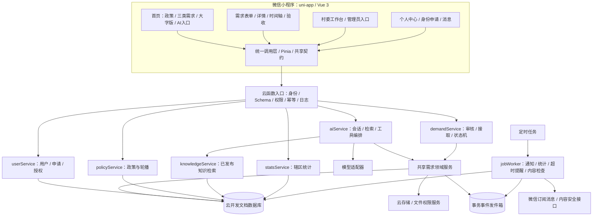
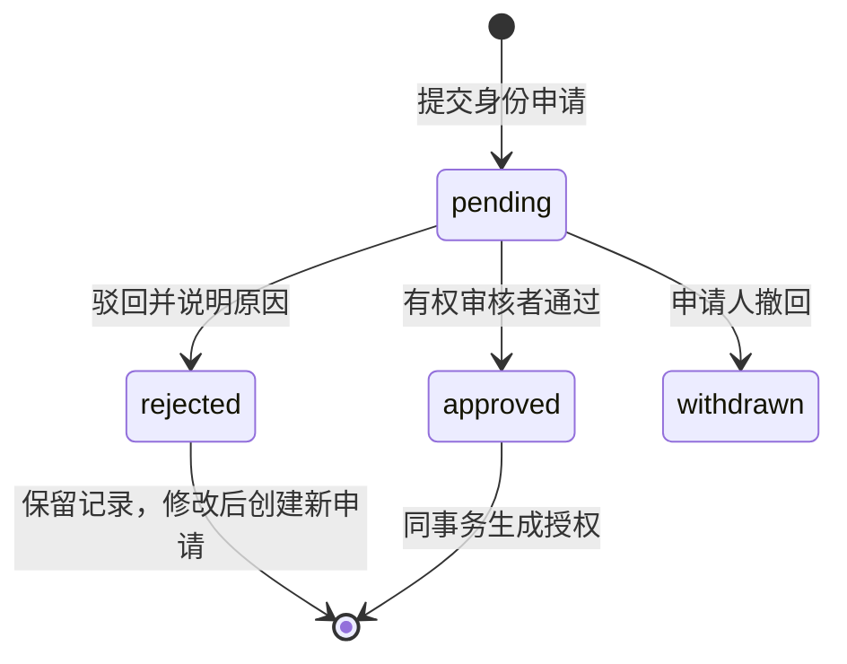
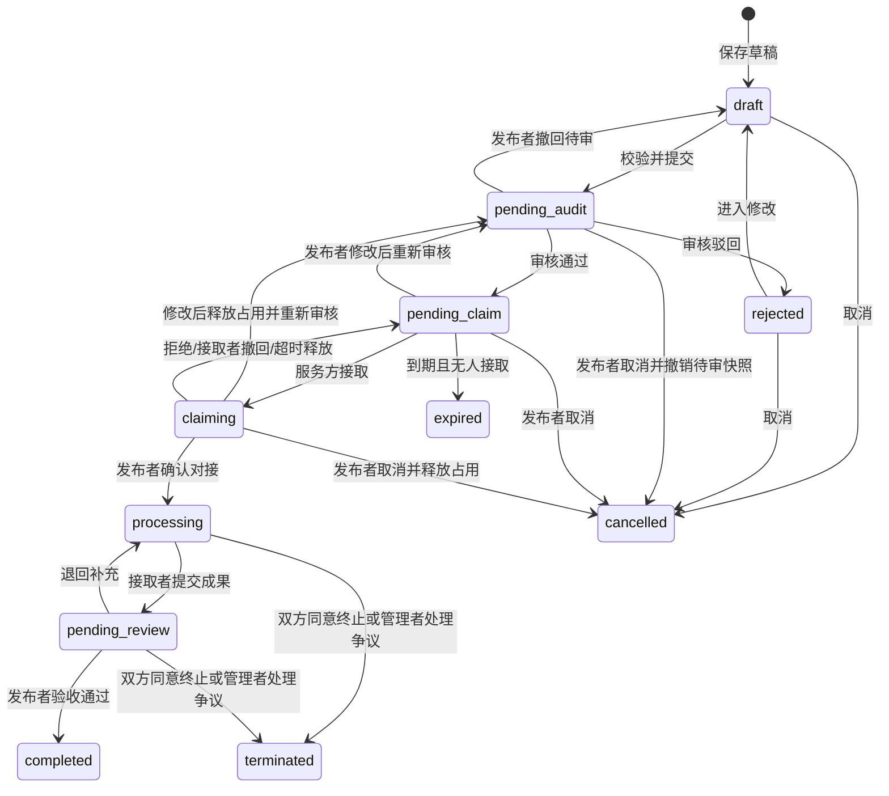
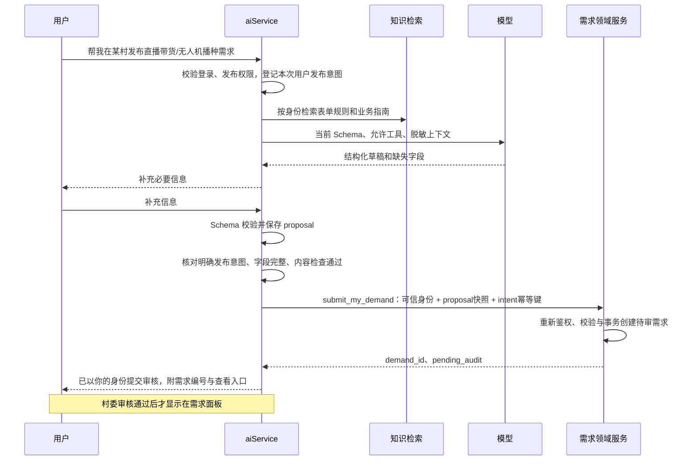

# 云治乡智：完整技术方案与项目架构

版本：2.0（已确认冻结）；确认日期：2026-10-25；适用对象：产品、开发、测试，以及执行代码任务的 AI。

2.0修订：整合57项访谈决定，明确乡村/校园、个人/团队、对话执行业务、身份到期例外、数据保留和真实环境交付；将原“需求推荐”统一澄清为任务进度时间轴。

Q1—Q57访谈已完成，用户已在Q58明确确认整体理解，本套文档冻结为正式开发规格2.0。业务规则以本文、契约和[运行规则](./operations.md)为准；[决策记录](./decisions.md)保留历史，不把历史建议当成当前要求。后续业务变更须同步规范、契约与验收并记录版本；冻结不代表功能已经实现，也不等于本轮启动业务开发或生产发布。

本文基于当前工作区代码核查编制。它描述目标架构，不表示相关功能已经实现或已经通过线上验证。当前任务仅新增方案文档，不修改业务代码和数据库。

配套文件：

- [接口、数据结构与 AI 工具契约](./contracts.md)：编码时使用的接口名称、字段、校验规则与错误码。
- [AI 编码实施任务与验收清单](./implementation.md)：按依赖排序的任务、修改路径、验收场景和交付要求。
- [运行规则](./operations.md)：期限、按钮、自然到期授权、清理与真实环境交付。
- [新AI交接入口](./AI_HANDOFF.md)：阅读顺序、关键约束、验证命令和可复制启动指令。

新AI从[开发交接入口](./AI_HANDOFF.md)开始，再阅读本文、contracts.md、operations.md与implementation.md。新功能按本套方案实现；旧接口通过兼容适配器迁移。若业务规则变化，先同步修订契约和验收条件，再修改代码。本套文档不自动覆盖仓库 AGENTS.md 等执行指令。

## 1. 项目定位与架构结论

平台连接乡村需求方、学校服务方和属地管理者，形成“身份申请 → 需求提交 → 审核公开 → 接取确认 → 服务推进 → 成果验收 → 数据汇总”的完整闭环。

采用 **uni-app + Vue 3 + TypeScript + Pinia + 微信云函数 + 微信云开发文档数据库 + 云存储**。保留当前项目基础，按业务模块组织代码；早期不引入独立微服务、Redis 或自建消息队列。通过数据库事务、事件发件箱和定时任务处理一致性及后台工作。

AI 使用“受控工具调用 + 检索增强知识库”，通过同一领域服务直接执行用户明确授权的业务操作。用户发送“帮我发布需求……”就是本次发布指令；信息齐全且有权限时直接以当前用户身份提交审核，无需默认再点击确认卡。权限判定、参数验证、状态流转和审批由确定性业务代码负责。

### 1.1 本方案确定的业务默认值

2026-10-25第一轮已确认：县域多村试点、村委可接单、个人与团队并行承接、先接取后由发布者确认、一需求一项目、小程序个人页内管理入口、保留人际聊天。下列内容是已确认范围摘要，完整规则见各章节与operations.md，历史回答见decisions.md。

第二轮已确认：服务广东省河源市连平县并增加深圳技术大学校内任务；师生仅面向该校；只有村委和超级管理员两类管理角色；二者可审核农商户/师生身份；管理员可以审核自己的需求；学生可建队；48小时待确认自动释放；预算为线下合作意向、不做平台支付。

第三轮已确认：深圳技术大学认证师生可发布校园任务，校园由超级管理员审核，已审核公开校园任务所有人可浏览，认证本校师生可接取；管理员可自审本人发布/代发需求，但不能自验收本人接取成果或自授身份；团队不额外审批，负责人代表接单/撤回/交成果，实际参与成员可写进度，每单名单在发布者确认时固定。

第四轮已确认：有接单资格用户可接取前咨询，按需求双人私聊、不做群聊；确认后双方联系人开放必要电话，参与成员可看服务地址；换人由负责人提出、发布者确认；执行前可取消、执行后协商终止，有争议由有权管理者处理；成果文字必填、附件选填；7天未验收仅提醒。

第五轮已确认：校园独立分类、农业增加无人机作业、共同必填与截止默认30天；不收身份证号/照片，平台人工认证；同账号多身份逐个审核；管理代发要受益用户确认授权；AI首版支持发布、接取、进度、成果提交，不支持审批/身份授权/验收/协商终止。

第六轮已确认：非业务成功消息每天10次，混合消息的业务照常/无关部分整体计1次，超限不挡业务；AI为文字+业务附件，不做语音或内容识别；政策/轮播与业务知识由超管维护，接口知识自动生成；知识库原文只给管理员，用户只看业务示例；优先云开发真实模型，保留适配器。

第七轮已确认：知识库后台只super_admin；师生身份共享待审池；团队邀请确认入队、多队可并存、不做广场；按真实需求方/本单名单判自接，代发管理者可服务他人需求；公开未对接需求允许同ID修改后复审，终止后只复制新发；统计同时导出CSV和XLSX。

第八轮已确认：不做独立需求匹配推荐，接单后以时间轴和受权限约束的按钮推进；按首次提交批次统计，曾确认参与者去重；接受分类型保留期限、站内+微信订阅通知、师生365天复核与在途任务例外；历史数据先备份试迁移；完整交付包含真实模型、真实测试云环境及体验版，正式发布另行操作。具体运行规则见operations.md。

| 事项 | 本期规则 |
|---|---|
| 首发范围 | 广东省河源市连平县多村试点与深圳技术大学校园任务；乡村与校园分场景归属，校园由本校认证师生发布、超级管理员审核；已审核公开内容所有人可浏览 |
| 普通游客 | 可浏览已审核公开的需求和政策；AI入口可打开，未登录对话返回“请先登录”，登录后可咨询与申请身份 |
| 农户、商户 | 统一业务角色 farmer，细分身份存 profile_kind；可发布三个板块需求 |
| 老师、学生 | 统一teacher_student，细分身份存profile_kind；仅深圳技术大学师生；可发布校园任务，个人/组队承接乡村与校园任务；乡村发布需另外具备对应发布身份 |
| 村委、政府 | 统一local_admin，按授权村管理；可发布、接取、审批、监管和统计，允许审核自己提交的需求；不新增镇/县管理角色 |
| 超级管理员 | super_admin，具备全平台业务权限和管理权限，可审核农商户/师生申请及自己的需求；仍执行状态检查与审计 |
| 多身份 | 一个用户可有多个有效授权，操作显式选择一个已授权 grant_id；切换身份不会产生新授权 |
| 认证材料 | 农商户：姓名电话、村、经营说明与一种证明；师生：姓名电话、类别、学号/工号、深技大校内证明；不收身份证号/照片，不称官方实名认证 |
| 授权代发 | 村委为本村、超管为有权场景的已注册且有发布资格者代发；受益者须在小程序确认授权，仍由受益者对接和验收 |
| 接取方式 | 一个需求同时只允许一个有效承接方（个人或团队）；先接取，再由发布者确认；拒绝后重新开放 |
| 项目与需求 | 本期一个需求作为一个服务项目，project_count = demand_count；不建立重复计数的独立项目实体 |
| “需求推荐”原始用语 | Q51明确实际指接取后的任务时间轴及按钮推进；不开发需求匹配、评分、推荐理由或推荐模型 |
| 完成标准 | 接取者提交成果，发布者验收通过才算完成；超时提醒，不自动验收、不自动好评 |
| 政策 | 官方来源、人工核验后发布；AI 摘要附来源，不把模拟数据当正式政策 |
| 首版后台 | 仅小程序内工作台，入口设在个人页；只有当前有效村委/管理员身份可见后台审批入口；普通、农商户、师生身份不可见；不交付PC后台 |
| 人际聊天 | 需求关联双人私聊；接取前有资格者可咨询，不占名额；履约时发布者与个人接取者/团队负责人对接，不做群聊；与AI、系统通知分开 |
| 对话发布 | 明确发布指令+必填完整+身份有权 → AI直接以本人身份提交待审；信息缺失只追问缺项，审核通过后显示需求面板 |
| AI无关问答额度 | 所有登录用户每人每天最多10次成功的非本小程序业务问答，按北京时间零点重置；业务咨询与业务操作不占此额度 |
| AI回答提示 | AI回答区域固定显示“AI回答，答案仅供参考”，业务操作另显示真实执行状态 |
| AI业务执行 | 首版支持本人发布、接取、记录进度、提交成果及有权查询；审核/授权/验收/终止仍在页面操作 |
| 知识库可见性 | 只有super_admin可浏览/维护目录、原文和API说明；村委/普通/农商户/师生无后台知识权限，用户AI页仅示例和业务答复 |
| AI输入 | 文字对话及业务图片/文件附件；不提供语音识别/朗读或AI图片/文档理解，附件仍走内容安全与业务绑定 |
| 报酬与支付 | 支持志愿或有预算合作意向，费用线下协商；不提供平台付款、结算、抽成，不承诺付款或交易保障；积分、信誉分等亦未纳入本次范围 |

### 1.2 业务必须保持的约束

1. 未审核需求不得出现在公共列表、公开搜索、分享预览或面向普通用户的AI公开业务答复中；知识库自身没有普通用户浏览入口。
2. 村委和超级管理员在自身有权范围内可以审核自己的需求；必须先提交待审，再显式执行审核并记录真实操作者与self_review标记，不得直接以published状态创建。身份申请自审、自授角色不因该规则自动开放。
3. 实际需求方owner_id不能本人接取，也不能成为承接团队本单负责人/实际参与者；仅长期同队但未参与不算冲突。created_by为另一人的代发管理员可以接取，由真实owner确认与验收。AI不代理审核/身份授权/验收/协商终止。
   管理者自己接取的成果仍由发布者验收，不能以监管身份自行完成自己的任务；需求自审与身份自授、履约自验收分别判定。
4. 村委只能管理授权辖区及其下级区域；前端传入 village_id 不能扩大范围。
5. 每次写操作重新检查账号、有效授权、资源范围、参与关系和当前状态。
6. 状态变更、时间轴事件和待处理消息事件必须一致写入。
7. 微信通知失败不能回滚已成功的审核或接取；站内通知作为可靠查询记录。
8. 普通资料编辑不能修改角色、授权、账号状态或审核记录。

## 2. 当前代码核查与差距

核查范围为磁盘中的源码与配置，未连接线上环境，未确认现网集合权限、索引、定时触发器和部署状态。已有测试报告与 coverage 文件不能证明当前业务闭环可用。

本节保留方案编制时的初始核查结果。后续开发前整理已修复部分构建/测试问题并调整工具依赖，最新实测现状见 [开发基线报告](../baseline.md)；其余目标能力仍需按计划实现。

| 模块 | 当前证据 | 目标处理 |
|---|---|---|
| 前端框架 | package.json 为 uni-app、Vue 3、TypeScript、Pinia、Wot Design Uni | 保留技术路线，独立处理依赖兼容与锁定版本 |
| 页面 | src/pages.json 已有首页、发布、详情、身份申请、审核、我的需求、认领任务、聊天、政策 | 复用页面，增加村委统计、需求审核、AI 助手、知识库入口 |
| 三类表单 | demand-create.vue 已有 enterprise/企需通、agriculture/农践帮、research/科研实践厅 | 保留分类，改为版本化 Schema 驱动及统一校验 |
| 需求后端 | cloudfunctions/demandService/index.js 仅分派 create，创建状态为 published，使用 ...data | 先修复为待审与字段白名单，再补齐完整生命周期；禁止批量写入客户端字段 |
| 前后端契约 | 页面调用 get；services 调用 getDetail；审核参数有 pass/approve、comment/reason 等差异 | 建立 v1 契约与短期兼容适配器，不继续增加别名 |
| 返回 ID | 云函数返回 id，前端服务取 result.data?._id | v1 统一 demand_id，兼容层定向转换 |
| 角色 | userService 使用 teacher_student；store、permission 使用 school_admin | 统一 teacher_student；历史 school_admin 作为普通服务方迁移，绝不自动转成管理角色 |
| 用户资料 | userService 的 updateProfile 接受客户端 _id 与其余字段直接更新；updateAvatar 也接受 _id | 只允许更新可信当前用户的白名单资料，禁止更新他人及角色字段 |
| 管理权 | userService 含固定 OpenID 管理例外和依赖电话号码的角色初始化路径 | 移除硬编码提权，采用可审计 role_grants；初始管理员离线初始化 |
| 用户状态 | users.status 混合账号状态与身份审核状态 | 分离 account_status、role_applications.status、role_grants.status |
| 会话 | src/stores/user.ts 有重复 generateToken 声明，本地随机 token 用于缓存 | 修复编译基线；服务端仅信任微信上下文身份，本地标记不作为凭证 |
| 集合声明 | database_schema.json 有 read_write_env_user 等 ACL 标签 | 不能仅按标签推断现网规则；导出现网配置核实，目标默认关闭客户端直连 |
| 政策 | updatePolicy 使用 MOCK_POLICIES，先清空再写入；页面按 publishDate 排序而写入为 publish_date | 改为有审核的增量同步，统一字段，不清空正式政策；收敛重复 updatePolicy/updatePolicy 目录 |
| AI | customer-service.vue 是关键词回复，未接模型与业务工具 | 建立独立 aiService；原客服可保留工单入口，去除虚构热线与审核时限 |
| 大字版 | settings.ts 已保存 largeTextMode | 扩展为全页面样式变量，验证表单、弹层、时间轴和 AI 消息布局 |
| 聊天 | 已有 chatService/contactService，不能仅按 README 判断为未实现 | 保留为辅助模块，专项检查会话成员权限；AI 会话独立存储 |

已有文档中依赖前端event.userInfo.role鉴权、自动超时好评等做法不能直接复制。需求自审已按第二轮允许，但必须基于服务端有效管理授权，不是切换本地身份即获得审批权限；身份申请审核与履约验收分别按各自规则实现。

## 3. 系统总体架构



### 3.1 分层职责

| 层级 | 责任 | 禁止事项 |
|---|---|---|
| Vue 页面 | 展示、用户交互、操作结果卡、路由 | 拼装任意数据库查询、直接改业务状态 |
| 前端 service | 请求封装、DTO 转换、错误提示数据 | 自己决定审核结果、用本地角色替代服务端鉴权 |
| 云函数 handler | 取可信身份、解析契约、调用用例、统一响应 | 直接把 event/data 展开写入数据库 |
| application/use-cases | 编排一次业务操作、事务、幂等 | 请求模型后直接跳过领域校验写库 |
| domain | 权限策略、状态机、表单规则、统计口径 | 依赖页面、全局用户缓存或外部模型 SDK |
| repository/adapters | 云数据库、存储、微信和模型调用 | 把 SDK 原始异常或隐私字段直接返回前端 |

### 3.2 云函数划分

保留按领域部署的云函数，而不是每个按钮一个函数。每个函数通过 action 路由；公共依赖由构建脚本打包到函数产物，不能假设云端能读取 cloudfunctions 外的源码。

| 函数 | 职责 |
|---|---|
| userService | bootstrap/getMe、资料、身份申请、授权查询、申请审核、授权管理 |
| demandService | 乡村三板块与校园表单、草稿、提交、审核、接取、进度时间轴、成果、验收 |
| teamService | 团队创建、成员确认、团队查询及治理；接单和名单快照仍由需求用例统一事务管理 |
| policyService | 已发布政策、轮播、管理草稿、发布与下架 |
| statsService | 辖区汇总、趋势、分类与异步导出 |
| notificationService | 站内通知、已读、订阅授权记录 |
| fileService | 上传凭据、文件绑定、按权限取临时链接、清理孤儿文件 |
| aiService | AI会话、意图分流、每日额度、业务工具执行、操作结果；不开放任意数据库工具 |
| knowledgeService | 管理员知识后台与可信服务端内部检索，业务/API文档版本与引用溯源；普通用户不可直读 |
| jobWorker | 仅受信任调度或后台触发：消费事件、统计、内容检查、AI 任务、同步 |
| chatService/contactService | 保留人与人沟通，独立会话成员权限，不与 AI 消息混用 |
| updatePolicy | 历史模拟同步停用正式部署/定时写入，保留必要离线参考；首版超管人工维护政策 |

## 4. 权限与身份架构

### 4.1 RBAC + 资源范围 + 状态约束

不用单一数字等级表达所有权限。farmer 与 teacher_student 是业务分工，不表示服务方天然拥有发布权。local_admin 在授权辖区具有二者业务能力和管理能力；super_admin 在全平台具有所有已定义业务能力。

判定公式：

```text
允许操作 = 可信用户存在且账号正常
        AND grant属于当前用户，且当前有效或满足已确认任务的自然到期例外（operations.md第2节）
        AND grant 的角色具有该 capability
        AND 资源位于 grant 授权范围内
        AND 满足本人/接取者/审核者等参与关系
        AND 满足状态机、操作对应的参与关系与已确认的自审规则
```

public read 可不创建业务用户；受限操作必须 bootstrap 创建 general_user 用户。OPENID 从 wxContext 获取，通过 users 唯一索引解析为内部 user_id；不接收客户端 openid 作为身份凭证。jobWorker 使用独立受信任调度身份，不能由 event 中的 internal=true 绕过鉴权。

| capability | 游客/普通用户 | farmer | teacher_student | local_admin | super_admin |
|---|---|---|---|---|---|
| 公开需求/政策浏览 | ✓ | ✓ | ✓ | ✓ | ✓ |
| 身份申请 | 登录后本人 | 本人 | 本人 | 本人 | 本人 |
| AI业务/一般咨询 | 登录后按额度与权限 | ✓ | ✓ | ✓ | ✓ |
| 创建乡村需求 | — | 本人乡村需求 | 需额外发布身份 | 授权村本人或代发 | 全平台本人或代发 |
| 创建校园任务 | — | 需额外师生身份 | 本校认证师生本人 | 需额外本校师生身份 | 全平台本人或代发 |
| 接取乡村需求 | — | — | 本校认证师生个人/团队 | 授权村个人/有权团队 | 全平台 |
| 接取校园任务 | — | — | 本校认证师生个人/团队 | 需额外本校师生身份 | 全平台 |
| 确认对接/验收 | 仅原owner且符合自然到期在途例外，不赋予新权限 | 仅本人作为owner的需求 | 仅本人作为owner的校园/有权发布需求 | 仅本人作为owner的需求，不代他人 | 仅本人作为owner的需求，不代他人 |
| 审核农商户/师生申请 | — | — | — | 本村农商户+本校师生共享待审池 | 全平台 |
| 授予 local_admin/super_admin | — | — | — | — | 全平台 |
| 审核乡村需求 | — | — | — | 授权村范围，允许本人发布/代发需求 | 全平台，允许本人发布/代发需求 |
| 审核校园任务 | — | — | — | — | 校园全部任务，允许本人发布/代发需求 |
| 添加执行进度/提交成果 | — | — | 本人接取 | 本人接取；监管操作另审计 | 本人接取；监管操作另审计 |
| 辖区统计 | — | — | 个人任务统计 | 授权辖区 | 全平台 |
| 政策/轮播/知识维护 | — | — | — | — | 全平台 |
| 知识库后台浏览 | — | — | — | — | 全平台 |

村委/超管不能代发布者确认开始或普通验收；失联、交接和终止争议使用独立管理动作并填写原因，不伪装成发布者或伪造已完成。所有管理员操作记录actor_user_id、grant_id、reason、request_id、目标和变更摘要。

### 4.2 身份申请与授权



- users.account_status 只表示 active/banned/deactivated；申请被驳回不影响已有角色和公开浏览。
- 每份申请指定 requested_role、organization_id、scope_region_id、材料 file_id。禁止任意角色字符串、自由填写权限数组。
- 认证资料分农户/商户、老师/学生，分别通过profile_kind记录。农商户提交姓名、电话、所属村、经营说明及土地证明/营业执照/经营场景照片等一种证明；师生提交姓名、电话、teacher/student、学号/工号及校内证件，学校固定深圳技术大学。不收身份证号或身份证照片；禁止将请求全文、材料原文写进日志。审核为平台人工认证，不表述为官方实名认证。
- 普通申请人可请求 farmer、teacher_student 或 local_admin；local_admin 申请仅由 super_admin 审核。super_admin 不走普通自助申请，只由现有 super_admin 通过管理流程授予。
- 农商户按真实村入本村审核池，local_admin仅本村、super_admin全平台；深圳技术大学师生进入统一待审池，任一有效local_admin或super_admin可审；管理身份仅super_admin。师生申请绑定学校，不要求填写村籍；共享资格审核池不扩大村委对校园任务/统计/知识库的权限。
- 审核对象为申请，不是直接更改 users.role；通过时写 role_grants，并审计；同一申请并发审核只有一次成功。
- role_grants 存 role、scope、organization、有效期、状态和来源申请。授权撤销立即阻止后续敏感写操作。
- 单次操作的 grant_id 是上下文提示，服务端重新读取并验证，不将“切换角色”本身作为提权操作。
- 初始超级管理员由受控部署脚本以事先核验的内部用户 ID 初始化，脚本不能部署成公开可调用函数；禁止依赖姓名、手机号或源码内固定 OpenID 特权。
- 账号封禁优先于所有授权；历史任务移交由其他有权管理员处理并保留事件。

### 4.3 组织与区域

regions 保存树结构：id、name、level、parent_id、ancestor_ids；organizations 保存村委、政府、学校等组织。需求固定 region_id 和 region_path_ids，提交后不允许普通编辑更改归属辖区。

region_path_ids 包含自身和全部祖先。范围判定使用服务端维护的树与授权，不以名称前缀、客户端地址文本或当前 GPS 推断。整个平台不接受“缺少 region_id 默认全平台”的查询。

首发范围固定为广东省河源市连平县多个村，以及深圳技术大学校内任务。只保留村委与超级管理员，不设置镇级、县级或学校管理员角色；师生身份的学校限定为深圳技术大学，首版不建设多学校管理。

需求增加business_scene=village|campus。village以真实region_id归属村；campus以campus_organization_id归属深圳技术大学，不能挂到连平县假村或被默认纳入村委乡村统计。校园由认证本校师生发布、超级管理员审核，已审核公开内容所有人均可浏览，认证本校师生可接取；超级管理员保留完整业务能力，村委单独身份不获得校园审批或接取权。地址树保留展示用途，不产生同级管理角色。

### 4.4 个人与团队承接（第一轮已确认）

首版同时支持个人与团队。接取主体用assignee_type=user|team与assignee_id表示；执行请求的actor_user_id、claimer_id表示真实操作人。团队不能复用某成员的个人账号作为团队身份，也不能因为有团队名称就把所有成员视为同一人。

增加teams、team_members及接取记录中的团队信息。有接单权限的认证用户可以建队，包含深圳技术大学学生；创建人默认负责人，成员有资格并主动确认加入即可使用，不增加团队审批。

只有负责人可代表团队接取、撤回接取、提交最终成果。负责人接取时从有效团队成员中选择本次实际参与名单，发布者确认对接时固定任务名单快照；实际参与成员可查看任务并补充文字/图片进度，未参与普通成员不能因同队关系获得任务私有记录或代表团队操作。

team_members是长期团队关系，claim_participants是每单参与关系；保存responsible_user_id与名单版本。负责人邀请、对方确认入队，可创建/加入多个队，不做公开申请广场。名单/任务负责人变更由负责人提、发布者确认；无未完成任务可退出/解散/交接，有任务先完成或获准交接，长期负责人变更不能自动改任务责任。团队解散/成员退出保留历史名单与记录，不物理抹掉参与事实。

一个需求只有一个active_claim_id，无论个人与个人、个人与团队还是两个团队同时接取，事务只能产生一个占用。拒绝对接后释放承接主体占用并保留历史记录；仍符合资格且需求开放时可重新接取，每次生成新claim_id，不能复用被拒记录；每轮发布者确认时限为48小时。

## 5. 需求领域与完整状态机

### 5.1 统一状态



completed/cancelled/expired/terminated为需求终态；不删除历史。terminated界面显示“已终止”，不计已解决；任务执行失败的基础设施job仍使用failed，不能与业务终态混用。重新开展服务以关联新需求处理。内容违规下架用visibility=hidden与审计，不篡改完成事实。

### 5.2 关键动作与约束

| 动作 | 前置条件 | 结果 |
|---|---|---|
| saveDraft/updateDraft | 本人有发布权；draft；版本匹配 | 只写 Schema 白名单，version + 1 |
| submit | draft；必填完整；辖区有效；文件合规检查通过 | pending_audit，revision + 1，产生快照 |
| withdrawSubmission | 本人 pending_audit；版本匹配 | draft，待审快照标记 withdrawn，不能再审批 |
| reopenRejected | 本人 rejected | draft，原审核快照保留 |
| editAndResubmit | owner本人；pending_claim/claiming；当前版本和完整新内容有效，场景归属不变 | 同ID新revision待审/隐藏，释放未确认占用并通知，保留首次提交与首次通过 |
| cloneDemand | source为本人历史需求，当前有相应发布权 | 新ID的draft，关联parent_demand_id，不复制审核/接取/完成事实 |
| audit approve/reject | 管理审核权与资源范围；允许审核自己的需求；pending_audit；匹配submission_id/revision/version | 通过到pending_claim；驳回到rejected，原因必填；记录self_review |
| claim | 接取权；pending_claim；未到期；个人或团队主体资格有效；实际需求方不能是接取人、本单负责人或本单参与者 | claiming；生成claim_id，保存assignee_type/id、真实claimer_id和expires_at；代发操作者与实际需求方不同时可按正常资格接取 |
| confirmClaim | 仅本人需求方；claiming；匹配claim_id与版本，拒绝reason必填 | accept→processing；reject释放占用，未到接取截止则pending_claim，否则expired；管理员不能冒充需求方确认 |
| withdrawClaim | 当前接取者；claiming；匹配 claim_id | 释放占用；保留接取历史 |
| addProgress | processing；个人接取者，或团队负责人/本单实际参与成员 | 状态不变，增加进度事件与凭证；普通未参与队员无权写 |
| submitCompletion | processing；个人接取者或本单团队负责人；成果文字必填，图片/文件选填；已选文件需合规 | pending_review；新completion_id与不可变成果版本；普通参与成员不能代交最终成果，不强制照片/定位 |
| acceptCompletion | 发布者；pending_review；匹配completion_id | completed，completed_at只写一次；管理者不能冒充发布者代验 |
| returnCompletion | 发布者；pending_review；原因必填 | processing，保留旧成果，可补充再交，不统计为完成 |
| cancel | 本人draft/rejected/pending_audit/pending_claim/claiming | cancelled；同事务撤销待审快照或释放未确认接取，写事件通知 |
| requestTermination / respondTermination | processing/pending_review；发布者或个人接取者/团队负责人提出，另一方答复 | 申请期间主状态不变；同意则terminated，拒绝保留履约状态，可申请管理处理 |
| resolveTermination | 有权村委/超级管理员，校园仅super_admin；有终止争议，原因必填 | 管理者记录处理结论与依据；终止则terminated，不计已解决 |
| requestRosterChange / reviewRosterChange | 当前团队任务负责人提出，发布者审核新名单/负责人；名单版本匹配 | 同意才更新本单责任与名单，旧版本保留；不同意不改任务 |

- 认领确认期限已确认为48小时；到期仍未确认则由定时任务释放并重新开放，不自动同意。确认和释放检查同一claim_id、version与expires_at，避免误释放新承接方。
- demand.expires_at 为需求接取截止时间；只有 pending_claim 可到期，processing 不被到期任务打断。
- 管理员处理终止和验收争议时不能提交空原因；不强制普通用户自动接受结果。
- active_completion_id提交满7天仍pending_review时，通知发布者与有权管理者；按成果ID去重，不自动完成/好评；成果已退回、验收或更换版本时不再发送旧提醒。
- 终止申请与验收/取消/换人等并发时按需求version和子资源version处理；已完成终态不能被迟到的终止同意覆盖。团队普通成员无权代表一方终止。
- 需求尚未确认对接时允许同ID提交内容修改重新审核，见5.6；原需求保留首次提交时间与历史，不因修改重复计项目。已确认对接后正文不直接改，须协商终止后复制新发；所属村、乡村/校园场景不能借正文编辑迁移。

### 5.3 时间轴

时间轴来自独立集合 demand_events，禁止把无限增长数组塞进 demands。

事件类型包括draft_created、submitted、audit_approved、audit_rejected、claim_created、claim_confirmed、claim_released、progress_added、completion_submitted、completion_returned、completion_reminder、roster_change_requested、roster_changed、termination_requested、termination_responded、termination_resolved、completed、cancelled、expired、terminated、visibility_changed。

每条事件保存 demand_id、sequence、type、from_status/to_status、actor_user_id、actor_grant_id、occurred_at、visibility、payload、request_id。状态事件由服务器生成，用户只填写允许的备注与凭证。

公开页只返回公开里程碑的脱敏摘要；需求双方可看服务记录；材料、内部意见和敏感地址只向有权者展示。抵达现场是可选进度类型，不强制定位，不将定位作为完成证明的唯一标准。

### 5.4 乡村三板块与校园独立表单

采用服务端维护、版本化的表单定义。前端渲染、后端验证、AI 信息抽取都使用同一个版本；发布后的 Schema 不原地修改。旧草稿继续按旧版本处理，停用版本需要明确升级映射。

共同必填为标题、描述、业务归属与大致地点、联系人、电话、服务时间、接取截止。乡村填真实村region_id；校园填深圳技术大学campus_organization_id与校内大致地点，不能伪造村归属。服务时间可选“可协商”或明确时段；截止默认提交后30天，用户可改，有明确开始时间时默认截止取两者较早且不得晚于开始。联系人电话可从已审核资料预填，AI只追问无法合法补齐的必填。

type为enterprise/agriculture/research/campus；business_scene=village时只允许前三类，campus时固定type=campus。预算、图片、文件以及未被明确设为共同必填的扩展信息选填；不能把现有界面有控件误当必填。精确地址与电话私有保存，公开只展示大致地点。

| 板块 | 现有字段映射 | 目标约束 |
|---|---|---|
| enterprise / 企需通 | coopPeriod、budget、companyScale、urgency、attachment | 子类production_tech/talent_recruit；extra.coop_period、company_scale、urgency；旧budget映射公共budget意向，文件统一attachments |
| agriculture / 农践帮 | liveLocation、productType、estimatedYield、logistics、helpPeriod | 子类harvest/sales/drone_service；保留直播地点类型、产品、产量单位、物流、服务时期；drone_service补作物、作业面积/单位、设备来源等，已知才填 |
| research / 科研实践厅 | projectStage、targetUniversity、funding、labConditions、attachment | extra.project_stage、target_university、funding_source、lab_conditions；旧funding是资金来源，不是金额，禁止直接迁成funding_range |
| campus / 校园任务 | 新增独立表单，共用基础字段 | 子类learning_research/activity_support/technical_support/daily_help/other，分别为学习科研/活动协助/技术支持/生活互助/其他；不要求乡村科研扩展字段 |

form_schemas记录上述明确子类、必填/选填、类型、单位、长度、条件显示和公开性；旧子类有定向映射，新增无人机作业与校园表单发布新版本。extra禁止任意键；产量/作业面积填写数值就必须有单位，未知可不填，AI不猜测。预算可协商、单边上限/下限或区间，金额用分与CNY；不把“5万以上”凭空改成有上界范围。

### 5.5 管理授权代发

实际需求方必须已有账号及当前场景发布资格；村委仅本村代发，校园代发仅super_admin。增加delegation_authorizations与userService授权申请/确认/撤销：受益者在小程序查看本次需求及代理人后确认，记录场景、对象、授权内容/快照哈希、状态和单次消费结果，不能仅凭管理员输入一个user_id代发。

创建/提交代发时重新检查双方账号、受益者发布资格、代理者范围与授权，owner_id固定受益者，created_by固定真实管理操作者。对接确认与成果验收归owner_id，不因代发转交给操作者；管理者仍可按已确认规则审核本人代发需求。撤销/已消费授权不能复用，成功重试返回原需求，不重复建单。

### 5.6 同ID修改复审与终止后复制

editAndResubmit仅实际需求方在pending_claim/claiming阶段可提交，核对当前version及完整新内容Schema/检查结果。提交时同事务写新submission revision、status=pending_audit、visibility=hidden；若有未确认接取则取消占用、清空active_claim_id/承接字段并通知接取者。对接已确认则拒绝，不能用内容编辑改掉处理中任务。

owner_id、created_by、business_scene、region_id/campus_organization_id保持原值。历史审核快照不改正文，旧claim/时间轴保留；first_submitted_at/first_approved_at保留，当前approved_at按新审核更新。公共列表/分享不返回新待审正文；旧审核页凭过期revision/version不能发布新内容。修改保留demand_id，不增加项目数。

terminated为已确认终态，不在原需求重新开放。cloneDemand为真实需求方复制一条新draft，设置parent_demand_id，复制必要表单和有权附件引用；清空审核/承接/成果/时间轴与旧截止，过期服务时间需用户重选，新截止按新提交默认规则。新单仍重新审核，新旧按不同demand_id分别统计，旧终止不计已解决。

## 6. 数据架构

### 6.1 数据规范

- 新集合和字段统一 snake_case；TS DTO 与持久化字段保持一致，避免出现第三套命名。
- 内部关联全部用 user_id/demand_id/organization_id；openid 仅在用户身份映射、微信发送适配器使用，不在公开 DTO 或知识库返回。
- 数据库时间字段统一服务端生成 Date，接口输出 UTC epoch 毫秒 number，展示与统计日界线使用 Asia/Shanghai；历史 Date/number/字符串由迁移脚本规范化。
- 所有可变聚合具有 schema_version、version、created_at、updated_at；需求额外有 submission_revision。服务端控制版本与时间。
- 禁止把手机号、认证材料、未审核需求、完整聊天记录混入公共全文检索。

### 6.2 集合清单

| 集合 | 核心字段/用途 | 访问范围 |
|---|---|---|
| users | _openid、display_name、avatar_file_id、account_status、auth_version、operation_seq | 本人基础资料；管理按权限 |
| user_private | user_id、phone_ciphertext、认证必要信息 | 本人必要展示、授权审核人员 |
| regions / organizations | 区域树、村委/政府/学校、管理组织关系 | 公共基础项脱敏可读；管理写 |
| role_applications | applicant_id、requested_role、scope_region_id、material_ids、status、review | 本人和范围内有权审核者 |
| role_grants | user_id、role、scope_region_id、scope_type、organization_id、status、expires_at | 本人授权摘要；管理写 |
| delegation_authorizations | beneficiary_id、delegate_id、scene、scope、draft_hash、status、consumed_demand_id、确认/撤销记录 | 受益者本人确认，管理代理有范围校验，单次消费 |
| form_schemas | type、schema_version、definition、status、content_hash | 启用版本可读，管理发布 |
| demands | owner_id、created_by、parent_demand_id、business_scene、type、sub_type、region_id、region_path_ids、campus_organization_id、status、visibility、version、submission_revision、assignee_type、assignee_id、claimer_id、responsible_user_id、active_claim_id、first_submitted_at、first_approved_at等时间字段 | 经过授权与DTO过滤查询 |
| demand_private | demand_id、contact、exact_location、private_answers | 需求方、确认后的服务方、辖区有权管理者 |
| demand_submissions | demand_id、revision、public_snapshot、private_snapshot_ciphertext、content_hash、status、review | 需求方与有权审核者；快照含私有字段加密副本，禁止指向可变当前资料 |
| demand_claims | demand_id、assignee_type、assignee_id、claimer_id、responsible_user_id、roster_version、roster_hash、status、expires_at、confirmed_at、released_reason | 需求方、本单负责人/实际参与者和有权监管者；未参与队员无私有权限 |
| teams / team_members | 团队主体、负责人、成员资格、确认加入与变更记录 | 有接单资格用户建队，无独立团队审核；负责人代表操作 |
| team_invitations / team_handovers | 邀请人与接收人、有效期、状态、版本；团队负责人交接双方及结果 | 精确组队识别码邀请、本人确认；交接不得自动改变已确认任务的负责人 |
| claim_participants | claim_id、user_id、responsible_user_id、roster_version、confirmed_at、参与变更记录 | 本单参与快照，确认对接时固定，与长期团队关系分离 |
| roster_change_requests | claim_id、base_roster_version、proposed_participant_ids、proposed_responsible_id、requester、decision、reason、reviewer | 负责人提出、发布者确认，保留变更链 |
| termination_requests | demand_id、claim_id、initiator、respondent、reason、status、resolution、resolved_by | 双方终止协商及管理争议处理记录 |
| demand_completions | demand_id、attempt、summary、attachment_ids、status、review | 参与方、监管者 |
| demand_events | demand_id、sequence、type、actor、visibility、payload | 根据事件 visibility 过滤 |
| files / file_bindings | 文件实体含owner/cloud_file_id/purpose/check_status/size/mime/hash；绑定表含file_id/resource_type/resource_id/usage/public_status | 上传者或具体绑定资源授权者；复制同一文件新增绑定，不覆盖原需求权限 |
| data_holds / deletion_receipts | 证据范围、理由、管理人、复查及解除时间；脱敏删除标记与清理批次 | 有权管理员按资源范围设置证据保留；后台清理与恢复时读取，不能扩大普通访问 |
| notifications | recipient_id、event_id、type、resource_id、read_at | 收件人本人 |
| subscription_receipts | user_id、template_key、client_result、recorded_at | 服务端发送策略；不把 accept 当永久可发送凭证 |
| outbox_events | type、aggregate_id、aggregate_version、payload、status、lease_until、attempts、next_retry_at | 仅后台 |
| job_runs / event_receipts | 调度记录、consumer+event_id 去重凭证 | 仅后台 |
| idempotency_keys | actor_id、action、key、request_hash、response、expires_at | 仅后台 |
| policies | title、source_url、source_authority、publish_at、effective_at、expire_at、status、content、version | 超管维护，公开只读已发布版本 |
| banners | policy_id、cover_file_id、sort_order、starts_at、ends_at、enabled | 首页仅返回有效且政策已发布项 |
| knowledge_documents | admin_visibility=super_admin、assistant_usage、scope、source、version、status、hash、publisher | 仅超管后台浏览；AI内部按用途与业务身份检索 |
| knowledge_chunks | document_id、version、chunk_index、text、keywords、引用锚点 | 仅可信服务端检索已发布且允许当前用途的片段，不将原文返回普通用户 |
| ai_sessions / ai_messages | owner_id、grant_context、role、content、citations、tool_summaries | 本人；后台仅最小化排障 |
| ai_jobs | session_id、owner_id、request_id、status、lease、result_ref、expires_at | 本人可查结果；后台执行 |
| ai_draft_proposals | owner_id、intent_id、draft_data、schema_version、draft_hash、status | 本人，补齐字段并直接执行时校验 |
| ai_action_intents | owner_id、session_id、source_message_id、action、grant_id、status、result_resource_id | 由可信用户消息形成，服务端校验并消费，不能由模型自授 |
| ai_quota_receipts | user_id、quota_day、message_id、kind、status、reservation_id | 每条消息计费一次，失败释放，日期固定 |
| rate_limit_buckets | subject、window、used、reserved、expires_at | 服务端原子计数；保护 AI 费用与写接口 |
| stats_snapshots | scope、period、filters、metrics、generated_at、data_as_of、algorithm_version | 范围内管理者 |
| export_jobs | owner_id、scope、filters、status、file_id、expires_at | 请求者和后台 |
| audit_logs | actor、action、target、reason、diff_summary、request_id | 超级管理员与有权审计人员；无前端更新入口 |
| conversations/messages/tickets | 保留现有人际聊天与工单，迁移统一内部 ID | 会话成员或工单处理权限 |

### 6.3 索引与查询约定

以下为逻辑索引设计，创建脚本需要依据所选文档数据库引擎验证数组、唯一与排序能力；不能把 PostgreSQL 或 MongoDB 完整语法直接套入微信 SDK。

| 集合 | 索引键 |
|---|---|
| users | _openid 唯一；user_code唯一（先回填历史数据再建索引，组队识别码不作登录凭证） |
| role_grants | user_id + status；scope_region_id + role + status |
| role_applications | scope_region_id + status + created_at DESC + _id DESC；applicant_id + created_at DESC |
| delegation_authorizations | beneficiary_id + status + created_at；delegate_id + status + created_at；单次消费由authorization_id文档事务保障 |
| form_schemas | type + schema_version唯一；business_scene + status |
| file_bindings | file_id + resource_type + resource_id + usage唯一；resource_type + resource_id |
| demands | status + visibility + created_at DESC + _id DESC；region_id + status + created_at DESC + _id DESC；owner_id + created_at DESC + _id DESC；claimer_id + status + updated_at DESC；status + expires_at |
| demands（分类筛选） | type + status + visibility + created_at DESC；筛选子区域先服务端解析允许的叶子 region_id 集合并分批查询合并 |
| demand_submissions | demand_id + revision 唯一 |
| demand_events | demand_id + sequence 唯一 |
| claim_participants | claim_id + roster_version + user_id唯一；user_id + participation_status |
| team_members | team_id + user_id唯一；user_id + membership_status |
| team_invitations | invitee_id + status + created_at；team_id + invitee_id + status；邀请幂等锁防重复有效邀请 |
| team_handovers | team_id + status；target_user_id + status |
| roster_change_requests | claim_id + status；requester_id + created_at |
| termination_requests | demand_id + status；initiator_id + created_at |
| conversations | demand_id + pair_key唯一；participant_user_ids + updated_at（实际数组索引能力实施时核验） |
| messages | conversation_id + created_at + _id；conversation_id + sender_user_id + client_message_id唯一 |
| notifications | recipient_id + created_at DESC + _id DESC；recipient_id + event_id 唯一 |
| outbox_events | status + next_retry_at；status + lease_until |
| idempotency_keys | actor_id + action + key 唯一；expires_at 普通索引供清理 |
| event_receipts | consumer + event_id 唯一 |
| policies / banners | status + publish_at DESC；enabled + sort_order |
| knowledge_chunks | document_id + version + chunk_index 唯一；检索引擎单独建索引 |
| ai_jobs | status + created_at；owner_id + request_id 唯一 |
| ai_action_intents | owner_id + session_id + source_message_id + action 唯一；status + expires_at |
| ai_quota_receipts | user_id + message_id + quota_kind 唯一；status + lease_until |
| rate_limit_buckets | subject + quota_kind + quota_day 唯一；expires_at供清理 |
| stats_snapshots | scope_key + period_key + filter_hash + algorithm_version 唯一 |

列表使用 created_at + _id 稳定游标；默认 page_size=20，最大 50。校验排序字段和筛选白名单，禁止客户端提交数据库运算符、任意排序表达式和任意集合名。跨多个 region_id 查询须限制批次与总扫描量，超过阈值转统计/搜索索引，不能无界全表扫描。

### 6.4 数据库和云存储权限

业务集合默认客户端 read=false、write=false，通过云函数读取和写入。先迁移现有前端直连与 watch，再切换规则，避免服务中断。政策等公开内容也经 policyService 返回稳定 DTO。

云数据库权限是文档级，不能依靠前端“不显示”保护同文档中的电话等属性；因此私有信息物理分集合。云函数管理端访问也需要自行鉴权，数据库规则不能代替业务检查。[腾讯云安全规则说明](https://cloud.tencent.com/document/product/876/41802)

文件分公开政策封面、私有认证材料、私有服务凭证和经审核可公开需求图片。客户端不得直接更新 file 的绑定关系或 check_status；由 fileService 校验资源权限并发放短期访问链接。临时链接不保存进公共 DTO、日志或知识库；访问过期重新鉴权。

## 7. 事务、并发与事件机制

### 7.1 一个业务命令的执行顺序

```text
验证微信可信身份 → 解析严格 Schema → 检查幂等记录
→ 读取有效账号、授权及资源 → 检查角色/辖区/参与关系/状态
→ 事务内重查参与判定的可变记录与 expected_version
→ 写聚合 + 对应申请/接取/成果记录 + 时间轴 + outbox + 幂等响应
→ 提交事务 → 返回明确业务结果
→ jobWorker 异步发送通知、更新统计或触发检索索引
```

幂等键按 actor_user_id + action + idempotency_key 隔离。相同键相同请求返回原结果；相同键不同请求体返回 IDEMPOTENCY_CONFLICT。请求哈希包括业务 data、grant_id 和目标版本，不包含 request_id。响应保留默认 7 天，过期后还依赖实体状态与 version 阻止重复动作；AI发布按服务端intent_id生成稳定幂等键，意图消费结果与demand_id持久关联，任务重试不得生成新键。

### 7.2 并发接取与审核

- 事务读取需求，确认 pending_claim、未过期且 version 匹配，再写 claiming 与 active_claim_id；其他竞争者收到 VERSION_CONFLICT 或 STATE_CONFLICT，不能全部显示认领成功。
- 审核事务同时核对 submission_id、revision、content_hash 与 pending 状态，杜绝审核旧内容而发布新内容。
- 用户账号、授权变更与业务写需要在事务内读取同一权限版本依赖，并用相同记录的版本保护，避免撤权与写操作并发时绕过。事务冲突自动重试有上限，重试仍必须重查所有条件。
- 时间轴 sequence 使用需求 version 和 event_index 编码成固定宽度有序字符串（例如 0000000003:0001）；唯一索引为 demand_id+sequence。一个命令最多99条事件，超过拆分用例。禁止使用数组长度或客户端时间分配序号。

CloudBase 支持事务，但 SDK 与运行环境的具体限制需要适配验证。当前官方文档强调事务内使用 doc 操作、不做外部调用；本方案预生成文档 ID，通过 doc(id) 操作，不把 where 批查询放入事务。不要在事务里调用模型、发微信消息或扫描文件。[事务文档](https://docs.cloudbase.net/database/transaction)

### 7.3 事件发件箱与可靠任务

不要求第一期采购队列服务。事务中写 outbox_events，受信任定时任务扫描 pending/retry 项，以事务租约领取，成功后标记处理，异常按退避重试，超限进入 dead 并提示管理员。

一个事件分为独立消费任务，例如 notification.inbox、notification.wechat、stats.refresh；每个任务独立租约和去重，不能因微信失败反复重做统计。站内通知通过 recipient+event_id 唯一键避免重复；统计重算/幂等投影通过 event_receipts 去重。

外部订阅消息发送与数据库无法形成一个事务：允许发生“微信已发送但本地未记成功”的不确定窗口。记录 sending/uncertain 状态，禁止无限盲重试，限制自动补发并可人工核查；不宣称微信消息严格 exactly-once。

## 8. 村委后台与统计口径

工作台入口在小程序个人页，根据当前有效村委/管理员身份显示；普通、农商户、师生身份不显示后台审批入口。个人页本身对所有用户保留，多身份切回非管理角色不展示后台；超管额外有政策/轮播/知识库，村委没有知识库入口，直调亦拒绝。

页面入口隐藏不是权限控制：审批页面路由、管理云函数和数据查询同样校验管理授权。包括身份审核、需求审核、辖区需求、进度监管、数据总览、导出、政策/知识管理以及待处理失败任务；子功能最终范围以相应访谈结论为准。

默认管理范围来自 grant，不让用户通过下拉选择扩大辖区。支持日期、区域、板块和状态筛选，页面显示数据截至时间，统计延迟目标不超过 5 分钟，失败时显示旧快照时间。

### 8.1 指标定义

默认按时间窗内首次提交审核的需求形成cohort；提交一次后驳回、重提不增加项目数。时间窗口使用[start_at,end_at)。村委乡村汇总只计有权村的village需求，校园任务单独归属，不因同一个师生参与就重复计入村统计；校园管理汇总仅超级管理员可读，公开校园任务不等于公开私有管理统计。

| 指标 | 精确定义 |
|---|---|
| 需求/项目数 | first_submitted_at在窗口内、范围匹配的不同demand_id数；不计纯草稿；取消和终止仍保留在该批需求总数中 |
| 发布人数 | 同一 cohort 内 owner_id 去重；村委代发计实际需求方，另报代发操作人数 created_by 去重 |
| 审核公开数 | cohort中有first_approved_at的需求数；修改复审不能抹掉曾公开事实，不仅统计当前pending_claim |
| 已解决数 | cohort 中 status=completed 的不同 demand_id 数 |
| 解决率 | 已解决数 / 同 cohort 需求总数；分母 0 输出 null，页面展示“暂无数据” |
| 待审核/待接取/处理中 | 查询时点辖区内对应状态的存量快照；明确不同于 cohort 流量 |
| 本期完成量 | completed_at 在窗口内的需求数；可能包含以前发布需求，不能用它直接除以本期提交数 |
| 已确认参与人数 | cohort所有曾经生效的确认名单按user_id去重，含被换出的参与者；个人承接计本人，团队不计未参与成员；A/B/C换为A/B/D计4人，不表示四人都完成服务 |
| 平均解决时长 | cohort 已完成需求 completed_at - first_submitted_at 的均值；无完成项输出 null |
| 板块分布 | cohort 按 enterprise/agriculture/research 分组的需求数 |
| 服务时长 | 仅在有明确起止及验收依据时单独计算；不能把需求周期全部算作志愿服务工时 |

### 8.2 统计实现

低数据量先服务端聚合快照，按scope+period+filters缓存，事件仅标记刷新；去重人数依据真实集合，不按事件简单+1。第七轮已确认村委/超管可按权限导出CSV和真实XLSX两种格式，不能只做其一或改扩展名伪装；复用相同过滤与口径。

数据量增长后再增加按日投影和去重成员集合，使用 consumer receipt 保证重复事件不重复计数。每日低峰按主数据对账重算；差异记录为任务。导出使用异步 export_job，服务端重新验证范围，生成私有文件与短期下载链接，默认剔除电话和材料。

## 9. AI 助手与知识库架构

### 9.1 能力边界

首页AI助手是对话式业务执行入口，首版支持发布需求、接取需求、记录进度、提交成果，以及政策、本人需求、公开需求筛选和有权统计查询。与页面共用领域用例，不能只回复教程或跳手填表单；审批、身份授权、验收、协商终止不注册AI工具，仍由页面处理。

未登录用户发任何AI消息时，前后端统一拦截并显示“请先登录”，不调用模型、不创建业务任务、不扣问答次数。已登录普通账号可以咨询；乡村发布校验农商户或有效管理发布权，校园发布校验深圳技术大学已认证师生或超级管理员。无对应身份时给出当前场景认证提示，不能所有情况都提示农商户认证，也不能把缺少角色当作未登录。登录完成不自动执行登录前写指令，应让用户重新发送。

首版采用ModelProvider中的cloudbase适配器接入微信云开发可用模型。开发AI核验当前云环境模型开通、地域、SDK与工具/结构化输出能力，实测中文抽取与执行后锁定具体型号/SDK版本并写入交付记录；不把型号留成上线时临时猜测。provider/model/timeout/token_budget通过服务端安全配置，不能写入VITE_*；外部供应商只保留适配扩展点，不擅自采购或换供应商。

真实环境未开通/无权限/不支持所需能力时，AI页面明确不可用并保留普通表单路径；输出尚缺资源与已完成代码，不宣称模拟客服已接模型。正式验收必须记录真实模型完成咨询、抽取发布、接取、进度、成果以及错误处理的证据；mock仅供自动化测试。

当前 demandService 使用 wx-server-sdk ~2.6.3，不能直接假设它有 cloud.ai()。官方 AI 调用文档有单独 SDK 版本和环境开通要求；实现任务须验证并选择受支持的固定版本，不照抄示例中的 beta 版本作为生产默认。[CloudBase AI 调用说明](https://docs.cloudbase.net/ai/model/wx-server-sdk-access)

### 9.2 对话直接发布的完整链路



用户的明确操作指令作为本次授权；ai_action_intent绑定user_id、session_id、真实source_message_id、action、grant_id和明确目标，默认30分钟有效；过期重新取得明确指令，已消费结果继续幂等查询，不重复执行。action白名单为submit_my_demand/claim_my_demand/add_my_progress/submit_my_completion；不能把“怎么接单/帮我润色成果”当实际执行，不复用发布授权去接单或交成果。

信息缺失时只追问缺失项；用户在同一发布意图中补齐后直接提交，无需每次再要求点击确认。真实字段来自用户消息或已核实的本人资料，模型建议的需求类型/子类型按当前Schema解析，不能猜联系人、精确区域、服务时间、产量和预算。指代多义、用户改成只写草稿、意图过期或请求含多个无法区分的需求时，先用对话澄清；取消指令使未执行意图失效。

submit_my_demand执行器在事务内核验意图、账号、授权、草稿版本/hash、完整Schema及内容检查结果，消费意图并调用与表单共用的CreateAndSubmitDemand用例，写pending_audit需求、事件、outbox及意图结果。一个意图最多创建一个需求；网络重试和Worker重启返回原demand_id。取消与执行竞争时用事务确定结果，已提交后如需撤回必须走正式withdrawSubmission，不能假装取消了已完成写入。

任务异步执行期间撤权立即影响执行检查；命令已提交而模型后续措辞生成失败时，界面仍从operation_result显示真实“已提交审核”，不重新建单。只有业务接口返回成功才可声称提交成功，审核通过事件发生后公共面板才可查询该需求。

两个对话示例：

- “帮我在XX村发布一个找人直播带货的需求……”：结合销售类表单核验必填信息；齐全则直接提交待审，否则仅追问产品、联系人或时间等缺项。
- “帮我找人用无人机播种……”：归agriculture/drone_service，只追问缺失的共同必填，作物/面积/设备已知则提取、未知可留空，不阻断发布；不硬塞到科研研发子类或伪造面积。

接取前解析唯一需求目标；重名或多个团队时追问，个人必须本人、团队必须当前用户有权负责，并由用户明确实际名单，不能默认全队。进度/成果只写当前有权任务；先读取version，再在领域事务重查，不让模型指定状态或验收结果。成果摘要来自用户事实，不捏造已完成工作；提交成果成功只能显示“待验收”，不能说已经完成。所有动作按各自intent_id幂等，重复调用返回原结果。

### 9.3 管理员知识库与AI内部检索

| 类型 | 例子 | 发布与访问 |
|---|---|---|
| 业务知识 | 如何认证、乡村/校园表单、流程与经核验政策索引 | 超管维护；后台原文仅管理员，AI可内部提取允许对用户解释的业务规则 |
| 接口知识 | action、Schema、错误码、工具参数、示例 | 真实契约自动生成，内部工具选择使用；不向普通用户展示API目录、原文或工具元数据 |
| 管理知识 | 审核操作、组织管理说明 | 管理员查看与对应管理者AI咨询，普通用户上下文不检索 |
| 实时业务数据 | 我的需求、我的进度、辖区统计 | 通过鉴权业务工具查询，不批量灌入公共 RAG |

知识库入口仅当前super_admin的个人页工作台可见；村委/普通/农商户/师生无入口，直调知识读取请求FORBIDDEN。查看/编辑/发布/下架均super_admin，不依赖额外授权。普通AI页按角色显示“帮我发布一个需求”“有哪些待接需求”“查看我的进度”“记录任务进度”“提交成果”等示例；点击仅预填，发送仍登录/鉴权，不自动执行。

后台浏览与内部检索是不同用例。aiService用可信服务端身份检索业务规则和当前白名单工具参考，按assistant_usage=business_answer|tool_reference|management_answer及当前用户资格过滤；不把知识原文/API说明/管理片段直接返回普通客户端。用户问平台操作可以得到解释，不能借“请展示知识库”导出内部材料；引用只给用户可访问的政策页/公开来源，不能附未授权知识文档跳转。隐藏知识库不是接口安全机制，业务接口始终鉴权。

### 9.4 检索流程

超管维护业务文本或导入允许格式的资料 → 清洗凭证与个人信息 → 分段/关键词 → 超管核对发布指定版本 → 可信服务端按用途检索 → 生成业务答复。API资料由契约生成，不能手工改造为未实现工具。普通用户上传业务附件仅存储/绑定，不自动OCR或解析为知识来源；后台知识文本处理与用户图片/文档理解能力分开。

第一期数据量小，以数据库关键词候选和服务端排序落地；定义 RetrievalProvider 接口。第二期有明确召回需求时接入 CloudBase 支持的向量能力或其他受管检索服务，先验证环境和索引能力。文档型数据库不默认等于可直接运行任意向量查询。

检索先筛status=published、有效期、assistant_usage及当前身份/范围，再召回；生成前复核来源版本。内部保留document_id/version/anchor作追溯，普通响应只暴露可公开政策引用与业务解释，不暴露内部原文/API/管理片段。政策失效/新版本发布时停用旧片段；无来源则说明不确定，不编造补贴或资格结论。

### 9.5 工具调用安全与稳定性

- 工具描述及参数从共享契约生成；执行端使用严格 Schema 和白名单，不让检索文档动态定义工具。
- 模型输出视为不可信输入。操作者user_id/openid/grant/角色从可信上下文注入，不能由模型自选；操作目标和参与人ID只能从有权查询结果按用户指令选择并再次校验，模型不能伪造授权、状态、审批结果或任意数据库查询。
- 所有工具通过当前 session 绑定的可信身份调用领域服务；模型传来的“我是管理员”不能成为权限依据。
- 写工具包括保存草稿、submit_my_demand、claim_my_demand、add_my_progress、submit_my_completion；消费对应明确用户指令的有效意图。发布不默认增加确认卡；审批/身份授权/验收/协商终止/强制完成/删除文件不暴露模型。
- 知识内容、网页、附件都标为资料；其中要求忽略系统规则、调用隐藏工具或泄露信息的文本不执行。
- 读业务工具只返回当前用户有权的数据；公开知识问答与含个人资料的上下文分开处理；电话、精确地址不必要时不传模型。
- 每个用户消息作业最多4次工具调用、最多2次Schema修复；每个逻辑模型请求最多3次总尝试（首次+至多2次瞬时失败重试），SDK内置重试不得另行叠加，Worker重领沿用持久化计数；限制输出token、输入长度和会话历史，工程初值见operations.md。
- 首版用异步 AI 任务：sendMessage 返回 job_id，jobWorker 持久化领取并执行，前端轮询结果。不得在函数返回后依赖后台悬空 Promise 继续生成。流式能力作为后续增强，不能假定 callFunction 会直接返回 token 流。
- 超时显示可重试并保留草稿。模型不可用时普通表单、审核和政策列表保持可用。
- 首版只接收文字指令和业务附件file_id；照片/文件可用于业务凭证，不发送其内容给模型识别，不做OCR、文档理解、语音输入或朗读。内容安全扫描与图片理解是不同功能，不能因不做识别而省略安全检查。

### 9.6 无关问答每日10次与回答页展示

服务端先将消息分为business_query（政策/流程/接口/本人需求等小程序业务咨询）、business_action（发布等业务命令）和general_chat（与小程序无关的百科、闲聊等）。前两类不占无关问答额度；general_chat每个登录user_id每天最多10次成功回答，所有角色统一规则，按Asia/Shanghai自然日00:00重置，与会话、设备、当前角色无关。

分流由服务端规则与受限分类器完成，不相信前端/用户自行标注；平台使用、政策、真实需求/进度为业务，普通百科/写作/闲聊为非业务。分类器无业务写权限；不明确先问用途，不能仅提到“本小程序”就免费回答百科。混合消息拆分量：业务照常；无关部分有额度整体答复并计1次，无额度只处理业务并说明未答；不能按多个子问/模型段落重复计次。

混合消息的业务结果与一般回答状态独立：业务成功后即使一般问答超限/超时，也从operation_result显示成功，不回滚或重做；一般答案成功持久化才结算该父消息1次，无关部分失败释放预留。纯非业务第11条可整体超限，混合消息只能一般分量超限，不能据此结束尚未处理的业务分量。

一次=一条真实用户消息对应的一次成功general_chat回答；模型内部推理、工具调用、网络重试、刷新和重新展示不重复计次。用户主动再问/重新生成新回答计新一次，客户端重试必须复用原消息幂等键。服务端原子预留，满足used+reserved<10才受理，成功落库后结算，失败或超时释放；成功回答已持久化但客户端断线仍算一次，回来可读原答案。

quota_day在预留时固定，跨午夜完成仍结算原日；新的一天使用独立计数桶。返回limit/used/reserved/remaining/reset_at，预留占用也计入remaining，避免并发超额。第11次返回“今日非业务问答次数已用完（10次），你仍可咨询小程序业务或发布需求”，不调用通用回答模型；分类器本身仍受独立成本和频率上限保护。业务消息另有防刷和模型预算限制，不能因不占这10次就允许无限请求，也不能在一般问答额度用完后屏蔽业务发布。

AI回答页在回答区域固定显示精确文案“AI回答，答案仅供参考”，咨询、业务答复、历史消息和大字版均保留；由前端固定组件渲染，不依赖模型生成。执行结果卡以真实接口结果展示“补充信息中 / 正在提交 / 已提交待审核 / 提交失败 / 审核通过”等状态、需求编号及详情链接，不能以参考提示代替明确操作结果。知识问答附可用引用；无登录、无权限、超限提示由系统直接返回。

### 9.7 任务时间轴与操作按钮

Q51明确不建设独立需求匹配推荐。需求广场保留普通分类、地区、状态筛选和时间排序；不生成匹配分数、技能画像、reason_codes或推荐模型。

接单后展示“待发布者确认→服务中→待验收→已完成”的时间轴，包含拒绝、撤回、退回补充和终止事件。服务方通过按钮记录到场/阶段进度、提交成果；团队实际参与者可记录进度，提交成果仅个人接取者/任务负责人。发布者确认后才开始，发布者验收后才完成；服务方不能任意选择status或点击直接完成。前端按动作权限展示按钮，后端重复校验身份、参与关系、当前状态与版本；重复点击使用原幂等键。时间轴正文按公共/参与方/管理事件可见性过滤。

## 10. 政策轮播、大字版、通知与辅助功能

### 10.1 政策与轮播

- 正式来源为政府官网等可信官方源，由super_admin人工录入、核对并发布/下架，保存source_url、发布单位、发布日期、有效日期和录入时间；不在方案虚构真实政策。不新增政策审核角色或强制另一位超管复审。
- 首版不建设定时自动抓取政策作为验收必需，不自动抓取即公开。现有updatePolicy模拟数据/清空集合逻辑停用正式写入；部署前核对并停用旧模拟定时触发，保留必要历史脚本记录，不清空已有正式集合。
- 去重以规范source_url+版本/hash为依据，编辑先保存草稿，超管核对后发布；失败保留旧版本。过期政策不进默认政策列表和轮播，历史页标失效，关联内部知识片段同步停用。
- 轮播 banner 引用 policy_id，不能直接跳任意外链。详情支持本地可审阅正文；外链打开能力受小程序配置影响，部署前核实业务域名和 web-view 支持，失败提供复制官方链接。
- 超管维护轮播封面、排期和排序，发布验证文件和政策状态；首页同时检查banner和policy状态。政策下架不删除历史事实，但轮播和AI新回答不再引用为有效政策。

### 10.2 大字版

首页提供明显的“大字版”开关，对所有用户开放，尤其照顾教师等有阅读需要的人群。偏好本地持久化，可选同步到个人设置。

使用统一字号/行高/间距变量，例如 normal 与 large=1.3 倍；不能仅给首页文本加 font-size。表单、按钮、弹层、通知、政策详情、AI 消息和时间轴同步适配；避免固定文本容器高度，支持换行与滚动。验收覆盖窄屏、长标题、长政策和输入键盘弹出，不以修改系统字体为实现方式。

### 10.3 站内通知与微信订阅消息

事件包括身份申请结果、需求审核结果、新接取确认、确认结果、进度更新、成果提交、验收结果、超时提醒、管理终止。站内通知必建，微信消息按用户授权、模板和平台实际允许条件发送。

订阅授权在用户点击提交等明确动作时申请，拒绝订阅不阻断需求提交。不能把一次接受当无限发送权限；模板 ID、字段长度与跳转页通过环境配置管理，发送失败记录原因与状态，不能向用户保证一定送达。[CloudBase 订阅消息指南](https://docs.cloudbase.net/recipes/add-subscribe-message-cloud-function)

### 10.4 文件与内容检查

上传 → 文件归属登记 → 大小/MIME/扩展名校验 → 文本/图片内容检查 → 业务绑定 → 权限下载。客户端尺寸检查只优化体验，服务端必须二次校验。文本与图片检查结果存在 pending/pass/reject/error；pending/error 不得静默当 pass 发布。

建议默认图片最多 5 张、每张 5MB；文档最多 3 份、每份 10MB，作为产品限制而非云平台承诺。禁止 HTML/SVG 等主动内容作为普通附件直接内嵌；正式允许的格式由 Schema 配置。恶意文件检测与微信内容安全是不同能力，供应商扫描能力未接入时不得显示“已完成病毒扫描”。

检查服务调用须基于实际小程序主体可用接口做适配。需求人工审核与机器检查并行提供依据，机器检查不取代村委审批。认证材料不收集与身份验证无关的敏感内容。

### 10.5 业务私聊与联系方式

认证且有相应场景接单资格的用户，可从公开需求详情联系发布者，形成需求关联双人咨询会话，不创建claim、不占用接取名额。不存在游客发私信或全平台陌生人通讯录入口；团队履约由负责人对接，实际成员通过进度协作，本期不做群聊。

对接确认后，发布者和个人接取者/团队负责人可查看对方必要电话；本单实际参与成员可查看服务所需详细地址，不能因此获得对方电话。公开列表、公开时间轴和AI公开检索均不返回电话/精确地址。管理者按资源权限查阅并留审计；任务结束30天后服务方失去电话与精确地址访问权，存储清理及争议保留见operations.md。

聊天按demand_id+双方user_id唯一关联，消息发送/读取/已读均核验真实会话成员；内部统一user_id，拒绝OPENID和user_id混用。新接取者或新负责人不自动继承原双方历史私聊；需要时建立新的双人会话，避免把原私聊消息转交第三人。

## 11. 工程目录与编码规范

```text
docs/architecture/              # 当前方案
contracts/                     # 实施时创建：唯一契约源
  schemas/                     # 请求、响应、表单、AI工具 JSON Schema
  actions.json                 # 函数/action、权限、幂等、版本
  enums.ts                     # 角色、状态、错误码
  generated/                   # 自动生成 DTO、工具和 API 文档
server/                        # TypeScript 后端业务源代码
  core/                        # auth、policy、error、idempotency、transaction
  modules/
    user/ demand/ policy/ stats/ notification/ file/ ai/ knowledge/
  adapters/                    # 微信SDK、数据库、存储、模型、检索
  jobs/                        # outbox、超时、统计、内容检查、AI任务
cloudfunctions/                # 微信可独立部署产物和薄入口
  userService/ demandService/ ...
src/
  pages/                       # 保留现有路径，增量迁移
  services/                    # 统一 callFunction，兼容层集中
  stores/                      # 用户、设置、AI会话、通知
  components/                  # SchemaForm、DemandTimeline、AIOperationCard、AIAnswerNotice
  features/                    # demand、workbench、ai、knowledge 的逻辑组合
  utils/                       # 前端权限提示、时间、游标处理
scripts/                       # 构建云函数、生成契约、迁移、种子、校验
database/                      # 集合规则、索引、迁移版本
tests/
  unit/ integration/ component/ e2e/ fixtures/
```

实施初期可继续维护现有 JS 云函数，但新核心逻辑应逐步移入 server TS；构建后每个云函数目录包含自身 index.js/package.json 及共享模块。不得把未编译 TS 直接上传到 Node 云函数，也不能上传开发测试密钥。

公共边界使用严格类型与运行时 Schema，禁止 any/任意 Record 作为业务契约。异步异常在合适的 handler/适配器边界统一处理，不要求每个 await 都机械套 try/catch。日志保存 request_id 与错误分类，不返回堆栈或完整 event。

## 12. 环境、部署、运维与数据迁移

### 12.1 环境配置

开发、测试、生产使用独立云环境和数据。客户端仅配置公开 cloud_env_id；服务端配置模型密钥、模板 ID、限额、租约和调度参数；禁止在 store 与多个页面硬编码环境。

本地工具链与云函数运行时分别选型。package.json 当前含较早 uni-app 与较新测试依赖，README 的旧 Node 建议不能当兼容结论；先验证支持矩阵并锁定版本，再逐包升级，不能一次性把所有依赖升到 latest。

### 12.2 部署顺序

1. 导出规则、索引和备份，记录现网业务状态，验证备份可恢复。
2. 新集合与索引、只增字段、后端兼容接口先部署；feature flag 默认关闭新入口。
3. 运行只读迁移演练，人工核验映射报告；按游标分批回填，记录迁移 checkpoint。
4. 部署新前端并迁移直连查询，观察旧版客户端调用量；写接口统一新语义。
5. 开启新流程、工作台、站内通知，核对业务事件与统计；再启用订阅通知和 AI。
6. 收紧数据库及函数调用权限，验证旧端安全失败或提示升级；后台任务仅可信触发。
7. 稳定后停止旧接口，保留明确兼容截止版本；回收旧目录和测试特权路径。

发布时后端必须兼容仍在使用的旧小程序版本。危险的旧“创建即公开”语义立即禁止，即便兼容接口也只能提交待审。回滚优先关闭功能与切回兼容客户端；已迁移数据和新状态不能靠回滚旧代码盲写覆盖。

### 12.3 历史数据映射

| 历史数据 | 迁移规则 |
|---|---|
| school_admin / teacher_student | 映射到 teacher_student；核验历史授权材料再生成有效 grant |
| local_admin | 必须核验授权与辖区，不能因历史 role 字符串直接授予管理权 |
| 代码硬编码管理员 | 清点并人工核验，迁移为有来源的 super_admin grant 后删除代码例外 |
| users.status=pending/rejected | 迁移为申请状态；账号 active 或 banned 需独立判断 |
| published / approved | 无可核验审核记录时回到 pending_audit 并隐藏；不能直接映射 pending_claim |
| pending | 根据上下文和审核记录核实为 pending_audit，未知状态进入隔离清单 |
| claimed | 根据接取者和确认记录核实 claiming/processing，不能凭字符串猜测 |
| completed | 验收证据完整才迁移 completed；缺证列为历史待核验，暂不纳入可信已解决指标 |
| 历史需求failed | 核实确为业务终止后映射terminated；未知原因进入隔离清单，不能把AI job失败混入需求状态 |
| camelCase 与 snake_case 时间/字段 | 映射规范字段、统一时间类型，保留迁移审计，缺失字段不凭空补业务事实 |
| policy 模拟条目 | 标记测试/草稿并从正式政策和知识检索移除，不作为真实政策继续传播 |

迁移脚本必须支持 dry-run、幂等重跑、分页、checkpoint 和错误隔离，禁止用清空集合重建来迁移。无法核实的数据保留隔离状态，避免静默放大权限或伪造完成量。

### 12.4 日志、监控与容量

结构化日志字段：request_id、actor_hash、function、action、demand_id、latency_ms、error_code、dependency、attempt。禁止记录完整手机号、认证材料、模型密钥与原始聊天全文。

监控云函数错误率/P95、事务冲突、待审核积压、outbox 最老待处理年龄、死信数、统计延迟、模型超时率、工具失败率和单用户 AI 消耗。目标值作为验收目标：普通读接口暖启动 P95 < 1 秒、写接口 P95 < 2 秒；AI 任务 2 秒内确认受理、30 秒内尽力完成；冷启动和外部依赖单独测量，不能当平台保证。

容量按真实试点人数、峰值并发、图片量、统计刷新频率和 AI token 测算。先验证 20/50/200 个并发用户场景；并发用户数不等于 QPS。达到套餐瓶颈时再扩容或接队列/检索服务，不预设必需 Redis。

数据保留和清理按operations.md第3节执行：AI消息90天、需求私聊180天、身份材料审核后180天、业务附件/审核记录至少1年、导出24小时；结束30天后服务方不再查看电话与精确地址。争议证据暂缓清理但不扩大用户访问权。备份频率与恢复目标取决于已配置能力，部署前实测，不能宣称已有自动备份或将产品期限称为法定期限。

## 13. 测试与交付门槛

- 单元测试：权限矩阵、辖区树、状态机、表单 Schema、幂等哈希、统计口径、工具参数校验。
- 集成测试：真实测试环境事务冲突、唯一索引、撤权竞争、outbox 重试、私有文件权限；内存 mock 不能替代事务验证。
- 组件测试：三表单、时间轴、AI操作结果卡、固定回答提示、大字版与后台筛选。
- E2E：普通用户申请 → 审核 → 发需求 → 驳回重提 → 审核公开 → 竞争接取 → 确认 → 进度 → 成果退回 → 再提交 → 验收 → 通知与统计。
- AI评估：明确发布指令直接提交、缺失字段追问后提交、咨询不误发、未登录显示“请先登录”、无权用户不能发布、幂等只建一单、无关问答第11次拦截但业务仍可用、跨日/并发计次准确、固定提示可见、知识引用及会话隔离正确。
- 安全回归：篡改本地角色、_id、owner_id、grant_id、region_id、status、reviewer、file_id、客户端数据库直连、越权会话读取均被阻止。
- 最终完成条件为“流程、数据一致性、权限和证据”通过，不能以页面已显示成功或测试覆盖率数字代替。

具体编码任务、测试用例与可执行顺序见 implementation.md；精确接口与数据字段见 contracts.md。

## 14. 官方依据与能力验证清单

以下资料用于核查技术边界，不代表本环境已开通对应能力：

- [CloudBase 数据库事务](https://docs.cloudbase.net/database/transaction)：事务与 SDK 限制，实施中用测试云环境验证。
- [腾讯云数据库安全规则](https://cloud.tencent.com/document/product/876/41802)：客户端文档级访问规则与服务端鉴权边界。
- [CloudBase 云函数安全规则](https://docs.cloudbase.net/cloud-function/security-rules)：客户端调用控制不能替代定时器、管理端调用的鉴权。
- [CloudBase 微信小程序云函数接入](https://docs.cloudbase.net/recipes/add-cloud-function-wechat-miniprogram)：可信上下文与调用入口。
- [CloudBase AI 服务端接入](https://docs.cloudbase.net/ai/model/wx-server-sdk-access)：模型环境开通、SDK 与超时要求。
- [微信订阅消息云函数实践](https://docs.cloudbase.net/recipes/add-subscribe-message-cloud-function)：授权触发、模板与消息发送。

实施前确认清单：现网 SDK/运行时、实际数据库引擎、事务与索引能力、环境套餐、函数安全规则、内容安全接口权限、订阅模板、文件访问策略、政策外链域名、模型可用地域与额度。这些属于环境核验任务，不能用猜测填充为“已配置”。
