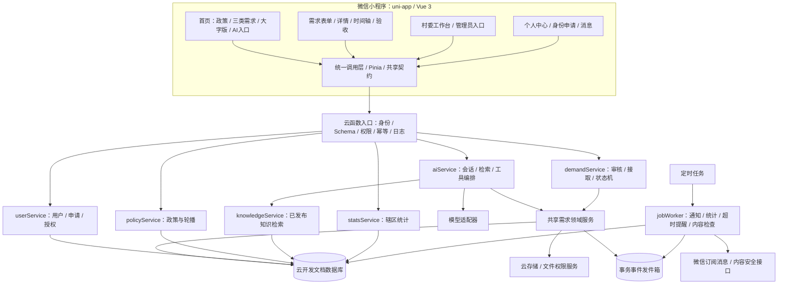
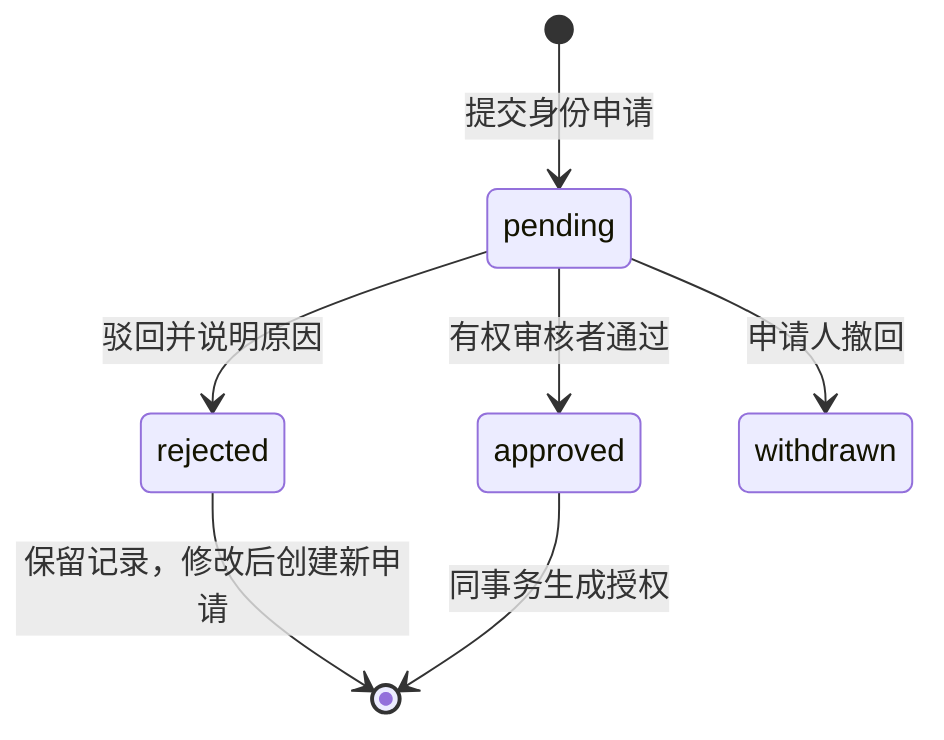
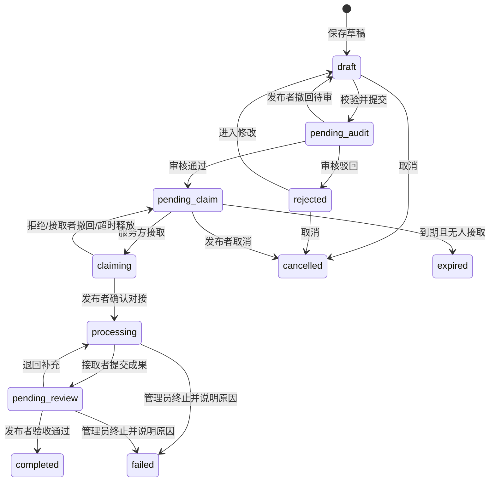
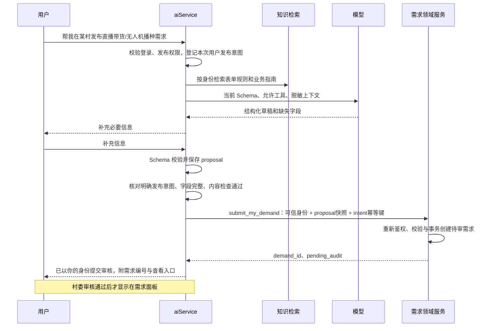

# 云治乡智：完整技术方案与项目架构

版本：1.1；编制日期：2026-10-24；适用对象：产品、开发、测试，以及执行代码任务的 AI。

1.1 修订：AI 从辅助填表升级为对话执行助手；明确发布指令可直接提交审核，取消每次必点确认卡的默认流程；新增无关问答每天10次、登录拦截和“AI回答，答案仅供参考”展示规范。

本文基于当前工作区代码核查编制。它描述目标架构，不表示相关功能已经实现或已经通过线上验证。当前任务仅新增方案文档，不修改业务代码和数据库。

配套文件：

- [接口、数据结构与 AI 工具契约](./contracts.md)：编码时使用的接口名称、字段、校验规则与错误码。
- [AI 编码实施任务与验收清单](./implementation.md)：按依赖排序的任务、修改路径、验收场景和交付要求。

阅读顺序：本文 → contracts.md → implementation.md。新功能按本套方案实现；旧接口通过兼容适配器迁移。若业务规则变化，先同步修订契约和验收条件，再修改代码。本套文档不自动覆盖仓库 AGENTS.md 等执行指令。

## 1. 项目定位与架构结论

平台连接乡村需求方、学校服务方和属地管理者，形成“身份申请 → 需求提交 → 审核公开 → 接取确认 → 服务推进 → 成果验收 → 数据汇总”的完整闭环。

采用 **uni-app + Vue 3 + TypeScript + Pinia + 微信云函数 + 微信云开发文档数据库 + 云存储**。保留当前项目基础，按业务模块组织代码；早期不引入独立微服务、Redis 或自建消息队列。通过数据库事务、事件发件箱和定时任务处理一致性及后台工作。

AI 使用“受控工具调用 + 检索增强知识库”，通过同一领域服务直接执行用户明确授权的业务操作。用户发送“帮我发布需求……”就是本次发布指令；信息齐全且有权限时直接以当前用户身份提交审核，无需默认再点击确认卡。权限判定、参数验证、状态流转和审批由确定性业务代码负责。

### 1.1 本方案确定的业务默认值

下列事项是为消除编码歧义采用的设计默认值，后续可通过产品决策修订：

| 事项 | 本期规则 |
|---|---|
| 普通游客 | 可浏览已审核公开的需求和政策；AI入口可打开，未登录对话返回“请先登录”，登录后可咨询与申请身份 |
| 农户、商户 | 统一业务角色 farmer，细分身份存 profile_kind；可发布三个板块需求 |
| 老师、学生 | 统一 teacher_student，细分身份存 profile_kind；可接取需求 |
| 村委、政府 | 统一 local_admin，通过辖区与组织区分管理范围；具备辖区内发布、接取、审批、监管和统计权限 |
| 超级管理员 | super_admin，具备全平台业务权限及管理权限；权限不免除状态、审计和禁止自审等完整性约束 |
| 多身份 | 一个用户可有多个有效授权，操作显式选择一个已授权 grant_id；切换身份不会产生新授权 |
| 接取方式 | 一个需求同时只允许一个有效接取者；接取后由发布者确认，避免不匹配的认领直接占用服务 |
| 项目与需求 | 本期一个需求作为一个服务项目，project_count = demand_count；不建立重复计数的独立项目实体 |
| “需求推荐” | 同时覆盖需求匹配推荐和需求进度推进；推荐是只读建议，推进是经过权限校验的业务动作 |
| 完成标准 | 接取者提交成果，发布者验收通过才算完成；超时提醒，不自动验收、不自动好评 |
| 政策 | 官方来源、人工核验后发布；AI 摘要附来源，不把模拟数据当正式政策 |
| 首版后台 | 在小程序内建设村委工作台和管理员入口；独立 PC Web 后台作为后续可选客户端 |
| 对话发布 | 明确发布指令+必填完整+身份有权 → AI直接以本人身份提交待审；信息缺失只追问缺项，审核通过后显示需求面板 |
| AI无关问答额度 | 所有登录用户每人每天最多10次成功的非本小程序业务问答，按北京时间零点重置；业务咨询与业务操作不占此额度 |
| AI回答提示 | AI回答区域固定显示“AI回答，答案仅供参考”，业务操作另显示真实执行状态 |
| 支付、积分 | 不包含支付结算、资金拨付、积分、信誉分、强制定位和自动处罚；有预算字段不代表支付能力 |

### 1.2 业务必须保持的约束

1. 未审核通过的需求不得出现在公共列表、推荐列表、公开搜索、分享预览或公开知识库中。
2. 禁止用户审核自己创建、自己代发或自己受益的需求；切换角色不能规避。超级管理员也遵守，使用另一名管理员处理。
3. 禁止发布者、实际需求方接取自己的需求。AI 不得代理审核、授权或验收。
   管理者接取他人需求后，也不能以监管身份确认自己的接取或验收自己的成果，应由需求方或另一名有权管理员处理。
4. 村委只能管理授权辖区及其下级区域；前端传入 village_id 不能扩大范围。
5. 每次写操作重新检查账号、有效授权、资源范围、参与关系和当前状态。
6. 状态变更、时间轴事件和待处理消息事件必须一致写入。
7. 微信通知失败不能回滚已成功的审核或接取；站内通知作为可靠查询记录。
8. 普通资料编辑不能修改角色、授权、账号状态或审核记录。

## 2. 当前代码核查与差距

核查范围为磁盘中的源码与配置，未连接线上环境，未确认现网集合权限、索引、定时触发器和部署状态。已有测试报告与 coverage 文件不能证明当前业务闭环可用。

本节保留方案编制时的初始核查结果。后续开发前整理已修复部分构建/测试问题并调整工具依赖，最新实测现状见 [开发基线报告](../baseline.md)；其余目标能力仍需按计划实现。

| 模块 | 当前证据 | 目标处理 |
|---|---|---|
| 前端框架 | package.json 为 uni-app、Vue 3、TypeScript、Pinia、Wot Design Uni | 保留技术路线，独立处理依赖兼容与锁定版本 |
| 页面 | src/pages.json 已有首页、发布、详情、身份申请、审核、我的需求、认领任务、聊天、政策 | 复用页面，增加村委统计、需求审核、AI 助手、知识库入口 |
| 三类表单 | demand-create.vue 已有 enterprise/企需通、agriculture/农践帮、research/科研实践厅 | 保留分类，改为版本化 Schema 驱动及统一校验 |
| 需求后端 | cloudfunctions/demandService/index.js 仅分派 create，创建状态为 published，使用 ...data | 先修复为待审与字段白名单，再补齐完整生命周期；禁止批量写入客户端字段 |
| 前后端契约 | 页面调用 get；services 调用 getDetail；审核参数有 pass/approve、comment/reason 等差异 | 建立 v1 契约与短期兼容适配器，不继续增加别名 |
| 返回 ID | 云函数返回 id，前端服务取 result.data?._id | v1 统一 demand_id，兼容层定向转换 |
| 角色 | userService 使用 teacher_student；store、permission 使用 school_admin | 统一 teacher_student；历史 school_admin 作为普通服务方迁移，绝不自动转成管理角色 |
| 用户资料 | userService 的 updateProfile 接受客户端 _id 与其余字段直接更新；updateAvatar 也接受 _id | 只允许更新可信当前用户的白名单资料，禁止更新他人及角色字段 |
| 管理权 | userService 含固定 OpenID 管理例外和依赖电话号码的角色初始化路径 | 移除硬编码提权，采用可审计 role_grants；初始管理员离线初始化 |
| 用户状态 | users.status 混合账号状态与身份审核状态 | 分离 account_status、role_applications.status、role_grants.status |
| 会话 | src/stores/user.ts 有重复 generateToken 声明，本地随机 token 用于缓存 | 修复编译基线；服务端仅信任微信上下文身份，本地标记不作为凭证 |
| 集合声明 | database_schema.json 有 read_write_env_user 等 ACL 标签 | 不能仅按标签推断现网规则；导出现网配置核实，目标默认关闭客户端直连 |
| 政策 | updatePolicy 使用 MOCK_POLICIES，先清空再写入；页面按 publishDate 排序而写入为 publish_date | 改为有审核的增量同步，统一字段，不清空正式政策；收敛重复 updatePolicy/updatePolicy 目录 |
| AI | customer-service.vue 是关键词回复，未接模型与业务工具 | 建立独立 aiService；原客服可保留工单入口，去除虚构热线与审核时限 |
| 大字版 | settings.ts 已保存 largeTextMode | 扩展为全页面样式变量，验证表单、弹层、时间轴和 AI 消息布局 |
| 聊天 | 已有 chatService/contactService，不能仅按 README 判断为未实现 | 保留为辅助模块，专项检查会话成员权限；AI 会话独立存储 |

已有文档中允许切换身份自审、依赖前端 event.userInfo.role、自动超时好评等内容与本期规则冲突，按本方案修订对应实现，不能直接复制旧文档中的伪代码。

## 3. 系统总体架构



### 3.1 分层职责

| 层级 | 责任 | 禁止事项 |
|---|---|---|
| Vue 页面 | 展示、用户交互、操作结果卡、路由 | 拼装任意数据库查询、直接改业务状态 |
| 前端 service | 请求封装、DTO 转换、错误提示数据 | 自己决定审核结果、用本地角色替代服务端鉴权 |
| 云函数 handler | 取可信身份、解析契约、调用用例、统一响应 | 直接把 event/data 展开写入数据库 |
| application/use-cases | 编排一次业务操作、事务、幂等 | 请求模型后直接跳过领域校验写库 |
| domain | 权限策略、状态机、表单规则、统计口径 | 依赖页面、全局用户缓存或外部模型 SDK |
| repository/adapters | 云数据库、存储、微信和模型调用 | 把 SDK 原始异常或隐私字段直接返回前端 |

### 3.2 云函数划分

保留按领域部署的云函数，而不是每个按钮一个函数。每个函数通过 action 路由；公共依赖由构建脚本打包到函数产物，不能假设云端能读取 cloudfunctions 外的源码。

| 函数 | 职责 |
|---|---|
| userService | bootstrap/getMe、资料、身份申请、授权查询、申请审核、授权管理 |
| demandService | 三类表单、草稿、提交、需求审核、接取、进度、成果、验收、推荐 |
| policyService | 已发布政策、轮播、管理草稿、发布与下架 |
| statsService | 辖区汇总、趋势、分类与异步导出 |
| notificationService | 站内通知、已读、订阅授权记录 |
| fileService | 上传凭据、文件绑定、按权限取临时链接、清理孤儿文件 |
| aiService | AI会话、意图分流、每日额度、业务工具执行、操作结果；不开放任意数据库工具 |
| knowledgeService | 知识库发布、业务/API 文档检索、引用溯源 |
| jobWorker | 仅受信任调度或后台触发：消费事件、统计、内容检查、AI 任务、同步 |
| chatService/contactService | 保留人与人沟通，独立会话成员权限，不与 AI 消息混用 |
| updatePolicy | 过渡期保留为受控调度入口，最终委派到政策同步用例 |

## 4. 权限与身份架构

### 4.1 RBAC + 资源范围 + 状态约束

不用单一数字等级表达所有权限。farmer 与 teacher_student 是业务分工，不表示服务方天然拥有发布权。local_admin 在授权辖区具有二者业务能力和管理能力；super_admin 在全平台具有所有已定义业务能力。

判定公式：

```text
允许操作 = 可信用户存在且账号正常
        AND grant 属于当前用户且有效
        AND grant 的角色具有该 capability
        AND 资源位于 grant 授权范围内
        AND 满足本人/接取者/审核者等参与关系
        AND 满足状态机、禁止自审、禁止自接等约束
```

public read 可不创建业务用户；受限操作必须 bootstrap 创建 general_user 用户。OPENID 从 wxContext 获取，通过 users 唯一索引解析为内部 user_id；不接收客户端 openid 作为身份凭证。jobWorker 使用独立受信任调度身份，不能由 event 中的 internal=true 绕过鉴权。

| capability | 游客/普通用户 | farmer | teacher_student | local_admin | super_admin |
|---|---|---|---|---|---|
| 公开需求/政策浏览 | ✓ | ✓ | ✓ | ✓ | ✓ |
| 身份申请 | 登录后本人 | 本人 | 本人 | 本人 | 本人 |
| AI 公开知识咨询 | 登录后限额 | ✓ | ✓ | ✓ | ✓ |
| 创建/提交需求 | — | 本人 | — | 辖区本人或代发 | 全平台本人或代发 |
| 接取需求 | — | — | 本人 | 辖区 | 全平台 |
| 确认对接/验收 | — | 本人需求 | — | 本人需求或监管处理 | 本人需求或监管处理 |
| 审核 farmer/teacher_student 申请 | — | — | — | 辖区 | 全平台 |
| 授予 local_admin/super_admin | — | — | — | — | 全平台 |
| 审核需求 | — | — | — | 辖区、非本人相关需求 | 全平台、非本人相关需求 |
| 添加执行进度/提交成果 | — | — | 本人接取 | 本人接取；监管操作另审计 | 本人接取；监管操作另审计 |
| 辖区统计 | — | — | 个人任务统计 | 授权辖区 | 全平台 |
| 政策/知识发布 | — | — | — | 经显式 capability 授权、辖区 | 全平台 |

村委干预验收、终止等必须使用明确管理动作并填写原因，不伪装成发布者。所有管理员操作记录 actor_user_id、grant_id、reason、request_id、目标和变更摘要。

### 4.2 身份申请与授权



- users.account_status 只表示 active/banned/deactivated；申请被驳回不影响已有角色和公开浏览。
- 每份申请指定 requested_role、organization_id、scope_region_id、材料 file_id。禁止任意角色字符串、自由填写权限数组。
- 普通申请人可请求 farmer、teacher_student 或 local_admin；local_admin 申请仅由 super_admin 审核。super_admin 不走普通自助申请，只由现有 super_admin 通过管理流程授予。
- local_admin 审核普通角色申请时，必须检查申请区域位于其授权范围；学校信息只用于资格材料，不自动产生学校管理权。
- 审核对象为申请，不是直接更改 users.role；通过时写 role_grants，并审计；同一申请并发审核只有一次成功。
- role_grants 存 role、scope、organization、有效期、状态和来源申请。授权撤销立即阻止后续敏感写操作。
- 单次操作的 grant_id 是上下文提示，服务端重新读取并验证，不将“切换角色”本身作为提权操作。
- 初始超级管理员由受控部署脚本以事先核验的内部用户 ID 初始化，脚本不能部署成公开可调用函数；禁止依赖姓名、手机号或源码内固定 OpenID 特权。
- 账号封禁优先于所有授权；历史任务移交由其他有权管理员处理并保留事件。

### 4.3 组织与区域

regions 保存树结构：id、name、level、parent_id、ancestor_ids；organizations 保存村委、政府、学校等组织。需求固定 region_id 和 region_path_ids，提交后不允许普通编辑更改归属辖区。

region_path_ids 包含自身和全部祖先。范围判定使用服务端维护的树与授权，不以名称前缀、客户端地址文本或当前 GPS 推断。整个平台不接受“缺少 region_id 默认全平台”的查询。

## 5. 需求领域与完整状态机

### 5.1 统一状态



completed/cancelled/expired/failed 为业务终态；禁止删除后伪装成未发生。申诉或重新开展服务以新关联需求处理，不直接改回处理中。内容违规下架用 visibility=hidden 与审计处理，不篡改已完成事实。

### 5.2 关键动作与约束

| 动作 | 前置条件 | 结果 |
|---|---|---|
| saveDraft/updateDraft | 本人有发布权；draft；版本匹配 | 只写 Schema 白名单，version + 1 |
| submit | draft；必填完整；辖区有效；文件合规检查通过 | pending_audit，revision + 1，产生快照 |
| withdrawSubmission | 本人 pending_audit；版本匹配 | draft，待审快照标记 withdrawn，不能再审批 |
| reopenRejected | 本人 rejected | draft，原审核快照保留 |
| audit approve/reject | 审核权、辖区、非自审；pending_audit；匹配 submission_id/revision/version | 通过到 pending_claim；驳回到 rejected，原因必填 |
| claim | 接取权；pending_claim；未到期；不是创建者或需求方 | claiming；生成 claim_id、claimer_id 和 expires_at |
| confirmClaim | 本人需求方，或有理由的辖区管理员；claiming；匹配 claim_id | accept → processing；reject → pending_claim |
| withdrawClaim | 当前接取者；claiming；匹配 claim_id | 释放占用；保留接取历史 |
| addProgress | 当前接取者且 processing | 状态不变，增加进度事件与凭证 |
| submitCompletion | 当前接取者；processing；成果摘要必填；文件检查通过 | pending_review；新 completion_id 与不可变成果版本 |
| acceptCompletion | 需求方或有理由的管理员；pending_review；匹配 completion_id | completed，completed_at 写一次 |
| returnCompletion | 同上，原因必填 | processing，保留旧成果，不统计为完成 |
| cancel | 本人 draft/rejected/pending_claim | cancelled；待审先撤回，claiming 先解除占用 |
| terminate | local_admin/super_admin，processing/pending_review，原因必填 | failed；非正常终止审计 |

- 默认认领确认期 48 小时，可配置；截止仍未确认才由定时任务释放。确认和释放必须检查同一 claim_id、version 和 expires_at，避免误释放新接取者。
- demand.expires_at 为需求接取截止时间；只有 pending_claim 可到期，processing 不被到期任务打断。
- 管理员处理终止和验收争议时不能提交空原因；不强制普通用户自动接受结果。
- 需求公开后不直接修改已审核正文。需要修改时：无人接取先取消再复制草稿提交；履约中的重大修改先协商终止，再创建关联需求。后续如需原地变更审批，单独建设版本化变更流程。

### 5.3 时间轴

时间轴来自独立集合 demand_events，禁止把无限增长数组塞进 demands。

事件类型包括 draft_created、submitted、audit_approved、audit_rejected、claim_created、claim_confirmed、claim_released、progress_added、completion_submitted、completion_returned、completed、cancelled、expired、terminated、visibility_changed。

每条事件保存 demand_id、sequence、type、from_status/to_status、actor_user_id、actor_grant_id、occurred_at、visibility、payload、request_id。状态事件由服务器生成，用户只填写允许的备注与凭证。

公开页只返回公开里程碑的脱敏摘要；需求双方可看服务记录；材料、内部意见和敏感地址只向有权者展示。抵达现场是可选进度类型，不强制定位，不将定位作为完成证明的唯一标准。

### 5.4 三板块表单

采用服务端维护、版本化的表单定义。前端渲染、后端验证、AI 信息抽取都使用同一个版本；发布后的 Schema 不原地修改。旧草稿继续按旧版本处理，停用版本需要明确升级映射。

共同字段：title、content、type、sub_type、region_id、location_text、expected_start_at、expected_end_at、expires_at、contact、attachment_ids、extra。联系电话与精确地址进入 demand_private，不进入公开需求文档。

| 板块 | 现有字段映射 | 目标约束 |
|---|---|---|
| enterprise / 企需通 | coopPeriod、budget、companyScale、urgency、attachment | extra.coop_period、budget_range、company_scale、urgency；文件统一 attachment_ids |
| agriculture / 农践帮 | liveLocation、productType、estimatedYield、logistics、helpPeriod | extra.product_type、yield_value、yield_unit、logistics、help_period；位置分公开概述与私有精确位置 |
| research / 科研实践厅 | projectStage、targetUniversity、funding、labConditions、attachment | extra.project_stage、target_university、funding_range、lab_conditions |

sub_type 枚举必须从现有表单选项整理到 form_schemas，不在迁移时凭空重命名。每个版本记录必填、类型、单位、长度、条件显示、可公开性；extra 禁止任意键。预算用最小货币单位整数和币种，产量必须有单位；未知值允许留空，AI 不猜测。

## 6. 数据架构

### 6.1 数据规范

- 新集合和字段统一 snake_case；TS DTO 与持久化字段保持一致，避免出现第三套命名。
- 内部关联全部用 user_id/demand_id/organization_id；openid 仅在用户身份映射、微信发送适配器使用，不在公开 DTO 或知识库返回。
- 数据库时间字段统一服务端生成 Date，接口输出 UTC epoch 毫秒 number，展示与统计日界线使用 Asia/Shanghai；历史 Date/number/字符串由迁移脚本规范化。
- 所有可变聚合具有 schema_version、version、created_at、updated_at；需求额外有 submission_revision。服务端控制版本与时间。
- 禁止把手机号、认证材料、未审核需求、完整聊天记录混入公共全文检索。

### 6.2 集合清单

| 集合 | 核心字段/用途 | 访问范围 |
|---|---|---|
| users | _openid、display_name、avatar_file_id、account_status、auth_version、operation_seq | 本人基础资料；管理按权限 |
| user_private | user_id、phone_ciphertext、认证必要信息 | 本人必要展示、授权审核人员 |
| regions / organizations | 区域树、村委/政府/学校、管理组织关系 | 公共基础项脱敏可读；管理写 |
| role_applications | applicant_id、requested_role、scope_region_id、material_ids、status、review | 本人和范围内有权审核者 |
| role_grants | user_id、role、scope_region_id、scope_type、organization_id、status、expires_at | 本人授权摘要；管理写 |
| form_schemas | type、schema_version、definition、status、content_hash | 启用版本可读，管理发布 |
| demands | owner_id、created_by、type、sub_type、region_id、region_path_ids、status、visibility、version、submission_revision、claimer_id、active_claim_id、时间字段 | 经过授权与 DTO 过滤查询 |
| demand_private | demand_id、contact、exact_location、private_answers | 需求方、确认后的服务方、辖区有权管理者 |
| demand_submissions | demand_id、revision、public_snapshot、private_snapshot_ciphertext、content_hash、status、review | 需求方与有权审核者；快照含私有字段加密副本，禁止指向可变当前资料 |
| demand_claims | demand_id、claimer_id、status、expires_at、confirmed_at、released_reason | 需求方、相关接取者、监管者 |
| demand_completions | demand_id、attempt、summary、attachment_ids、status、review | 参与方、监管者 |
| demand_events | demand_id、sequence、type、actor、visibility、payload | 根据事件 visibility 过滤 |
| files | owner_id、cloud_file_id、purpose、bound_resource、check_status、size、mime、hash | 上传者或绑定资源授权访问者 |
| notifications | recipient_id、event_id、type、resource_id、read_at | 收件人本人 |
| subscription_receipts | user_id、template_key、client_result、recorded_at | 服务端发送策略；不把 accept 当永久可发送凭证 |
| outbox_events | type、aggregate_id、aggregate_version、payload、status、lease_until、attempts、next_retry_at | 仅后台 |
| job_runs / event_receipts | 调度记录、consumer+event_id 去重凭证 | 仅后台 |
| idempotency_keys | actor_id、action、key、request_hash、response、expires_at | 仅后台 |
| policies | title、source_url、source_authority、publish_at、effective_at、expire_at、review_status、content、version | 公开只读已发布版本 |
| banners | policy_id、cover_file_id、sort_order、starts_at、ends_at、enabled | 首页仅返回有效且政策已发布项 |
| knowledge_documents | audience、scope、source、version、status、hash、reviewer | 按身份与辖区过滤 |
| knowledge_chunks | document_id、version、chunk_index、text、keywords、引用锚点 | 只检索当前可访问的已发布版本 |
| ai_sessions / ai_messages | owner_id、grant_context、role、content、citations、tool_summaries | 本人；后台仅最小化排障 |
| ai_jobs | session_id、owner_id、request_id、status、lease、result_ref、expires_at | 本人可查结果；后台执行 |
| ai_draft_proposals | owner_id、intent_id、draft_data、schema_version、draft_hash、status | 本人，补齐字段并直接执行时校验 |
| ai_action_intents | owner_id、session_id、source_message_id、action、grant_id、status、result_resource_id | 由可信用户消息形成，服务端校验并消费，不能由模型自授 |
| ai_quota_receipts | user_id、quota_day、message_id、kind、status、reservation_id | 每条消息计费一次，失败释放，日期固定 |
| rate_limit_buckets | subject、window、used、reserved、expires_at | 服务端原子计数；保护 AI 费用与写接口 |
| stats_snapshots | scope、period、filters、metrics、generated_at、data_as_of、algorithm_version | 范围内管理者 |
| export_jobs | owner_id、scope、filters、status、file_id、expires_at | 请求者和后台 |
| audit_logs | actor、action、target、reason、diff_summary、request_id | 超级管理员与有权审计人员；无前端更新入口 |
| conversations/messages/tickets | 保留现有人际聊天与工单，迁移统一内部 ID | 会话成员或工单处理权限 |

### 6.3 索引与查询约定

以下为逻辑索引设计，创建脚本需要依据所选文档数据库引擎验证数组、唯一与排序能力；不能把 PostgreSQL 或 MongoDB 完整语法直接套入微信 SDK。

| 集合 | 索引键 |
|---|---|
| users | _openid 唯一 |
| role_grants | user_id + status；scope_region_id + role + status |
| role_applications | scope_region_id + status + created_at DESC + _id DESC；applicant_id + created_at DESC |
| demands | status + visibility + created_at DESC + _id DESC；region_id + status + created_at DESC + _id DESC；owner_id + created_at DESC + _id DESC；claimer_id + status + updated_at DESC；status + expires_at |
| demands（推荐候选） | type + status + visibility + created_at DESC；筛选子区域先服务端解析允许的叶子 region_id 集合并分批查询合并 |
| demand_submissions | demand_id + revision 唯一 |
| demand_events | demand_id + sequence 唯一 |
| notifications | recipient_id + created_at DESC + _id DESC；recipient_id + event_id 唯一 |
| outbox_events | status + next_retry_at；status + lease_until |
| idempotency_keys | actor_id + action + key 唯一；expires_at 普通索引供清理 |
| event_receipts | consumer + event_id 唯一 |
| policies / banners | review_status + publish_at DESC；enabled + sort_order |
| knowledge_chunks | document_id + version + chunk_index 唯一；检索引擎单独建索引 |
| ai_jobs | status + created_at；owner_id + request_id 唯一 |
| ai_action_intents | owner_id + session_id + source_message_id + action 唯一；status + expires_at |
| ai_quota_receipts | user_id + message_id + quota_kind 唯一；status + lease_until |
| rate_limit_buckets | subject + quota_kind + quota_day 唯一；expires_at供清理 |
| stats_snapshots | scope_key + period_key + filter_hash + algorithm_version 唯一 |

列表使用 created_at + _id 稳定游标；默认 page_size=20，最大 50。校验排序字段和筛选白名单，禁止客户端提交数据库运算符、任意排序表达式和任意集合名。跨多个 region_id 查询须限制批次与总扫描量，超过阈值转统计/搜索索引，不能无界全表扫描。

### 6.4 数据库和云存储权限

业务集合默认客户端 read=false、write=false，通过云函数读取和写入。先迁移现有前端直连与 watch，再切换规则，避免服务中断。政策等公开内容也经 policyService 返回稳定 DTO。

云数据库权限是文档级，不能依靠前端“不显示”保护同文档中的电话等属性；因此私有信息物理分集合。云函数管理端访问也需要自行鉴权，数据库规则不能代替业务检查。[腾讯云安全规则说明](https://cloud.tencent.com/document/product/876/41802)

文件分公开政策封面、私有认证材料、私有服务凭证和经审核可公开需求图片。客户端不得直接更新 file 的绑定关系或 check_status；由 fileService 校验资源权限并发放短期访问链接。临时链接不保存进公共 DTO、日志或知识库；访问过期重新鉴权。

## 7. 事务、并发与事件机制

### 7.1 一个业务命令的执行顺序

```text
验证微信可信身份 → 解析严格 Schema → 检查幂等记录
→ 读取有效账号、授权及资源 → 检查角色/辖区/参与关系/状态
→ 事务内重查参与判定的可变记录与 expected_version
→ 写聚合 + 对应申请/接取/成果记录 + 时间轴 + outbox + 幂等响应
→ 提交事务 → 返回明确业务结果
→ jobWorker 异步发送通知、更新统计或触发检索索引
```

幂等键按 actor_user_id + action + idempotency_key 隔离。相同键相同请求返回原结果；相同键不同请求体返回 IDEMPOTENCY_CONFLICT。请求哈希包括业务 data、grant_id 和目标版本，不包含 request_id。响应保留默认 7 天，过期后还依赖实体状态与 version 阻止重复动作；AI发布按服务端intent_id生成稳定幂等键，意图消费结果与demand_id持久关联，任务重试不得生成新键。

### 7.2 并发接取与审核

- 事务读取需求，确认 pending_claim、未过期且 version 匹配，再写 claiming 与 active_claim_id；其他竞争者收到 VERSION_CONFLICT 或 STATE_CONFLICT，不能全部显示认领成功。
- 审核事务同时核对 submission_id、revision、content_hash 与 pending 状态，杜绝审核旧内容而发布新内容。
- 用户账号、授权变更与业务写需要在事务内读取同一权限版本依赖，并用相同记录的版本保护，避免撤权与写操作并发时绕过。事务冲突自动重试有上限，重试仍必须重查所有条件。
- 时间轴 sequence 使用需求 version 和 event_index 编码成固定宽度有序字符串（例如 0000000003:0001）；唯一索引为 demand_id+sequence。一个命令最多99条事件，超过拆分用例。禁止使用数组长度或客户端时间分配序号。

CloudBase 支持事务，但 SDK 与运行环境的具体限制需要适配验证。当前官方文档强调事务内使用 doc 操作、不做外部调用；本方案预生成文档 ID，通过 doc(id) 操作，不把 where 批查询放入事务。不要在事务里调用模型、发微信消息或扫描文件。[事务文档](https://docs.cloudbase.net/database/transaction)

### 7.3 事件发件箱与可靠任务

不要求第一期采购队列服务。事务中写 outbox_events，受信任定时任务扫描 pending/retry 项，以事务租约领取，成功后标记处理，异常按退避重试，超限进入 dead 并提示管理员。

一个事件分为独立消费任务，例如 notification.inbox、notification.wechat、stats.refresh；每个任务独立租约和去重，不能因微信失败反复重做统计。站内通知通过 recipient+event_id 唯一键避免重复；统计重算/幂等投影通过 event_receipts 去重。

外部订阅消息发送与数据库无法形成一个事务：允许发生“微信已发送但本地未记成功”的不确定窗口。记录 sending/uncertain 状态，禁止无限盲重试，限制自动补发并可人工核查；不宣称微信消息严格 exactly-once。

## 8. 村委后台与统计口径

工作台入口根据有效权限显示，但页面入口隐藏不是权限控制。包括身份审核、需求审核、辖区需求、进度监管、数据总览、导出、政策/知识管理以及待处理失败任务。

默认管理范围来自 grant，不让用户通过下拉选择扩大辖区。支持日期、区域、板块和状态筛选，页面显示数据截至时间，统计延迟目标不超过 5 分钟，失败时显示旧快照时间。

### 8.1 指标定义

默认按时间窗内首次提交审核的需求形成 cohort；提交一次后驳回、重提不增加项目数。时间窗口使用 [start_at, end_at)。

| 指标 | 精确定义 |
|---|---|
| 需求/项目数 | first_submitted_at 在窗口内，辖区匹配的不同 demand_id 数；不计纯草稿；取消和失败仍保留在该批需求总数中 |
| 发布人数 | 同一 cohort 内 owner_id 去重；村委代发计实际需求方，另报代发操作人数 created_by 去重 |
| 审核公开数 | cohort 中有 approved_at 的需求数；不是仅统计当前 pending_claim |
| 已解决数 | cohort 中 status=completed 的不同 demand_id 数 |
| 解决率 | 已解决数 / 同 cohort 需求总数；分母 0 输出 null，页面展示“暂无数据” |
| 待审核/待接取/处理中 | 查询时点辖区内对应状态的存量快照；明确不同于 cohort 流量 |
| 本期完成量 | completed_at 在窗口内的需求数；可能包含以前发布需求，不能用它直接除以本期提交数 |
| 参与服务人数 | cohort 关联的已确认接取记录中 claimer_id 去重；接取被拒不计 |
| 平均解决时长 | cohort 已完成需求 completed_at - first_submitted_at 的均值；无完成项输出 null |
| 板块分布 | cohort 按 enterprise/agriculture/research 分组的需求数 |
| 服务时长 | 仅在有明确起止及验收依据时单独计算；不能把需求周期全部算作志愿服务工时 |

### 8.2 统计实现

低数据量先用服务端聚合生成快照，按 scope+period+filters 缓存；事件只标记受影响快照需刷新。去重人数必须按实际聚合/去重集合计算，不能简单每次事件 +1。

数据量增长后再增加按日投影和去重成员集合，使用 consumer receipt 保证重复事件不重复计数。每日低峰按主数据对账重算；差异记录为任务。导出使用异步 export_job，服务端重新验证范围，生成私有文件与短期下载链接，默认剔除电话和材料。

## 9. AI 助手与知识库架构

### 9.1 能力边界

首页AI助手是对话式业务执行入口，提供政策问答、需求发布、补齐表单、本人需求状态查询和适配推荐，村委还可按权限查询辖区统计。首版必须真实落地“对话直接提交需求”，不能仅回复操作教程或跳回手填表单；其他写操作按工具注册表逐项接入，不因模型声称支持就开放。

未登录用户发任何AI消息时，前后端统一拦截并显示“请先登录”，不调用模型、不创建业务任务、不扣问答次数。已登录普通账号可以咨询，但发布仍要求farmer或具有发布能力的管理授权；无对应身份时提示“请先申请农商户身份认证”，不能把缺少角色错误地当作未登录。登录完成不自动执行登录前的写指令，应让用户重新发送发布指令。

模型供应商通过 ModelProvider 接口接入，配置 provider/model/timeout/token_budget，密钥只在云端安全配置保存。优先评估已开通云开发模型能力；若采用其他供应商，只替换服务端适配器。费用、地域、延迟、中文效果和工具调用能力经实际 PoC 后锁定，不在本方案臆造价格和额度。

当前 demandService 使用 wx-server-sdk ~2.6.3，不能直接假设它有 cloud.ai()。官方 AI 调用文档有单独 SDK 版本和环境开通要求；实现任务须验证并选择受支持的固定版本，不照抄示例中的 beta 版本作为生产默认。[CloudBase AI 调用说明](https://docs.cloudbase.net/ai/model/wx-server-sdk-access)

### 9.2 对话直接发布的完整链路



用户的明确发布指令作为本次操作授权；每条服务端登记的ai_action_intent绑定user_id、session_id、真实source_message_id、action、grant_id及意图有效期（默认30分钟，可配置）。模型不能凭空创建意图、指定别人的身份或复用其他会话授权；“如何发布”“帮我润色”“如果发布会怎样”不构成执行指令。

信息缺失时只追问缺失项；用户在同一发布意图中补齐后直接提交，无需每次再要求点击确认。真实字段来自用户消息或已核实的本人资料，模型建议的需求类型/子类型按当前Schema解析，不能猜联系人、精确区域、服务时间、产量和预算。指代多义、用户改成只写草稿、意图过期或请求含多个无法区分的需求时，先用对话澄清；取消指令使未执行意图失效。

submit_my_demand执行器在事务内核验意图、账号、授权、草稿版本/hash、完整Schema及内容检查结果，消费意图并调用与表单共用的CreateAndSubmitDemand用例，写pending_audit需求、事件、outbox及意图结果。一个意图最多创建一个需求；网络重试和Worker重启返回原demand_id。取消与执行竞争时用事务确定结果，已提交后如需撤回必须走正式withdrawSubmission，不能假装取消了已完成写入。

任务异步执行期间撤权立即影响执行检查；命令已提交而模型后续措辞生成失败时，界面仍从operation_result显示真实“已提交审核”，不重新建单。只有业务接口返回成功才可声称提交成功，审核通过事件发生后公共面板才可查询该需求。

两个对话示例：

- “帮我在XX村发布一个找人直播带货的需求……”：结合销售类表单核验必填信息；齐全则直接提交待审，否则仅追问产品、联系人或时间等缺项。
- “帮我找人用无人机播种……”：按实际表单服务子类匹配并追问作物、面积/单位、区域和时间等所需信息；当前表单缺适用子类时先补充版本化Schema，不能硬塞到无关选项或编造枚举。

### 9.3 知识库分层

| 类型 | 例子 | 发布与访问 |
|---|---|---|
| 公共业务知识 | 如何认证、三类表单、流程说明、经核验政策 | 管理员审核后公开检索，保留引用 |
| 业务接口知识 | action、JSON Schema、错误码、工具参数、示例 | 从代码契约自动生成；使用脱敏示例，不含密钥与真实用户数据 |
| 组织管理知识 | 辖区操作手册、内部审核规范 | 按 role/scope 过滤后检索 |
| 实时业务数据 | 我的需求、我的进度、辖区统计 | 通过鉴权业务工具查询，不批量灌入公共 RAG |

用户可在 AI 助手“业务与接口知识库”查看自己可见的规则与接口说明；可读接口文档不等于获得调用权限。公开 API 文档可以展示结构，但真实调用仍需微信身份与服务器权限校验。

### 9.4 检索流程

导入官方来源/本地文档 → 清洗并剔除凭证与个人信息 → 分段 → 生成关键词与可选 embedding → 管理审核 → 发布指定版本 → 检索 → 引用回答。

第一期数据量小，以数据库关键词候选和服务端排序落地；定义 RetrievalProvider 接口。第二期有明确召回需求时接入 CloudBase 支持的向量能力或其他受管检索服务，先验证环境和索引能力。文档型数据库不默认等于可直接运行任意向量查询。

检索必须先筛 status=published、有效期、audience 和 scope，再召回；答案生成前再次确认引用版本可见。引用附 document_id、version、title、source_url、anchor。政策失效或新版本发布时停用旧片段，避免新旧混答；无充分来源时说明无法确定，不编造补贴标准或资格判断。

### 9.5 工具调用安全与稳定性

- 工具描述及参数从共享契约生成；执行端使用严格 Schema 和白名单，不让检索文档动态定义工具。
- 模型输出视为不可信输入。禁止模型选择 user_id、openid、grant、角色、审批结果或任意数据库查询。
- 所有工具通过当前 session 绑定的可信身份调用领域服务；模型传来的“我是管理员”不能成为权限依据。
- 写工具包括保存建议草稿和submit_my_demand；后者仅允许消费当前用户明确发布指令产生的有效意图。用户已下达明确指令时不增加默认点击确认步骤；审批、授权、强制完成、删除文件等不暴露给模型。
- 知识内容、网页、附件都标为资料；其中要求忽略系统规则、调用隐藏工具或泄露信息的文本不执行。
- 读业务工具只返回当前用户有权的数据；公开知识问答与含个人资料的上下文分开处理；电话、精确地址不必要时不传模型。
- 每轮最多 4 次工具调用、最多 2 次 Schema 修复、最多 1 次重试模型网络请求，限制输出 token、输入长度和会话历史；具体额度通过配置调整。
- 首版用异步 AI 任务：sendMessage 返回 job_id，jobWorker 持久化领取并执行，前端轮询结果。不得在函数返回后依赖后台悬空 Promise 继续生成。流式能力作为后续增强，不能假定 callFunction 会直接返回 token 流。
- 超时显示可重试并保留草稿。模型不可用时普通表单、审核和政策列表保持可用。

### 9.6 无关问答每日10次与回答页展示

服务端先将消息分为business_query（政策/流程/接口/本人需求等小程序业务咨询）、business_action（发布等业务命令）和general_chat（与小程序无关的百科、闲聊等）。前两类不占无关问答额度；general_chat每个登录user_id每天最多10次成功回答，所有角色统一规则，按Asia/Shanghai自然日00:00重置，与会话、设备、当前角色无关。

分流由服务端规则和受限分类器共同完成，不能相信前端或用户自行声明“这是业务问题”。分类器只输出类别与置信度、无业务工具权限；不清晰时保守计入general_chat或追问用途，用户明确引用小程序不能自动把无关问题变成业务问题。混合消息优先执行真实业务部分，不免费回答附带无关问题；需要回答无关部分时单独拆为可计数的general_chat子任务，结果说明是否使用一次额度。

一次=一条真实用户消息对应的一次成功general_chat回答；模型内部推理、工具调用、网络重试、刷新和重新展示不重复计次。用户主动再问/重新生成新回答计新一次，客户端重试必须复用原消息幂等键。服务端原子预留，满足used+reserved<10才受理，成功落库后结算，失败或超时释放；成功回答已持久化但客户端断线仍算一次，回来可读原答案。

quota_day在预留时固定，跨午夜完成仍结算原日；新的一天使用独立计数桶。返回limit/used/reserved/remaining/reset_at，预留占用也计入remaining，避免并发超额。第11次返回“今日非业务问答次数已用完（10次），你仍可咨询小程序业务或发布需求”，不调用通用回答模型；分类器本身仍受独立成本和频率上限保护。业务消息另有防刷和模型预算限制，不能因不占这10次就允许无限请求，也不能在一般问答额度用完后屏蔽业务发布。

AI回答页在回答区域固定显示精确文案“AI回答，答案仅供参考”，咨询、业务答复、历史消息和大字版均保留；由前端固定组件渲染，不依赖模型生成。执行结果卡以真实接口结果展示“补充信息中 / 正在提交 / 已提交待审核 / 提交失败 / 审核通过”等状态、需求编号及详情链接，不能以参考提示代替明确操作结果。知识问答附可用引用；无登录、无权限、超限提示由系统直接返回。

### 9.7 需求匹配推荐

第一期采用可解释规则：仅从已审核、公开、未过期、pending_claim 的需求中召回，再结合板块、技能标签、地域和时间匹配排序。示例权重：技能 40%、地域 25%、时间 20%、板块偏好 15%，缺失项重新归一化；这些是产品初值，不宣称已经验证效果。

详情中返回 reason_codes，例如 skill_match、nearby_region、time_overlap。推荐结果可辅助老师学生选择，不自动接取、不保证成功；点接取时重新走正常鉴权与事务。第二期才评估向量语义匹配，保留规则基线和人工筛选。

## 10. 政策轮播、大字版、通知与辅助功能

### 10.1 政策与轮播

- 数据来源为政府官网等事先配置的可信源，保存原文链接、发布单位、发布日期、有效日期和采集时间；不在本方案生成具体真实政策条目。
- updatePolicy 仅导入候选草稿，去重键为规范化 source_url + source_version/content_hash；人工核验后发布，不清空已有集合。
- 失败保留旧版本，摘要变更重新审核；过期政策不进入默认推荐，历史页面标记失效。
- 轮播 banner 引用 policy_id，不能直接跳任意外链。详情支持本地可审阅正文；外链打开能力受小程序配置影响，部署前核实业务域名和 web-view 支持，失败提供复制官方链接。
- 管理发布时验证封面文件、排期、排序和政策状态，首页查询同时检查 banner 与 policy 状态。

### 10.2 大字版

首页提供明显的“大字版”开关，对所有用户开放，尤其照顾教师等有阅读需要的人群。偏好本地持久化，可选同步到个人设置。

使用统一字号/行高/间距变量，例如 normal 与 large=1.3 倍；不能仅给首页文本加 font-size。表单、按钮、弹层、通知、政策详情、AI 消息和时间轴同步适配；避免固定文本容器高度，支持换行与滚动。验收覆盖窄屏、长标题、长政策和输入键盘弹出，不以修改系统字体为实现方式。

### 10.3 站内通知与微信订阅消息

事件包括身份申请结果、需求审核结果、新接取确认、确认结果、进度更新、成果提交、验收结果、超时提醒、管理终止。站内通知必建，微信消息按用户授权、模板和平台实际允许条件发送。

订阅授权在用户点击提交等明确动作时申请，拒绝订阅不阻断需求提交。不能把一次接受当无限发送权限；模板 ID、字段长度与跳转页通过环境配置管理，发送失败记录原因与状态，不能向用户保证一定送达。[CloudBase 订阅消息指南](https://docs.cloudbase.net/recipes/add-subscribe-message-cloud-function)

### 10.4 文件与内容检查

上传 → 文件归属登记 → 大小/MIME/扩展名校验 → 文本/图片内容检查 → 业务绑定 → 权限下载。客户端尺寸检查只优化体验，服务端必须二次校验。文本与图片检查结果存在 pending/pass/reject/error；pending/error 不得静默当 pass 发布。

建议默认图片最多 5 张、每张 5MB；文档最多 3 份、每份 10MB，作为产品限制而非云平台承诺。禁止 HTML/SVG 等主动内容作为普通附件直接内嵌；正式允许的格式由 Schema 配置。恶意文件检测与微信内容安全是不同能力，供应商扫描能力未接入时不得显示“已完成病毒扫描”。

检查服务调用须基于实际小程序主体可用接口做适配。需求人工审核与机器检查并行提供依据，机器检查不取代村委审批。认证材料不收集与身份验证无关的敏感内容。

## 11. 工程目录与编码规范

```text
docs/architecture/              # 当前方案
contracts/                     # 实施时创建：唯一契约源
  schemas/                     # 请求、响应、表单、AI工具 JSON Schema
  actions.json                 # 函数/action、权限、幂等、版本
  enums.ts                     # 角色、状态、错误码
  generated/                   # 自动生成 DTO、工具和 API 文档
server/                        # TypeScript 后端业务源代码
  core/                        # auth、policy、error、idempotency、transaction
  modules/
    user/ demand/ policy/ stats/ notification/ file/ ai/ knowledge/
  adapters/                    # 微信SDK、数据库、存储、模型、检索
  jobs/                        # outbox、超时、统计、内容检查、AI任务
cloudfunctions/                # 微信可独立部署产物和薄入口
  userService/ demandService/ ...
src/
  pages/                       # 保留现有路径，增量迁移
  services/                    # 统一 callFunction，兼容层集中
  stores/                      # 用户、设置、AI会话、通知
  components/                  # SchemaForm、DemandTimeline、AIOperationCard、AIAnswerNotice
  features/                    # demand、workbench、ai、knowledge 的逻辑组合
  utils/                       # 前端权限提示、时间、游标处理
scripts/                       # 构建云函数、生成契约、迁移、种子、校验
database/                      # 集合规则、索引、迁移版本
tests/
  unit/ integration/ component/ e2e/ fixtures/
```

实施初期可继续维护现有 JS 云函数，但新核心逻辑应逐步移入 server TS；构建后每个云函数目录包含自身 index.js/package.json 及共享模块。不得把未编译 TS 直接上传到 Node 云函数，也不能上传开发测试密钥。

公共边界使用严格类型与运行时 Schema，禁止 any/任意 Record 作为业务契约。异步异常在合适的 handler/适配器边界统一处理，不要求每个 await 都机械套 try/catch。日志保存 request_id 与错误分类，不返回堆栈或完整 event。

## 12. 环境、部署、运维与数据迁移

### 12.1 环境配置

开发、测试、生产使用独立云环境和数据。客户端仅配置公开 cloud_env_id；服务端配置模型密钥、模板 ID、限额、租约和调度参数；禁止在 store 与多个页面硬编码环境。

本地工具链与云函数运行时分别选型。package.json 当前含较早 uni-app 与较新测试依赖，README 的旧 Node 建议不能当兼容结论；先验证支持矩阵并锁定版本，再逐包升级，不能一次性把所有依赖升到 latest。

### 12.2 部署顺序

1. 导出规则、索引和备份，记录现网业务状态，验证备份可恢复。
2. 新集合与索引、只增字段、后端兼容接口先部署；feature flag 默认关闭新入口。
3. 运行只读迁移演练，人工核验映射报告；按游标分批回填，记录迁移 checkpoint。
4. 部署新前端并迁移直连查询，观察旧版客户端调用量；写接口统一新语义。
5. 开启新流程、工作台、站内通知，核对业务事件与统计；再启用订阅通知和 AI。
6. 收紧数据库及函数调用权限，验证旧端安全失败或提示升级；后台任务仅可信触发。
7. 稳定后停止旧接口，保留明确兼容截止版本；回收旧目录和测试特权路径。

发布时后端必须兼容仍在使用的旧小程序版本。危险的旧“创建即公开”语义立即禁止，即便兼容接口也只能提交待审。回滚优先关闭功能与切回兼容客户端；已迁移数据和新状态不能靠回滚旧代码盲写覆盖。

### 12.3 历史数据映射

| 历史数据 | 迁移规则 |
|---|---|
| school_admin / teacher_student | 映射到 teacher_student；核验历史授权材料再生成有效 grant |
| local_admin | 必须核验授权与辖区，不能因历史 role 字符串直接授予管理权 |
| 代码硬编码管理员 | 清点并人工核验，迁移为有来源的 super_admin grant 后删除代码例外 |
| users.status=pending/rejected | 迁移为申请状态；账号 active 或 banned 需独立判断 |
| published / approved | 无可核验审核记录时回到 pending_audit 并隐藏；不能直接映射 pending_claim |
| pending | 根据上下文和审核记录核实为 pending_audit，未知状态进入隔离清单 |
| claimed | 根据接取者和确认记录核实 claiming/processing，不能凭字符串猜测 |
| completed | 验收证据完整才迁移 completed；缺证列为历史待核验，暂不纳入可信已解决指标 |
| camelCase 与 snake_case 时间/字段 | 映射规范字段、统一时间类型，保留迁移审计，缺失字段不凭空补业务事实 |
| policy 模拟条目 | 标记测试/草稿并从正式政策和知识检索移除，不作为真实政策继续传播 |

迁移脚本必须支持 dry-run、幂等重跑、分页、checkpoint 和错误隔离，禁止用清空集合重建来迁移。无法核实的数据保留隔离状态，避免静默放大权限或伪造完成量。

### 12.4 日志、监控与容量

结构化日志字段：request_id、actor_hash、function、action、demand_id、latency_ms、error_code、dependency、attempt。禁止记录完整手机号、认证材料、模型密钥与原始聊天全文。

监控云函数错误率/P95、事务冲突、待审核积压、outbox 最老待处理年龄、死信数、统计延迟、模型超时率、工具失败率和单用户 AI 消耗。目标值作为验收目标：普通读接口暖启动 P95 < 1 秒、写接口 P95 < 2 秒；AI 任务 2 秒内确认受理、30 秒内尽力完成；冷启动和外部依赖单独测量，不能当平台保证。

容量按真实试点人数、峰值并发、图片量、统计刷新频率和 AI token 测算。先验证 20/50/200 个并发用户场景；并发用户数不等于 QPS。达到套餐瓶颈时再扩容或接队列/检索服务，不预设必需 Redis。

身份材料、AI 聊天、通知、审计等设置可配置保留期限和清理作业。建议起点：AI 原始会话 90 天、临时导出 24 小时、幂等记录 7 天；最终按实际业务要求和必要性确认，不把此数值表述为法定期限。备份频率与恢复目标取决于已购买能力，部署前实测，不能宣称已有自动备份。

## 13. 测试与交付门槛

- 单元测试：权限矩阵、辖区树、状态机、表单 Schema、幂等哈希、统计口径、工具参数校验。
- 集成测试：真实测试环境事务冲突、唯一索引、撤权竞争、outbox 重试、私有文件权限；内存 mock 不能替代事务验证。
- 组件测试：三表单、时间轴、AI操作结果卡、固定回答提示、大字版与后台筛选。
- E2E：普通用户申请 → 审核 → 发需求 → 驳回重提 → 审核公开 → 竞争接取 → 确认 → 进度 → 成果退回 → 再提交 → 验收 → 通知与统计。
- AI评估：明确发布指令直接提交、缺失字段追问后提交、咨询不误发、未登录显示“请先登录”、无权用户不能发布、幂等只建一单、无关问答第11次拦截但业务仍可用、跨日/并发计次准确、固定提示可见、知识引用及会话隔离正确。
- 安全回归：篡改本地角色、_id、owner_id、grant_id、region_id、status、reviewer、file_id、客户端数据库直连、越权会话读取均被阻止。
- 最终完成条件为“流程、数据一致性、权限和证据”通过，不能以页面已显示成功或测试覆盖率数字代替。

具体编码任务、测试用例与可执行顺序见 implementation.md；精确接口与数据字段见 contracts.md。

## 14. 官方依据与能力验证清单

以下资料用于核查技术边界，不代表本环境已开通对应能力：

- [CloudBase 数据库事务](https://docs.cloudbase.net/database/transaction)：事务与 SDK 限制，实施中用测试云环境验证。
- [腾讯云数据库安全规则](https://cloud.tencent.com/document/product/876/41802)：客户端文档级访问规则与服务端鉴权边界。
- [CloudBase 云函数安全规则](https://docs.cloudbase.net/cloud-function/security-rules)：客户端调用控制不能替代定时器、管理端调用的鉴权。
- [CloudBase 微信小程序云函数接入](https://docs.cloudbase.net/recipes/add-cloud-function-wechat-miniprogram)：可信上下文与调用入口。
- [CloudBase AI 服务端接入](https://docs.cloudbase.net/ai/model/wx-server-sdk-access)：模型环境开通、SDK 与超时要求。
- [微信订阅消息云函数实践](https://docs.cloudbase.net/recipes/add-subscribe-message-cloud-function)：授权触发、模板与消息发送。

实施前确认清单：现网 SDK/运行时、实际数据库引擎、事务与索引能力、环境套餐、函数安全规则、内容安全接口权限、订阅模板、文件访问策略、政策外链域名、模型可用地域与额度。这些属于环境核验任务，不能用猜测填充为“已配置”。
