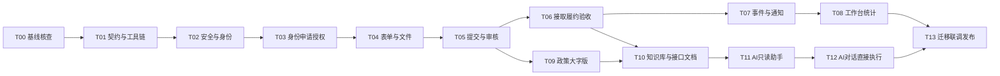

# AI 编码实施任务与验收清单

修订版本2.0（2026-10-25，已确认冻结）。与[总体架构](./README.md)、[接口契约](./contracts.md)和[运行规则](./operations.md)一同使用，从[新AI交接入口](./AI_HANDOFF.md)开始。本文件是后续编码的执行计划，不表示任务已经完成。实施时每完成一个任务，在任务记录中写证据、命令、环境和遗留项。

开发前本地基线核查与源码整理结果已记录于 [docs/baseline.md](../baseline.md)。执行T00时复用该证据、核对后续变更，继续补齐尚未完成的真实云环境与E2E项，不把本地通过误认为全部环境已验收。

用户已在Q58确认整体理解，见[决策记录](./decisions.md)。本清单已冻结为新AI的编码交付依据；当前轮次仅完成文档定稿，不启动业务实现。

## 1. 执行约束

1. 先读取适用的 AGENTS.md，再读取方案与决策记录；以当前工作区为基础，先检查git status。2026-10-24基线已提交，后续状态以实际检查为准；禁止 reset、覆盖用户改动或清理不明文件。
2. 一个任务只解决指定边界；先实现领域规则和契约，再接页面。不得先堆页面、最后补鉴权。
3. 不把历史文档、mock、coverage 或测试截图当线上已实现证据。
4. 所有云端变更先在独立测试环境验证，不把生产环境作为自动化测试目标。
5. 计划中的新路径要按任务实际创建；不导入尚不存在的共享模块，不留空壳方法返回成功。
6. 不自行增加支付、积分、自动验收、强制定位或跨域管理员权限。
7. 确实需要修改规则时，同步更新总体方案、接口 Schema、权限测试与迁移说明；不能只改页面按钮。

## 2. 实施阶段与依赖



按阶段验收：

| 阶段 | 包含任务 | 可交付结果 |
|---|---|---|
| M0 基础可信 | T00–T03 | 构建可用，身份申请和辖区授权安全有效 |
| M1 业务闭环 | T04–T07 | 乡村三表单及校园表单、审核、个人/团队接取、验收、时间轴和站内通知 |
| M2 管理能力 | T08–T10 | 统计工作台、CSV/XLSX、真实政策、大字版、超管知识库与接口文档 |
| M3 AI融合 | T11–T12 | 对话直接提交待审、缺项追问、登录拦截、无关问答每日10次与固定回答提示 |
| M4 可发布 | T13 | 迁移演练、全链路验收、监控和回滚说明 |

第一轮范围补充：M1包含个人和团队承接，M2管理入口在小程序个人页按当前身份显示，M1/M2内完成需求关联聊天；PC后台不在本次范围。团队任务操作、名单、退队换人与会话策略均见契约，不可推迟为二期。

第二轮范围补充：连平县乡村与深圳技术大学校园分场景；只保留村委和超级管理员，不建设镇/县/学校后台；师生仅限该校；管理员可自审需求；48小时未确认接取释放；平台无支付、结算、抽成。第三轮已确定校园发布/审核与自验收边界，以下任务按最新决定执行。

第三轮范围补充：本校认证师生发布校园任务，超级管理员审批，公开校园任务游客可浏览，认证师生个人/组队接取，超管保留完整权限。无独立团队审批；负责人代表接取/撤回/交成果，实际参与成员可补充进度，名单在对接确认时固定。管理员可自审本人发布/代发需求，不能自行验收本人承接成果或自授身份。

第四轮补充：需求关联私聊、接取前咨询不占名额，不做群聊或陌生人通讯录；确认后按角色开放电话/地址；换人须负责人申请与发布者确认，活动任务阻止直接退队；执行前可取消，执行后支持协商终止/管理争议；成果文字必填、附件选填；7天未验收仅提醒。需求终止用terminated，不能沿用仅管理员terminate→failed的旧实现计划。

第五轮补充：campus独立表单与五类任务，乡村三板块保留并新增drone_service；共同必填、可协商时间、默认30天截止已定，扩展字段不擅自加必填；无身份证收集，支持多身份；授权代发正式实现；AI写操作增加接取/进度/交成果，但不开放审批、授权、验收或协商终止。

第六轮补充：成功非业务消息每天10次，混合消息分别处理/整体一般部分计1，超限不能失败整个业务；文字+业务附件，不语音/OCR/图片文档理解；政策/知识维护仅超管，知识库查看已由Q44明确同样仅超管；普通AI页仅示例，CloudBase适配器优先且真实模型验收。

第七轮补充：知识库读写均仅super_admin；师生共享待审池；团队邀请本人确认/多队/有任务交接约束；按实际owner与本单名单防自接，代发操作者可接另一真实用户需求；新增同ID修改复审/终态复制新发；CSV和XLSX两格式都交付。

第八轮补充：取消独立匹配推荐，时间轴按角色按钮推进；已确认历史参与人数去重；operations.md中的期限、自然到期履约例外、通知与真实环境交付均为强制验收范围。

## 3. 逐项编码任务

### T00：基线核查与风险清单

- 输入：当前代码、package.json、配置、tests、database_schema.json。
- 工作：检查实际 AGENTS.md；记录 Git 现有改动；建立函数 action 与页面调用对照；核实用户 store 重复声明、构建依赖和环境配置。
- 输出：docs/baseline.md，记录真实运行的命令和错误；环境核验清单区分“可本地确认”和“需测试云环境”。
- 验收：明确 npm 构建、类型检查、已有测试是否可运行及实际失败；不把失败测试删掉来制造通过。

### T01：统一契约、构建与 SDK 适配

- 新建 contracts/schemas、actions.json、enums.ts 与生成脚本；请求/响应 Schema 严格校验，枚举来源唯一。
- 新建 server/core/errors、request、repository 接口；前端 src/services/cloudClient.ts 统一封装。
- 建立后端 TypeScript 打包流程，输出可独立部署的 cloudfunctions 目录；先验证 demandService 一条读路径。
- 在 package.json 新增可用的 typecheck、contracts:check、build:cloudfunctions、lint:check；lint:check 不带 --fix。现有 lint 会改文件，不能作为无副作用检查。
- 根据工具链兼容矩阵固定 Node/uni-app/Vue/测试工具和服务器 SDK 版本，提交锁文件；不要写未经验证的“最低支持版本”。
- 验收：契约生成可重复；未知 action、未知字段、错误 api_version 拒绝；前端与每个函数产物均可独立解析依赖。

### T02：修复鉴权与资料更新边界

- 修改 cloudfunctions/userService/index.js、login、register 的入口；新建 server/core/auth、policy、auth-guard。
- 移除固定 OpenID、电话号码初始化角色与任意字段资料更新，bootstrap 默认普通用户；不接受客户端目标 _id 更新资料。
- 修复 src/stores/user.ts 重复声明，删除把本地随机 token 当凭证的逻辑，统一 src/utils/cloud-init.ts 环境读取。
- 用户敏感写与撤权实现同文档 auth_guard 协议，并在目标 SDK 验证；不同用户资料与私有信息正确分离。
- 更新 src/utils/permission.ts 为 capability/grant 的 UI 提示，服务端策略独立强制执行。
- 验收：篡改本地角色、传他人 _id、更新 role/status/available_roles 均失败；封禁账号不能凭缓存继续写。

### T03：区域、角色申请与授权审核

- 新建 regions、organizations、role_applications、role_grants 的仓储、索引与测试种子。
- 区域种子为广东省河源市连平县试点村；组织种子包含深圳技术大学；不使用“深圳市连平县”。村委可直接接取，不要求额外师生身份；不新增镇/县/学校管理员角色。
- teacher_student绑定深圳技术大学并进入sztu_shared待审池，村委/超管均可审；农商户入真实村队列，村委本村/超管全域；local_admin申请仅超管。明确队列路由/DTO，不把师生绑定假村籍或因共享身份审核开放校园管理权。
- 按Q33落地农商户/师生材料Schema，农户/商户、老师/学生分别存profile_kind，证据走私有fileService；移除身份证号/照片收集，日志不记完整表单；文案明确平台人工认证。
- 独立“追加身份申请”替换旧role-apply直接register流程；已有用户可追加多个身份，驳回不覆盖已有grant，只切换本人有效grant，页面与后端同步检查。
- 实现 userService 契约中的申请、撤回、审核、授权查询、撤权和管理授权。
- 改造 src/pages/role-apply、audit-manage、stores/user.ts；前端切换 grant_id，不能切换到未授予角色。
- 同一申请审核写申请结果、grant、审计与outbox采用同一事务；重复pending申请加锁去重。
- 初始管理员用受控脚本生成，禁止公开函数自助初始化；禁止撤销最后一个超级管理员。
- 验收：村A管理员不能越权处理村B申请；身份申请不得自授管理权；普通申请不能请求super_admin；已有farmer资格不因新申请被驳回失效；其他学校不能被注册为本期认证师生。

### T04：版本化表单与文件管道

- 梳理原三乡村板块和新增campus表单，生成版本化Schema；乡村保留production_tech/talent_recruit、harvest/sales、planting/mechanical/intelligent，农业加drone_service，校园五类按contracts固定。
- 无人机实际作业与科研研发区分；保留直播地点类型、特急与资金来源语义；旧funding不能迁成金额，旧单边预算不能伪造上界，统一预算意向结构。
- 共同必填按Q32；资料可预填、时间可协商、截止默认30天并不晚于明确服务开始。预算/附件及额外板块信息选填，已填写数值才检查单位与合法范围，AI不因未知产量/面积反复追问。
- 新建 SchemaForm 组件、表单状态组合逻辑和后端 Schema 验证；所有附件统一files引用。
- 实现 prepareUpload/finalizeUpload/getAccessUrl 与文件归属、绑定、内容检查状态；补充云存储规则。
- 文本检查以规范化内容hash作为结果键，字段修改后旧pass失效；外部检查在事务外，提交事务核对同一hash和有效检查记录。
- 改造 src/pages/demand-create，支持存草稿、三类条件字段与服务端字段错误展示。
- 验收：前端和后端对同一fixture校验一致；错误板块字段、伪造file_id、未通过检查文件不得提交；未知预算不填0冒充真实预算。

### T05：需求提交、审核和公开查询

- 在 server/modules/demand 实现领域聚合、状态机、仓储、DTO投影及幂等事务包装。
- editAndResubmit同ID提交新revision，pending_claim/claiming可修改，进入pending_audit并隐藏，取消未确认claim/通知、保留first_submitted_at/first_approved_at；范围/owner不变，已对接拒绝。cloneDemand建新draft与parent_demand_id，清空系统事实/旧期限，重新审核，两项目分别统计。
- 增加business_scene=village|campus：乡村绑定真实村；校园绑定深圳技术大学，认证本校师生/超管可发布，super_admin审核；审核公开后任何人可浏览，不能伪造村归属或限制为仅校内可读。
- 实现 saveDraft/updateDraft/submit/createAndSubmit/reopenRejected/withdrawSubmission/review、list/get详情。
- 实现 demand_submissions 不可变快照、版本、内容hash以及审核绑定；修复当前create直接published行为。
- 改造 src/services/demandService.ts、首页、我的需求、详情审核按钮；页面统一通过services调用。
- 新建 legacyAdapter 兼容现有 get/getDetail、audit 参数与ID返回；旧create必须待审，不可保持旧公开语义。
- 新增delegation_authorizations及requestDelegation/respondDelegation/listMyDelegations/revokeDelegation；受益人本人确认本次需求，createDelegatedDemand消费快照、校验双方当前资格，同事务建待审需求/事件/outbox。只可为已注册且有资格者代发；村委本村、校园仅超管；owner受益人保留对接与验收权，不以consent_ref空壳或关闭入口代替实现。
- 验收：未审不可公开；有权管理员可显式审核本人发布/代发需求并记录self_review，无权用户不能靠本人关系或本地角色审批；旧版本审核不能发布新正文；重提不增加first_submitted计数；校园公开接口游客可读但私有字段不可见。

### T06：接取、进度、成果和验收

- 实现claim、confirmClaim、withdrawClaim、addProgress、submitCompletion、reviewCompletion、cancel、hide/restoreVisibility；终止实现requestTermination/respondTermination/withdrawTermination/disputeTermination/resolveTermination，不能只给管理者一个强制终止按钮。
- 新建 claim/completion/event仓储和时间轴组件；处理已公开正文不可直接修改。
- 正式增加teams/team_members、teamService及个人页“我的团队”入口；创建者需有接单资格，默认负责人，无独立审批；加入需真实成员主动确认。
- 团队仅负责人邀请+被邀本人确认，不做公开申请广场，可创建/加入多个团队；解散/退出/交接检查未完成任务，保留历史。个人自接查owner，团队查本单负责人/实际名单是否含owner；不把未参与长期队员或另一人的代发created_by误当自接。
- 增加claim_participants快照与responsible_user_id；负责人接取时选实际参与者，发布者确认时固定名单版本/哈希；不能把全队或当前队员动态映射到历史任务。
- 强制负责人代表团队接取、撤回、交成果；负责人/实际参与成员可补充进度，普通未参与队员无任务私有权。实现requestRosterChange/reviewRosterChange：负责人提、发布者确认，新名单/负责人版本化，不能直接覆盖。
- 实现退队/长期负责人转让保护：有未完成参与/负责任务，先完成或获准交接再退出；团队负责人改变不自动变更任务责任；旧名单和记录保留。
- cancel支持draft/rejected/pending_audit/pending_claim/claiming，同事务撤销待审快照与未确认claim；processing/pending_review必须协商终止，争议由有权村委/超管，校园仅超管处理；结束为terminated且不计已解决。
- 成果summary必填，附件省略/空数组均合法，只有上传时才需检查文件；不强制图片/定位。发布者正常验收或带原因退回，保持每次提交历史。
- 修改 src/pages/demand-detail、claimed-tasks；完整展示待确认、执行、待验收、退回补充和终态。
- 超时按48小时期限与claim_id/version/expires_at判断，未确认释放，不自动同意；成果提交7天仍pending_review按active_completion_id幂等提醒发布者与有权管理者，不自动完成/好评，旧成果不误提醒。
- 验收：200个并发接取请求恰好一个占用成功，其余返回明确冲突；旧超时任务不能释放新接取；成果退回不计已解决；接取者不能自行完成验收。
- 并发测试包括个人与团队、两个团队竞争同一需求；只存在一个有效承接主体，拒绝后才可重新接取。团队任务不能因操作人个人状态变化而静默改为个人任务。

### T07：事件发件箱、站内通知与订阅适配

- 新建 outbox_events、event_receipts、job_runs；实现租约领取、退避、死信与人工重试记录。
- 状态写入与outbox同事务；按消费任务拆分站内通知、微信通知、统计失效标记。
- 实现 notificationService 与消息中心“系统通知”，与原人际聊天分Tab或分类展示。
- 订阅模板与用户点击授权接入，拒绝订阅不影响业务；微信发送不确定状态明确记录。
- 同步审查chatService/contactService：发送、读取、标记已读均校验当前用户为会话成员；私有数据库收紧前完成替代查询方案。
- 人际聊天按4.4契约重构：createDemandConversation/listMine/getMessages/sendMessage/markRead，需求关联双人私聊；认证且有相应接取资格者可在详情咨询，不占名额；团队只负责人对接，不开发群聊。
- contactService只列本人业务联系人，去掉全平台角色搜索；统一内部user_id，发送/已读也强制成员检查。新负责人建立新会话，不能自动接收旧双方私聊历史。
- getContact只在确认后开放发布者与接取者/负责人的对方电话；getServiceLocation可向实际参与成员给必要地址，禁止成员据此读电话；公开DTO无精确地址和电话。
- 验收：业务提交后Worker崩溃可恢复；重复消费不重复生成站内通知；微信失败不回滚审核；伪造event.internal不能执行Worker。

### T08：村委工作台与统计

- 新建 statsService、stats_snapshots、export_jobs和统计任务，严格实现总体方案中cohort/flow/stock口径。
- 新增 src/pages/workbench、stats-dashboard、需求审核列表；入口加入pages.json，布局支持大字版。
- 工作台审批入口放在src/pages/user/user.vue个人页，普通、农商户、师生身份隐藏该入口；有效村委/超级管理员身份展示。个人页本身不能被隐藏，接口和审核路由同时拒绝非管理身份。
- 一需求一项目，project_count=demand_count；按同批所有曾确认生效的参与名单user_id去重，包含换出成员、不含未确认人员及未参与队员；A/B/C换为A/B/D计4名已确认参与者，不表示4人均完成。
- 乡村/校园统计分归属，村委查本村，超级管理员可查校园与全平台；公开校园列表不等于开放校园私有管理统计。
- 时间边界统一Asia/Shanghai，返回data_as_of；默认缓存5分钟内刷新。
- CSV和XLSX均实现异步导出，同scope/filter/report与字段白名单，复验当前管理权、私有文件/到期清理；服务端锁定并验证Node XLSX依赖，不能改CSV后缀。CSV UTF-8 BOM、规范转义；Excel真实数值/百分比与空值，文本防公式注入；统计报表不混入电话/材料。
- 验收：同人多需求发布人数只算1；代发按owner去重；跨期完成不会错误提高本期cohort解决率；空分母不展示0%；管理员不能导出其他村数据。

### T09：政策管理、轮播与全局大字版

- 新建policyService：超管人工录入官方来源/正文摘要、核对后publish/unpublish和管理轮播；不增加第二审核角色或政策自动抓取作为首版验收条件。
- 停用updatePolicy模拟数据/清空正式集合及旧定时触发，收敛重复目录，保留必要历史脚本；不自动抓取即公开，不清空已有正式政策。来源去重、草稿、版本、下架、banner排期完整实现。
- 改造src/pages/policy、首页轮播，统一publish_at，不再让页面直接读policy集合或失败展示假政策。
- 扩展settings store与样式变量，全页面支持大字版，包含Wot组件、弹窗、输入框和长文。
- 验收：无模拟政策进入生产候选；过期/下架内容不进入轮播；失败不清空政策；窄屏大字版主要操作可完整点击。

### T10：知识库与接口文档

- 新建knowledgeService、knowledge_documents/chunks与RetrievalProvider；先实现受权限过滤的关键词检索。
- 从contracts生成脱敏API说明，发布文档带release_id/source_hash；schema变动必须更新知识草稿。
- API知识必须包含submit_my_demand的前提、参数、状态及错误示例，让模型据文档选已注册工具；检索文本不能自行增加工具或权限。梳理直播带货、无人机播种的适用分类和条件字段，缺少选项则以新Schema版本补齐并同步普通表单。
- 知识库列表/详情及全部读写仅super_admin，村委/普通/农商户/师生无入口且直调search/getDocument返回FORBIDDEN；不实现公开API知识页面。
- 分离管理浏览与retrieveForAssistant内部检索：业务解释可用于普通AI答复，工具参考仅当前白名单，管理片段按角色；内部文档/工具原文不下发用户。普通AI页getExamples返回安全业务示例，只预填消息不执行；公开政策引用不绕过知识权限。
- 不实现独立匹配推荐API/AI工具/页面；普通分类地区筛选和时间排序复用listPublic。
- 验收：未审核需求、认证材料和私有聊天不能被公共检索召回；下架文档即时不参与新答案；无匹配分数、推荐理由、推荐入口。

### T11：AI咨询、登录分流与每日额度

- 新建server/modules/ai、ModelProvider、工具executor、ai_sessions/messages/jobs、ai_quota_receipts及rate_limit_buckets。
- 新增首页AI入口与src/pages/ai-assistant；保留原客服工单职责，删除假热线与未经约定的审核承诺。
- 实现异步sendMessage/getJob/getQuota、会话归属、一会话一运行任务、消息级幂等与租约重试；未登录固定返回“请先登录”，不调用模型、不扣次数，登录后不自动重放写指令。
- 实现business_query/business_action/general_chat服务端分流；所有用户的general_chat按user_id+北京时间自然日每日最多10次成功回答，业务咨询和操作不占该额度。
- 额度事务预留、成功结算、失败释放、原日跨午夜结算；并发/重复回调不多扣。混合消息业务照常，一般部分有额度整体计1，无额度明确未答；按父消息唯一receipt，不按子问/工具/段落扣多次。业务成功、一般失败/超限返回partial_success，不能回滚或重做业务。
- 实现AIAnswerNotice固定文案“AI回答，答案仅供参考”与剩余次数展示，覆盖历史记录和大字版；不要让模型自行生成提示。
- 先只开启search_knowledge/get_form_schema/search_public_demands/get_my_demand_status/get_local_statistics及契约规定的本人任务/团队只读工具，不注册recommend_demands。
- 模型联网检索和任意HTTP工具默认不提供；外部资料只通过可信知识导入管道。
- 首个正式CloudBaseModelProvider按contracts 6.7落地，实测中文抽取/结构化工具/超时/鉴权，固定model和SDK版本及服务端配置；FakeModel仅测试，缺真实环境资源明确阻塞真实验收，不能关键词客服冒充完成。
- 首版文字消息+附件file_id，不做语音输入/朗读、OCR、图片/文档理解；附件仍进行内容安全与资源绑定，不向模型发送附件内容，不声称已阅读。
- 验收：提示注入不能扩大工具白名单；跨用户session/job读取失败；非业务第11次无通用模型调用，但发布可用；切设备/角色不能重置；所有AI回答界面有固定提示。

### T12：AI发布、接取、进度与成果执行

- 实现ai_action_intents、真实用户指令来源、save_demand_proposal、字段来源、缺失项追问和严格Schema校验。
- 意图action扩为submit_my_demand/claim_my_demand/add_my_progress/submit_my_completion，按场景角色和参与关系校验；任务与团队有权查询工具支持唯一目标/名单识别，重名或多个团队时先追问，不默认全队或第一条结果。
- 实现submit_my_demand内部工具、getOperation/cancelPendingIntent和AIOperationCard；用户明确要求发布且字段齐全时直接执行，不再将prepareConfirmation/confirmDemandSubmission或确认token作为必经流程。
- 与表单复用CreateAndSubmitDemand用例，以intent_id稳定幂等键在同事务消费意图、创建pending_audit需求、记录事件/outbox和结果；不能复制另一套发布逻辑。
- 提交时重查当前业务场景的发布权、意图、草稿version/hash、Schema、文件和内容检查；未登录提示“请先登录”，已登录无权时提示该场景所需认证，校园不能被全局farmer-only条件错误拦截。
- 用户只问教程/润色时不执行；信息不全只追问，补齐后直接提交；意图取消/过期阻止提交。模型答复失败但业务已提交时结果卡仍显示真实已提交，禁止重发。
- 接取复用ClaimDemand，进度复用AddProgress，成果复用SubmitCompletion；负责人/本单参与者权限和版本在事务重查，摘要来自用户事实，图片选填。接取成功显示待确认，交成果显示待验收，不伪报执行中/完成；所有动作各自幂等，不能复用发布授权。
- 不注册审批/身份授权/验收/协商终止/代发工具，相关请求引导页面；业务请求不因AI暂不支持就算无关问答。
- 验收：直播带货/无人机播种两类完整对话真实建单；重试/Worker重启只一个demand_id；跨用户/会话意图、旧hash、过期/取消意图、撤权不能提交；审核前不公开，审核后面板可见。

### T13：数据迁移、端到端验收与部署

- 根据总体方案编写database/migrations与scripts/migrate，dry-run报告包含角色、状态、日期、私有字段和政策模拟条目。
- 在备份副本/测试云环境演练，不覆盖生产用户改动；无法核实的历史记录隔离，不自动授予管理角色。
- 完成端到端真实云测试、部署清单、日志看板、容量测量和回滚演练；不把旧版代码回滚作为数据库回滚。
- 前端不再直连私有集合后，启用默认禁止客户端读写规则；验证生产包不包含debug入口、mock政策、私钥和不必要source map。
- 输出docs/release-checklist.md、migration-report.md、test-evidence.md，逐项记录环境、版本、成功/失败和未完成原因。
- 验收：下文关键场景全部通过；真实测试云环境开关、模板、模型及备份恢复有实测记录，生成可运行体验版；按备份可恢复→dry-run→异常清单→分批迁移→对账演练。正式生产迁移和发布另行操作；缺外部资源时标记待真实验收。

## 4. 必须覆盖的关键场景

| 编号 | 场景 | 通过标准 |
|---|---|---|
| AUTH-01 | 游客直接构造发布请求 | 拒绝，不产生正式需求 |
| AUTH-02 | userId/_id/role/status注入普通资料接口 | 拒绝未知字段，不更改他人或授权 |
| AUTH-03 | 村A管理员访问村B待审、统计、导出 | 均拒绝，私有详情不泄露存在性 |
| AUTH-04 | 管理员审核自己发布的需求 | 有效管理授权与范围内允许，仍须先提交再显式审核并记录self_review；无管理授权仅改本地角色不能审批 |
| AUTH-05 | 撤权与发布并发 | auth_guard顺序确定，撤权提交后不能成功执行新权限写 |
| AUTH-06 | 普通/农商户/师生与管理身份切换 | 所有人可访问个人页；仅当前管理身份显示后台审批入口，非管理身份直接调用审批接口也失败 |
| AUTH-07 | 村委以自身有效身份接取 | 不要求额外师生身份，仍遵守范围、参与关系及状态检查 |
| AUTH-08 | 乡村/校园与师生身份归属 | 连平县村需求与深圳技术大学校园任务分开归属；不新增学校管理员；师生认证不接受其他学校；校园授权按最终确认规则 |
| AUTH-09 | 校园发布、审核、公开与接取 | 认证本校师生可发布，super_admin审核；公开校园游客可读，普通farmer/local_admin不因乡村角色获得校园发布/接取/审批权；超管保留完整权限 |
| AUTH-10 | 管理员自审与自行验收/授权区分 | 本人发布/代发需求有权自审，自己承接成果不能自验收，身份/管理权限不能自授 |
| AUTH-11 | 多身份与材料最小化 | 追加申请不覆盖已通过身份，只能切换本人有效grant；身份证字段被拒绝且不进入日志，认证不伪称官方实名 |
| DELEGATE-01 | 受益用户确认授权代发 | 未确认/撤销/对象或快照变更拒绝；一次授权一条待审需求；owner=受益人，对接/验收不归代理；重复消费返回同一需求 |
| AUTH-12 | 师生共享审核与资源管理隔离 | 任一有效村委可审本校待审身份，但不能因此审校园任务/读知识；师生不填假村籍，农商户仍限所属村 |
| AUTH-13 | 自接按真实需求方判断 | owner本人或其作为负责人/本单参与者的团队拒绝；仅长期同队未参与不拒绝；代发管理者服务另一owner允许，由owner确认/验收 |
| FORM-01 | 校园/乡村及默认值 | 校园type固定campus五分类，无人机归农业drone_service；未知选填不阻止，时间可协商，截止默认30天/明确开始较早值，不能空造已知事实 |
| ROLE-01 | 两管理员同时审核同一申请 | 仅一次结果和一个有效grant |
| ROLE-02 | 删除最后一个超级管理员 | 拒绝并保留原授权 |
| DEM-01 | 表单/AI提交含未允许extra字段 | 两者均返回字段错误 |
| DEM-02 | 提交待审需求后公开查询和分享 | 未审核正文不可见 |
| DEM-03 | 撤回待审后旧页面审批 | 状态/版本冲突，不发布草稿 |
| DEM-04 | 接取并发200请求 | 只一个claim占用，其余明确冲突，无悬空事件 |
| DEM-05 | 旧claim超时任务延迟执行 | 不影响新claim或processing任务 |
| DEM-06 | 成果退回再次提交验收 | 历史成果保留，最终只计一次完成 |
| DEM-07 | 已完成需求内容下架 | 公共不可见，完成事实和审计仍保留 |
| DEM-08 | 同ID修改后复审 | 新正文隐藏、旧审核不能批准新revision、未确认占用释放；ID和首次提交/首次通过保留，项目数不增加；已对接不允许改正文或迁场景 |
| DEM-09 | 终止后复制新发 | 原terminated不重开，新draft关联parent_demand_id，旧审核/服务不复制，新单重审，项目按两ID统计 |
| TEAM-01 | 个人与团队/两个团队并发接取同一需求 | 只有一个有效承接主体，真实操作人和团队ID分别可追溯 |
| TEAM-02 | 团队负责人、实际参与者和普通队员 | 负责人代表接取/撤回/交成果，实际参与者可写进度，未参与队员无任务私有访问/操作权；任务不能借个人接取替代团队 |
| TEAM-03 | 一队10人，本单3人 | 对接确认保存3人快照，只计3人实际名单；之后长期队员变化不能静默改历史参与人数 |
| TEAM-04 | 符合资格的学生创建团队 | 可创建且无额外团队审批，其他成员须主动确认加入；不能代他人直接加入 |
| TEAM-05 | 参与中直接退队/团队负责人转让 | 活动任务阻止直接退出；长期转让不改任务责任，任务换人须发布者确认；保留旧名单版本 |
| CHAT-01 | 接取前咨询与私聊读写 | 有资格者可按需求咨询，不产生claim或占名额；双方私聊，第三人不能读写/标已读，无陌生人通讯录 |
| CHAT-02 | 团队成员与负责人交接 | 本期无群聊，成员用进度协作；新负责人不继承旧私聊历史 |
| CONTACT-01 | 电话与地址分权限 | 确认前不给电话/精确地址；确认后双方对接人可看对方电话，实际成员仅必要地址，普通队员与游客拒绝 |
| FLOW-01 | 取消与接取/审核并发 | 先确认的事务生效，取消原子撤销快照/占用，不能出现取消后仍审核公开或残留有效claim |
| FLOW-02 | 双方协商终止与管理员处理 | 一方不能代另一方同意；同意或有权争议结论后terminated，不计已解决；校园村委不得越权处理 |
| FLOW-03 | 成果空附件、退回与7天提醒 | 有文字无图片可提交，退回须原因且可再交，7天提醒去重且不改状态，旧completion不误报 |
| EVT-01 | 事务提交后Worker崩溃 | 可重新领取，时间轴/outbox与主状态一致 |
| EVT-02 | 同一事件重复消费5次 | 站内通知不重复，统计不重复累加 |
| FILE-01 | 用户A引用用户B私有file_id | 绑定/下载均拒绝 |
| FILE-02 | 文件检查pending/error | 不静默作为合规文件公开 |
| STAT-01 | A发布2个、B发布1个 | 需求3、发布人2 |
| STAT-02 | 上月发布本月完成 | 本月flow计1；本月cohort按实际提交群体，不混算 |
| STAT-03 | 全空数据、跨午夜和月底 | rate=null、区间准确，无NaN/Infinity |
| AI-01 | 用户要求忽略规则直接审核发布 | 不调用写审批工具，不改变业务状态 |
| AI-02 | 知识库包含恶意工具调用文本 | 作为资料处理，工具白名单和身份不变 |
| AI-03 | 缺少联系电话/单位/辖区 | 追问或提示缺失，不生成假值 |
| AI-04 | 同发布意图多次工具调用/网络重试/Worker重启 | 只有一个正式需求，均能关联原结果 |
| AI-05 | 修改草稿后执行旧hash或过期/取消意图 | 拒绝旧执行，使用当前有效数据与用户意图 |
| AI-06 | 模型超时、任务进程重启 | 有明确失败/恢复状态，不重复扣费或创建需求 |
| AI-07 | 明确发布指令且字段齐全 | 直接提交pending_audit，无默认必点确认卡；工具成功才显示成功 |
| AI-08 | 只问如何发布/润色/模拟案例 | 不创建正式需求，不登记可执行发布授权 |
| AI-09 | 未登录请求发布或问答 | 精确显示“请先登录”，不调用模型、不建单、不计次 |
| AI-10 | 按场景鉴权发布 | 认证本校师生可经AI发校园待审任务，不能无农商户资格发乡村需求；农商户不能借角色发校园；超管保留完整能力；无资格提示对应认证 |
| AI-11 | 当日10次无关回答后再问第11次 | GENERAL_CHAT_DAILY_LIMIT，业务咨询/发布仍可用 |
| AI-12 | 多会话/设备/角色并发一般问答 | 同user_id同日成功+预留不超过10；重试同消息只计一次 |
| AI-13 | 23:59预留，次日00:01完成 | 结算原日，新日独立10次；服务器按北京时间计算 |
| AI-14 | 通用回答失败、超时、断线和重读 | 失败释放；成功落库断线仍计1；刷新/重读不重复扣 |
| AI-15 | 把百科题包装成业务或混合消息 | 不绕过额度，业务部分可正常执行，无关部分单独受限 |
| AI-16 | AI回答、业务结果、历史记录和大字版 | 固定显示“AI回答，答案仅供参考”，业务卡状态准确 |
| AI-17 | 审核通过/拒绝后的面板与通知 | 通过后才公开；拒绝保持隐藏且本人可查原因 |
| AI-18 | 建单成功但模型后续回复失败 | getOperation恢复真实结果，不重复建单，不伪报提交失败 |
| AI-19 | AI接取、进度与成果提交 | 明确本人/团队指令才执行，团队仅负责人可接/交成果，参与成员可写进度；重试不重复；状态分别待确认/原执行中/待验收 |
| AI-20 | 模型试图调用审批/授权/验收/终止 | TOOL_NOT_ALLOWED并引导页面，不执行、不伪报成功；不拿发布意图执行其他动作 |
| AI-21 | 混合消息一般超限/超时但业务成功 | 业务结果保留，job部分成功；无关部分仅按父消息整体一次，失败释放，不重复执行已完成业务 |
| AI-22 | 知识库原文/API权限与业务示例 | 普通/农商户/师生无入口且直读拒绝；示例无内部Schema/文档ID，点击不执行；AI解释不泄露内部片段或绕权链接 |
| AI-23 | 真实模型与文字输入范围 | CloudBase真实调用完成四类写操作与咨询，记录脱敏证据；fake不算正式完成，附件不被谎称已识别，语音/OCR不在验收承诺 |
| CONTENT-01 | 政策/轮播/知识维护 | 仅超管编辑发布，下架停止轮播/新检索；保留官方来源日期，不自动模拟同步、不新增政策审核角色 |
| EXPORT-01 | CSV和Excel导出 | 两格式真实可读且同筛选/口径；跨范围拒绝，无电话/材料，文本公式安全，null比率不填0；不能伪造XLSX |
| POLICY-01 | 同步失败或来源条目变少 | 旧正式政策保留，无清空操作 |
| UI-01 | 窄屏大字版、长标题、键盘弹出 | 主要文案可读、按钮可用，无关键内容截断 |
| MIG-01 | published但无审核记录 | 迁移为待核验/待审且隐藏，不自动公开 |

建议固定fixture覆盖统计：村A三需求，其中owner甲两个、owner乙一个，完成一个、待审一个、终止一个；村B另有一个完成需求。村A指标需求3、发布人2、完成1、解决率1/3，不混入村B；时间条件另测。

### Q51—Q57补充验收（必须纳入对应任务）

| 编号 | 场景/归属任务 | 必须结果 |
|---|---|---|
| FLOW-04 | T06 时间轴按钮 | 接取后待确认；需求方同意才服务中；进度按钮只增事件；个人/本单负责人交成果到待验收，需求方验收才完成；参与者不能交最终成果 |
| FLOW-05 | T06 伪造状态/节点 | 无通用setStatus；不能客户端伪造审核、验收节点或历史时间；重复点击幂等，版本冲突刷新 |
| SCOPE-01 | T10 无独立推荐 | 不存在匹配推荐页面、API、AI工具或reason_codes输出；分类筛选与时间排序可用 |
| STAT-04 | T08 历史参与者 | 同批A/B/C换为A/B/D计4人；其他单重复A仍去重，待确认和长期未参与成员排除 |
| AUTH-14 | T02/T03/T06 自然到期 | 师生审核后365天到期，新发布/接取/确认开始拒绝；原已确认任务进度、交成果、owner验收仍按原绑定权限执行；人工撤权/封禁拒绝，不能借别的过期grant绕过 |
| AUTH-15 | T03 身份复核 | applyRenewal进入师生共享队列；通过生成365天新grant，旧任务绑定和审核历史保留；重试不产生多条pending申请 |
| DATA-01 | T04/T07/T11/T13 保留边界 | 假时钟验证结束30天关闭服务方联系人/地址、AI90天、私聊180天、身份材料审核后180天、业务附件至少1年、导出24小时；清理延迟也不放开过期访问 |
| DATA-02 | T04/T13 文件清理 | 文件多绑定不误删；争议hold保留必要证据但不扩大普通访问；AI删会话不删已发布需求，不导致已消费意图重执行；备份恢复重放删除标记 |
| NOTICE-02 | T07 通知失败 | 站内通知可恢复生成且去重；未授权/微信失败不回滚业务；无短信邮件依赖 |
| RELEASE-01 | T13 真实交付 | 真实测试云、模型确切版本、个人/团队完整闭环、CSV/XLSX和可运行体验版有证据；缺外部资源明确待验收，不拿mock冒充；正式发布不自动执行 |

实施分派：T01先从本文及契约生成完整严格请求/响应/表单Schema，禁止留下未定义的DraftInput/DTO别名；新增动作必须进入actions.json并有契约检查。T02/T03实现自然到期与撤权区分及applyRenewal；T04/T07实现data_holds、清理作业与访问期限；T06实现时间轴映射及allowed_actions；T11实现删除/到期AI对话与执行凭证分离；T13覆盖清理/恢复/真实体验版验收。所有操作期限以operations.md集中定义为准。

## 5. 任务完成定义

每个任务提交以下结果：

- 具体实现与改动文件，以及为何需要这些修改。
- 更新后的Schema/接口文档/数据库索引或规则（适用时）。
- 实际运行的检查命令、通过结果；失败时保留原因和复现方式。
- 对应关键场景编号与证据，真实云验证和mock测试分开标注。
- 与用户现有修改的关系、迁移影响、兼容边界和必要的功能开关。

不使用“理论上可用”“测试覆盖率已存在”“页面出现成功Toast”作为完成依据。未配置模板/模型时允许明确标记相关依赖待配置，但不能把依赖缺失包装成已上线功能。

## 6. 可直接给 AI 的任务提示模板

```text
你正在当前云治乡智仓库实施任务 <T编号>。

先阅读适用AGENTS.md及：
1. docs/architecture/README.md
2. docs/architecture/contracts.md
3. docs/architecture/implementation.md中的<T编号>及其依赖

检查当前工作区和前置任务的实际状态，不假设文档中的目标已实现。
保留用户现有修改；不要reset、批量重写、部署生产或清空集合。

本次只实现<T编号>要求的领域逻辑、接口、页面及必要迁移。
后端强制鉴权、辖区隔离、版本与状态机检查；前端权限只用于提示。
所有写操作幂等；关键实体、事件、outbox同事务。
AI与表单复用同一需求用例；未审不得公开，管理员可在有效范围显式审核本人发布/代发需求并记录审计；身份不能自授，本人承接成果不能自行验收。
明确发布指令且资料完整时AI直接提交待审，不能强制每次点击确认卡。
未登录AI提示“请先登录”；无发布角色引导认证，不伪装登录错误。
无关问答每user_id每北京时间自然日10次，业务不占这10次，重试不重复扣。
回答页固定显示“AI回答，答案仅供参考”，操作结果必须来自真实接口。

先对照契约检查输入输出和依赖，再完成实现与关键测试。
如发现契约冲突，给出具体冲突并同步修改文档与测试，不能各写一套。
最终报告实现内容、检查命令和结果、未完成依赖及风险。
```

第一项编码工作建议从 T00 开始。业务核心优先完成 M1，再上线 M3，避免 AI 接入绕过尚未完备的审核与权限体系。
