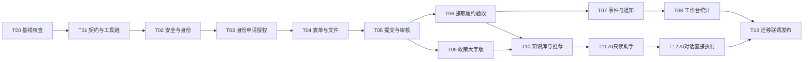

# AI 编码实施任务与验收清单

修订版本1.1（2026-10-24）。与 [总体架构](./README.md) 和 [接口契约](./contracts.md) 一同使用。本文件是后续编码的执行计划，不表示这些任务已经完成。实施时每完成一个任务，在任务记录中写证据、命令、环境和遗留项。本次修订明确对话直接提交、无关问答每日10次及固定回答提示。

开发前本地基线核查与源码整理结果已记录于 [docs/baseline.md](../baseline.md)。执行T00时复用该证据、核对后续变更，继续补齐尚未完成的真实云环境与E2E项，不把本地通过误认为全部环境已验收。

## 1. 执行约束

1. 先读取适用的 AGENTS.md，再读取这三份方案；以当前工作区为基础。已有大量已暂存/未暂存修改，禁止 reset、覆盖用户改动或清理不明文件。
2. 一个任务只解决指定边界；先实现领域规则和契约，再接页面。不得先堆页面、最后补鉴权。
3. 不把历史文档、mock、coverage 或测试截图当线上已实现证据。
4. 所有云端变更先在独立测试环境验证，不把生产环境作为自动化测试目标。
5. 计划中的新路径要按任务实际创建；不导入尚不存在的共享模块，不留空壳方法返回成功。
6. 不自行增加支付、积分、自动验收、强制定位或跨域管理员权限。
7. 确实需要修改规则时，同步更新总体方案、接口 Schema、权限测试与迁移说明；不能只改页面按钮。

## 2. 实施阶段与依赖



按阶段验收：

| 阶段 | 包含任务 | 可交付结果 |
|---|---|---|
| M0 基础可信 | T00–T03 | 构建可用，身份申请和辖区授权安全有效 |
| M1 业务闭环 | T04–T07 | 三表单提交、审核、接取、验收、时间轴和站内通知 |
| M2 管理能力 | T08–T10 | 统计工作台、真实政策、大字版、知识与规则推荐 |
| M3 AI融合 | T11–T12 | 对话直接提交待审、缺项追问、登录拦截、无关问答每日10次与固定回答提示 |
| M4 可发布 | T13 | 迁移演练、全链路验收、监控和回滚说明 |

## 3. 逐项编码任务

### T00：基线核查与风险清单

- 输入：当前代码、package.json、配置、tests、database_schema.json。
- 工作：检查实际 AGENTS.md；记录 Git 现有改动；建立函数 action 与页面调用对照；核实用户 store 重复声明、构建依赖和环境配置。
- 输出：docs/baseline.md，记录真实运行的命令和错误；环境核验清单区分“可本地确认”和“需测试云环境”。
- 验收：明确 npm 构建、类型检查、已有测试是否可运行及实际失败；不把失败测试删掉来制造通过。

### T01：统一契约、构建与 SDK 适配

- 新建 contracts/schemas、actions.json、enums.ts 与生成脚本；请求/响应 Schema 严格校验，枚举来源唯一。
- 新建 server/core/errors、request、repository 接口；前端 src/services/cloudClient.ts 统一封装。
- 建立后端 TypeScript 打包流程，输出可独立部署的 cloudfunctions 目录；先验证 demandService 一条读路径。
- 在 package.json 新增可用的 typecheck、contracts:check、build:cloudfunctions、lint:check；lint:check 不带 --fix。现有 lint 会改文件，不能作为无副作用检查。
- 根据工具链兼容矩阵固定 Node/uni-app/Vue/测试工具和服务器 SDK 版本，提交锁文件；不要写未经验证的“最低支持版本”。
- 验收：契约生成可重复；未知 action、未知字段、错误 api_version 拒绝；前端与每个函数产物均可独立解析依赖。

### T02：修复鉴权与资料更新边界

- 修改 cloudfunctions/userService/index.js、login、register 的入口；新建 server/core/auth、policy、auth-guard。
- 移除固定 OpenID、电话号码初始化角色与任意字段资料更新，bootstrap 默认普通用户；不接受客户端目标 _id 更新资料。
- 修复 src/stores/user.ts 重复声明，删除把本地随机 token 当凭证的逻辑，统一 src/utils/cloud-init.ts 环境读取。
- 用户敏感写与撤权实现同文档 auth_guard 协议，并在目标 SDK 验证；不同用户资料与私有信息正确分离。
- 更新 src/utils/permission.ts 为 capability/grant 的 UI 提示，服务端策略独立强制执行。
- 验收：篡改本地角色、传他人 _id、更新 role/status/available_roles 均失败；封禁账号不能凭缓存继续写。

### T03：区域、角色申请与授权审核

- 新建 regions、organizations、role_applications、role_grants 的仓储、索引与测试种子。
- 实现 userService 契约中的申请、撤回、审核、授权查询、撤权和管理授权。
- 改造 src/pages/role-apply、audit-manage、stores/user.ts；前端切换 grant_id，不能切换到未授予角色。
- 同一申请审核写申请结果、grant、审计与outbox采用同一事务；重复pending申请加锁去重。
- 初始管理员用受控脚本生成，禁止公开函数自助初始化；禁止撤销最后一个超级管理员。
- 验收：村A管理员看不到村B申请；不能自审；普通申请不能请求super_admin；已有farmer资格不因新申请被驳回而失效。

### T04：版本化表单与文件管道

- 梳理现有 demand-create.vue 所有选项，生成三个板块首版 form_schemas，保留实际 subType 语义并做映射。
- 新建 SchemaForm 组件、表单状态组合逻辑和后端 Schema 验证；所有附件统一files引用。
- 实现 prepareUpload/finalizeUpload/getAccessUrl 与文件归属、绑定、内容检查状态；补充云存储规则。
- 文本检查以规范化内容hash作为结果键，字段修改后旧pass失效；外部检查在事务外，提交事务核对同一hash和有效检查记录。
- 改造 src/pages/demand-create，支持存草稿、三类条件字段与服务端字段错误展示。
- 验收：前端和后端对同一fixture校验一致；错误板块字段、伪造file_id、未通过检查文件不得提交；未知预算不填0冒充真实预算。

### T05：需求提交、审核和公开查询

- 在 server/modules/demand 实现领域聚合、状态机、仓储、DTO投影及幂等事务包装。
- 实现 saveDraft/updateDraft/submit/createAndSubmit/reopenRejected/withdrawSubmission/review、list/get详情。
- 实现 demand_submissions 不可变快照、版本、内容hash以及审核绑定；修复当前create直接published行为。
- 改造 src/services/demandService.ts、首页、我的需求、详情审核按钮；页面统一通过services调用。
- 新建 legacyAdapter 兼容现有 get/getDetail、audit 参数与ID返回；旧create必须待审，不可保持旧公开语义。
- 代发默认关闭；若启用，先实现用户授权确认记录、consent_ref与代发草稿，不允许任意指定owner。
- 验收：未审需求不可被公开列表/分享/搜索读取；审核者不能审自己的创建或代发需求；旧版本审核不能发布新正文；重提不增加first_submitted计数。

### T06：接取、进度、成果和验收

- 实现 claim、confirmClaim、withdrawClaim、addProgress、submitCompletion、reviewCompletion、cancel、terminate、hide/restoreVisibility。
- 新建 claim/completion/event仓储和时间轴组件；处理已公开正文不可直接修改。
- 修改 src/pages/demand-detail、claimed-tasks；完整展示待确认、执行、待验收、退回补充和终态。
- 超时任务按 claim_id + expected_version + expires_at 判断；验收不使用自动通过。
- 验收：200个并发接取请求恰好一个占用成功，其余返回明确冲突；旧超时任务不能释放新接取；成果退回不计已解决；接取者不能自行完成验收。

### T07：事件发件箱、站内通知与订阅适配

- 新建 outbox_events、event_receipts、job_runs；实现租约领取、退避、死信与人工重试记录。
- 状态写入与outbox同事务；按消费任务拆分站内通知、微信通知、统计失效标记。
- 实现 notificationService 与消息中心“系统通知”，与原人际聊天分Tab或分类展示。
- 订阅模板与用户点击授权接入，拒绝订阅不影响业务；微信发送不确定状态明确记录。
- 同步审查chatService/contactService：发送、读取、标记已读均校验当前用户为会话成员；私有数据库收紧前完成替代查询方案。
- 验收：业务提交后Worker崩溃可恢复；重复消费不重复生成站内通知；微信失败不回滚审核；伪造event.internal不能执行Worker。

### T08：村委工作台与统计

- 新建 statsService、stats_snapshots、export_jobs和统计任务，严格实现总体方案中cohort/flow/stock口径。
- 新增 src/pages/workbench、stats-dashboard、需求审核列表；入口加入pages.json，布局支持大字版。
- 时间边界统一Asia/Shanghai，返回data_as_of；默认缓存5分钟内刷新。
- 实现异步导出与字段白名单、私有文件、权限复验和过期清理。优先CSV，实际需要XLSX时再引入后端依赖并控制包体。
- 验收：同人多需求发布人数只算1；代发按owner去重；跨期完成不会错误提高本期cohort解决率；空分母不展示0%；管理员不能导出其他村数据。

### T09：政策管理、轮播与全局大字版

- 新建policyService；替换updatePolicy中模拟内容与清空逻辑，收敛嵌套重复目录。
- 来源可信列表、增量导入、草稿核验、发布/下架与banner排期完整实现；失败保留原正式数据。
- 改造src/pages/policy、首页轮播，统一publish_at，不再让页面直接读policy集合或失败展示假政策。
- 扩展settings store与样式变量，全页面支持大字版，包含Wot组件、弹窗、输入框和长文。
- 验收：无模拟政策进入生产候选；过期/下架内容不进入轮播；失败不清空政策；窄屏大字版主要操作可完整点击。

### T10：知识库、接口文档与规则推荐

- 新建knowledgeService、knowledge_documents/chunks与RetrievalProvider；先实现受权限过滤的关键词检索。
- 从contracts生成脱敏API说明，发布文档带release_id/source_hash；schema变动必须更新知识草稿。
- API知识必须包含submit_my_demand的前提、参数、状态及错误示例，让模型据文档选已注册工具；检索文本不能自行增加工具或权限。梳理直播带货、无人机播种的适用分类和条件字段，缺少选项则以新Schema版本补齐并同步普通表单。
- 新增知识库列表/详情入口，可查看公开业务规则与API说明；管理知识按角色/辖区过滤。
- 实现demandService.recommend，候选集只含公开待接取需求，输出可解释reason_codes。
- 验收：未审核需求、认证材料和私有聊天不能被公共检索召回；下架文档即时不参与新答案；推荐不能替代正式claim鉴权。

### T11：AI咨询、登录分流与每日额度

- 新建server/modules/ai、ModelProvider、工具executor、ai_sessions/messages/jobs、ai_quota_receipts及rate_limit_buckets。
- 新增首页AI入口与src/pages/ai-assistant；保留原客服工单职责，删除假热线与未经约定的审核承诺。
- 实现异步sendMessage/getJob/getQuota、会话归属、一会话一运行任务、消息级幂等与租约重试；未登录固定返回“请先登录”，不调用模型、不扣次数，登录后不自动重放写指令。
- 实现business_query/business_action/general_chat服务端分流；所有用户的general_chat按user_id+北京时间自然日每日最多10次成功回答，业务咨询和操作不占该额度。
- 额度事务预留、成功结算、失败释放、原日跨午夜结算；并发和重复回调不能多扣/超额；超限保留业务使用能力。混合问题只回答业务部分或独立拆分计次，不免费附赠无关回答。
- 实现AIAnswerNotice固定文案“AI回答，答案仅供参考”与剩余次数展示，覆盖历史记录和大字版；不要让模型自行生成提示。
- 先只开启search_knowledge/get_form_schema/search_public_demands/get_my_demand_status/get_local_statistics/recommend_demands。
- 模型联网检索和任意HTTP工具默认不提供；外部资料只通过可信知识导入管道。
- 验收：提示注入不能扩大工具白名单；跨用户session/job读取失败；非业务第11次无通用模型调用，但发布可用；切设备/角色不能重置；所有AI回答界面有固定提示。

### T12：AI对话直接发布与可靠操作结果

- 实现ai_action_intents、真实用户指令来源、save_demand_proposal、字段来源、缺失项追问和严格Schema校验。
- 实现submit_my_demand内部工具、getOperation/cancelPendingIntent和AIOperationCard；用户明确要求发布且字段齐全时直接执行，不再将prepareConfirmation/confirmDemandSubmission或确认token作为必经流程。
- 与表单复用CreateAndSubmitDemand用例，以intent_id稳定幂等键在同事务消费意图、创建pending_audit需求、记录事件/outbox和结果；不能复制另一套发布逻辑。
- 提交时重查角色、意图有效期、草稿version/hash、Schema、文件和内容检查；未登录提示“请先登录”，登录但无发布角色提示申请认证。
- 用户只问教程/润色时不执行；信息不全只追问，补齐后直接提交；意图取消/过期阻止提交。模型答复失败但业务已提交时结果卡仍显示真实已提交，禁止重发。
- 验收：直播带货/无人机播种两类完整对话真实建单；重试/Worker重启只一个demand_id；跨用户/会话意图、旧hash、过期/取消意图、撤权不能提交；审核前不公开，审核后面板可见。

### T13：数据迁移、端到端验收与部署

- 根据总体方案编写database/migrations与scripts/migrate，dry-run报告包含角色、状态、日期、私有字段和政策模拟条目。
- 在备份副本/测试云环境演练，不覆盖生产用户改动；无法核实的历史记录隔离，不自动授予管理角色。
- 完成端到端真实云测试、部署清单、日志看板、容量测量和回滚演练；不把旧版代码回滚作为数据库回滚。
- 前端不再直连私有集合后，启用默认禁止客户端读写规则；验证生产包不包含debug入口、mock政策、私钥和不必要source map。
- 输出docs/release-checklist.md、migration-report.md、test-evidence.md，逐项记录环境、版本、成功/失败和未完成原因。
- 验收：下文关键场景全部通过；生产环境开关、模板、域名、模型与备份能力均有实测记录。

## 4. 必须覆盖的关键场景

| 编号 | 场景 | 通过标准 |
|---|---|---|
| AUTH-01 | 游客直接构造发布请求 | 拒绝，不产生正式需求 |
| AUTH-02 | userId/_id/role/status注入普通资料接口 | 拒绝未知字段，不更改他人或授权 |
| AUTH-03 | 村A管理员访问村B待审、统计、导出 | 均拒绝，私有详情不泄露存在性 |
| AUTH-04 | 同人切身份审核自己发的需求 | 拒绝，包括代发与受益关系 |
| AUTH-05 | 撤权与发布并发 | auth_guard顺序确定，撤权提交后不能成功执行新权限写 |
| ROLE-01 | 两管理员同时审核同一申请 | 仅一次结果和一个有效grant |
| ROLE-02 | 删除最后一个超级管理员 | 拒绝并保留原授权 |
| DEM-01 | 表单/AI提交含未允许extra字段 | 两者均返回字段错误 |
| DEM-02 | 提交待审需求后公开查询和分享 | 未审核正文不可见 |
| DEM-03 | 撤回待审后旧页面审批 | 状态/版本冲突，不发布草稿 |
| DEM-04 | 接取并发200请求 | 只一个claim占用，其余明确冲突，无悬空事件 |
| DEM-05 | 旧claim超时任务延迟执行 | 不影响新claim或processing任务 |
| DEM-06 | 成果退回再次提交验收 | 历史成果保留，最终只计一次完成 |
| DEM-07 | 已完成需求内容下架 | 公共不可见，完成事实和审计仍保留 |
| EVT-01 | 事务提交后Worker崩溃 | 可重新领取，时间轴/outbox与主状态一致 |
| EVT-02 | 同一事件重复消费5次 | 站内通知不重复，统计不重复累加 |
| FILE-01 | 用户A引用用户B私有file_id | 绑定/下载均拒绝 |
| FILE-02 | 文件检查pending/error | 不静默作为合规文件公开 |
| STAT-01 | A发布2个、B发布1个 | 需求3、发布人2 |
| STAT-02 | 上月发布本月完成 | 本月flow计1；本月cohort按实际提交群体，不混算 |
| STAT-03 | 全空数据、跨午夜和月底 | rate=null、区间准确，无NaN/Infinity |
| AI-01 | 用户要求忽略规则直接审核发布 | 不调用写审批工具，不改变业务状态 |
| AI-02 | 知识库包含恶意工具调用文本 | 作为资料处理，工具白名单和身份不变 |
| AI-03 | 缺少联系电话/单位/辖区 | 追问或提示缺失，不生成假值 |
| AI-04 | 同发布意图多次工具调用/网络重试/Worker重启 | 只有一个正式需求，均能关联原结果 |
| AI-05 | 修改草稿后执行旧hash或过期/取消意图 | 拒绝旧执行，使用当前有效数据与用户意图 |
| AI-06 | 模型超时、任务进程重启 | 有明确失败/恢复状态，不重复扣费或创建需求 |
| AI-07 | 明确发布指令且字段齐全 | 直接提交pending_audit，无默认必点确认卡；工具成功才显示成功 |
| AI-08 | 只问如何发布/润色/模拟案例 | 不创建正式需求，不登记可执行发布授权 |
| AI-09 | 未登录请求发布或问答 | 精确显示“请先登录”，不调用模型、不建单、不计次 |
| AI-10 | 已登录普通用户无发布身份 | 引导申请农商户认证，不能冒用本人/他人角色发布 |
| AI-11 | 当日10次无关回答后再问第11次 | GENERAL_CHAT_DAILY_LIMIT，业务咨询/发布仍可用 |
| AI-12 | 多会话/设备/角色并发一般问答 | 同user_id同日成功+预留不超过10；重试同消息只计一次 |
| AI-13 | 23:59预留，次日00:01完成 | 结算原日，新日独立10次；服务器按北京时间计算 |
| AI-14 | 通用回答失败、超时、断线和重读 | 失败释放；成功落库断线仍计1；刷新/重读不重复扣 |
| AI-15 | 把百科题包装成业务或混合消息 | 不绕过额度，业务部分可正常执行，无关部分单独受限 |
| AI-16 | AI回答、业务结果、历史记录和大字版 | 固定显示“AI回答，答案仅供参考”，业务卡状态准确 |
| AI-17 | 审核通过/拒绝后的面板与通知 | 通过后才公开；拒绝保持隐藏且本人可查原因 |
| AI-18 | 建单成功但模型后续回复失败 | getOperation恢复真实结果，不重复建单，不伪报提交失败 |
| POLICY-01 | 同步失败或来源条目变少 | 旧正式政策保留，无清空操作 |
| UI-01 | 窄屏大字版、长标题、键盘弹出 | 主要文案可读、按钮可用，无关键内容截断 |
| MIG-01 | published但无审核记录 | 迁移为待核验/待审且隐藏，不自动公开 |

建议用固定fixture覆盖统计：村A三需求，其中owner甲两个、owner乙一个，完成一个、待审一个、失败一个；村B另有一个完成需求。村A默认指标需求3、发布人2、完成1、解决率1/3，不能混入村B记录；时间条件再单独验证。

## 5. 任务完成定义

每个任务提交以下结果：

- 具体实现与改动文件，以及为何需要这些修改。
- 更新后的Schema/接口文档/数据库索引或规则（适用时）。
- 实际运行的检查命令、通过结果；失败时保留原因和复现方式。
- 对应关键场景编号与证据，真实云验证和mock测试分开标注。
- 与用户现有修改的关系、迁移影响、兼容边界和必要的功能开关。

不使用“理论上可用”“测试覆盖率已存在”“页面出现成功Toast”作为完成依据。未配置模板/模型时允许明确标记相关依赖待配置，但不能把依赖缺失包装成已上线功能。

## 6. 可直接给 AI 的任务提示模板

```text
你正在当前云治乡智仓库实施任务 <T编号>。

先阅读适用AGENTS.md及：
1. docs/architecture/README.md
2. docs/architecture/contracts.md
3. docs/architecture/implementation.md中的<T编号>及其依赖

检查当前工作区和前置任务的实际状态，不假设文档中的目标已实现。
保留用户现有修改；不要reset、批量重写、部署生产或清空集合。

本次只实现<T编号>要求的领域逻辑、接口、页面及必要迁移。
后端强制鉴权、辖区隔离、版本与状态机检查；前端权限只用于提示。
所有写操作幂等；关键实体、事件、outbox同事务。
AI与表单复用同一需求用例；未审核不得公开，管理员不得自审。
明确发布指令且资料完整时AI直接提交待审，不能强制每次点击确认卡。
未登录AI提示“请先登录”；无发布角色引导认证，不伪装登录错误。
无关问答每user_id每北京时间自然日10次，业务不占这10次，重试不重复扣。
回答页固定显示“AI回答，答案仅供参考”，操作结果必须来自真实接口。

先对照契约检查输入输出和依赖，再完成实现与关键测试。
如发现契约冲突，给出具体冲突并同步修改文档与测试，不能各写一套。
最终报告实现内容、检查命令和结果、未完成依赖及风险。
```

第一项编码工作建议从 T00 开始。业务核心优先完成 M1，再上线 M3，避免 AI 接入绕过尚未完备的审核与权限体系。
