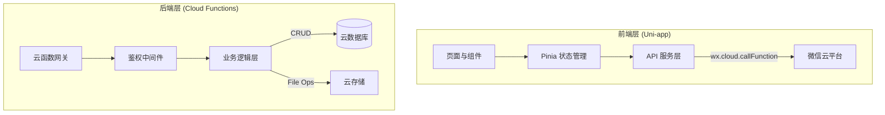

# 云治乡智 (Yun Zhi Xiang Zhi) - 全栈技术规格说明书

> **文档版本**: 1.0.0
> **最后更新**: 2026-02-18
> **适用对象**: AI 开发者 / 全栈工程师
> **文档目标**: 提供构建“云治乡智”微信小程序所需的全部技术细节、架构规范与实现路径，支持 AI 独立完成项目开发。

---

## 1. 项目概述与技术架构 (Project Overview & Architecture)

### 1.1 业务定位
“云治乡智”是一个连接**乡村需求**与**高校/社会资源**的数字化协作平台。
- **核心价值**: 解决乡村发展中的人才短缺、技术壁垒与信息不对称问题。
- **目标用户**:
  - **需求方 (农户/村集体)**: 发布劳务、技术、设计、电商等帮扶需求。
  - **管理方 (地方团委/学校团委)**: 负责需求审核、资源匹配与监督。
  - **服务方 (高校学生/科研团队)**: 认领需求，提供智力与实践服务。
  - **大众用户**: 浏览乡村风貌，参与互动。

### 1.2 技术栈选型 (Tech Stack)

#### 前端 (Mini Program)
- **核心框架**: [Uni-app](https://uniapp.dcloud.net.cn/) (Vue 3 + TypeScript)
- **构建工具**: Vite 4+
- **UI 组件库**: [Wot Design Uni](https://wot-design-uni.netlify.app/) (基于 Vue3 的现代化组件库)
- **状态管理**: [Pinia](https://pinia.vuejs.org/) (轻量级、类型安全)
- **CSS 预处理**: SCSS / Sass
- **运行环境**: 微信小程序 (MP-Weixin)

#### 后端 (Serverless)
- **云服务**: [微信小程序云开发 (WeChat Cloud Development)](https://developers.weixin.qq.com/miniprogram/dev/wxcloud/basis/getting-started.html)
- **计算服务**: Cloud Functions (Node.js 16+)
- **数据库**: Cloud Database (MongoDB-like JSON Document Store)
- **存储**: Cloud Storage (文件/图片存储)

### 1.3 系统架构设计

采用 **前后端分离** + **Serverless** 架构：



---

## 2. 代码规范与工程化标准 (Engineering Standards)

### 2.1 命名规范
- **目录**: `kebab-case` (e.g., `pages/demand-create/`)
- **文件**: `kebab-case` (e.g., `user-profile.vue`, `api-client.ts`)
- **组件**: `PascalCase` (e.g., `DemandCard.vue`, `WdButton.vue`)
- **变量/函数**: `camelCase` (e.g., `getUserInfo`, `demandList`)
- **常量**: `UPPER_SNAKE_CASE` (e.g., `MAX_RETRY_COUNT`, `DEFAULT_AVATAR`)
- **云函数**: `camelCase` (e.g., `demandService`, `userAuth`)

### 2.2 代码格式规范
- **缩进**: 2 spaces
- **分号**: Always
- **单引号**: Preferred
- **TypeScript**: 强制类型定义，避免 `any`。
- **错误处理**: 所有异步操作必须包裹在 `try-catch` 中，并在 `catch` 块中统一处理错误提示。

### 2.3 Git 工作流
- **分支模型**:
  - `main`: 生产环境稳定分支
  - `dev`: 开发分支
  - `feat/xxx`: 功能分支
  - `fix/xxx`: 修复分支
- **Commit Message**: 遵循 Conventional Commits (`feat: add login`, `fix: resolve auth error`)

### 2.4 测试规范
- **单元测试**: 核心工具函数 (`src/utils`) 需有 Jest 测试覆盖。
- **集成测试**: 关键业务流程（登录、发布需求）需编写测试脚本（如 `src/pages/debug/test-runner.vue`）。

---

## 3. 核心业务逻辑详细设计 (Core Business Logic)

### 3.1 用户系统 (User System)
- **身份体系**:
  - `farmer` (农户): 发布需求，查看进度。
  - `local_admin` (地方团委): 审核需求，管理辖区。
  - `school_admin` (学校团委/师生): 认领需求，分配/执行任务。
  - `general_user` (普通用户): 浏览，点赞。初始注册默认为此角色。
- **鉴权与角色申请流程**:
  1. `wx.login()` 获取 `code`，换取 `openid`。
  2. 若为 `general_user`，在“我的”页面可申请角色升级：
     - **申请农户**: 提交身份证、土地/营业证明 -> 进入 `pending` 状态 -> 团委审核。
     - **申请师生**: 提交学生证/教师证 -> 进入 `pending` 状态 -> 学校管理员审核。
  3. **权限拦截**: 普通用户尝试发布需求或认领任务时，前端拦截并提示“无操作权限，请前往个人中心进行身份认证”。

### 3.2 数据流转 (Data Flow)
- **采集**: 表单输入 (Vant/Wot 组件) -> 校验 (VeeValidate/Zod) -> 提交。
- **传输**: `wx.cloud.callFunction` (HTTPS 加密通道)。
- **存储**: 云数据库 JSON 文档。
- **展示**: Vue 响应式数据绑定 -> 列表渲染 (`v-for`) -> 状态映射。

### 3.3 业务规则引擎
- **权限控制 (RBAC)**:
  - **发布需求**: 仅限 `farmer` 角色。`general_user` 操作触发权限弹窗。
  - **认领任务**: 仅限 `school_admin` 或 `student` 角色。
  - **审核权限**: 仅限 `local_admin`。
- **需求状态机**:
  `Draft` (草稿) -> `Pending` (待审核) -> `Open` (招募中) -> `Matched` (对接中) -> `Completed` (已完成) -> `Archived` (归档)
- **审核规则**: 敏感词过滤 (微信文本安全接口) + 人工审核。

---

## 4. 功能模块深度解析 (Module Deep Dive)

### 4.0 "首页" 模块 (Home Page)
- **智能轮播图 (Smart Carousel)**:
  - **视觉设计**: 采用新颖、高视觉冲击力的设计，支持全屏或卡片式布局。
  - **交互功能**: 支持自动播放、手势滑动切换、动态指示器。
  - **动效与性能**: 实现平滑过渡动画（淡入淡出/滑动），内置图片懒加载机制。
  - **配置化**: 支持通过后台动态配置轮播内容、跳转链接及播放参数。
- **适老化 "大字版" (Big Font Mode)**:
  - **入口**: 首页顶部显著位置设置 "大字版/标准版" 切换按钮。
  - **功能**: 点击一键切换全局字体大小（放大 1.5-2 倍），适配老年用户阅读习惯。
  - **体验保障**:
    - **布局适配**: 确保字体放大后页面布局不崩坏，交互元素（按钮、卡片）同步等比放大。
    - **持久化**: 自动保存用户偏好至本地存储 (`uni.setStorage`)，下次打开自动应用。
    - **无障碍**: 按钮设计高对比度，确保在任何模式下均易于点击。

### 4.1 "我的" 个人中心 (User Center)
- **用户信息**: 展示头像、昵称、角色徽章。支持编辑资料。
- **角色/身份认证**:
  - 提供入口供普通用户申请成为“农户”或“高校师生”。
  - 展示当前申请状态 (审核中/已驳回/已通过)。
- **数据统计与可视化 (Data Visualization)**:
  - **农户端**: 简洁展示“已发布”、“解决中”、“已完成”的数量。
  - **团委/师生端 (重点增强)**: 
    - 引入 ECharts/UCharts 组件库。
    - **可视化报表**: 
      - 任务完成率趋势 (折线图/曲线图)。
      - 服务类型分布 (饼图/环形图)。
      - 帮扶区域热力图 (地图组件)。
    - 界面要求: 卡片式布局，色彩清新现代，提升专业感与美观度。
- **设置**: 清除缓存、关于我们、退出登录。

### 4.2 "聊天" 模块 (IM System)
- **架构**: 基于云开发数据库监听 (`db.collection('messages').watch`) 实现实时通信。
- **消息类型**:
  - `text`: 文本消息
  - `image`: 图片 (fileID)
  - `system`: 系统通知 (如“需求已被认领”)
- **存储结构**:
  - `conversations`: 会话列表 (members: [uid1, uid2], lastMessage, updateTime)
  - `messages`: 消息记录 (conversationId, senderId, type, content, createTime)

### 4.3 "客服" 模块 (Customer Service)
- **智能客服**: 集成微信对话开放平台 (WeChat OpenAI) 或基于关键词的自动回复。
- **人工接入**: 利用微信小程序自带的 `<button open-type="contact">` 接入微信客服系统。
- **工单系统**: 复杂问题提交工单表单，存入 `tickets` 集合，后台管理员处理。

---

### 4.4 "发布需求" 模块 (Demand Publishing)

#### 4.4.1 子模块与问卷设计
1.  **企需通 (Enterprise Connect)**
    - **场景定义**: 聚焦生产技术改进与人才引进（类似招聘）。
    - **问卷字段**:
      - 基础场景 (单选): 生产技术 / 人才引进。
      - **扩展字段**:
        - 期望合作周期 (单选: 1个月内/1-3个月/长期)。
        - 预算区间 (单选: <1万/1-5万/5万+)。
        - 企业规模 (单选: 初创/中小/大型)。
        - 紧急程度 (级联: 普通/紧急/特急)。
        - 附件上传 (文件: 支持 PDF/Docx, max 10MB)。
2.  **农践帮 (Agri-Help)**
    - **场景定义**: 聚焦农产品采摘、打包及电商直播销售。
    - **问卷字段**:
      - 基础场景 (单选): 采摘打包 / 销售(电商)。
      - **分支逻辑**: 若选“销售(电商)”，级联显示 -> [校内直播基地 / 果园(当地)直播]。
      - **扩展字段**:
        - 农产品种类 (多选: 水果/蔬菜/粮油/其他)。
        - 预计产量 (数字输入: 单位kg)。
        - 物流支持需求 (单选: 自理/需协助/全包)。
        - 帮扶时间段 (多选: 周末/寒暑假/工作日)。
        - 现场照片 (图片上传: max 9张)。
3.  **科研实践厅 (Research Lab)**
    - **场景定义**: 聚焦农业种植、机械硬件及智能软件技术难题。
    - **问卷字段**:
      - 基础场景 (单选): 种植技术(农业) / 机械技术(硬) / 智能技术(软)。
      - **扩展字段**:
        - 项目阶段 (单选: 需求调研/研发攻关/成果转化)。
        - 拟合作高校 (联想输入: 支持模糊搜索)。
        - 经费支持 (单选: 无/自筹/申请补贴)。
        - 实验场地条件 (多选: 实验室/试验田/工厂车间)。
        - 技术文档 (文件上传: 需求书/图纸)。

#### 4.4.2 通用逻辑与规范
- **文字描述字段 (选填)**:
  - **规则**: 仅允许数字、字母、中英文常用标点及空格。
  - **校验**: 前端实时过滤非法字符；后端正则校验 `^[A-Za-z0-9\u4e00-\u9fa5，。！？：；“”‘’（）【】、\s]{0,200}$`。
  - **长度**: ≤ 200 字符。
- **校验机制**:
  - 前端: 提交前校验完整性、文件格式/大小、级联逻辑一致性。
  - 后端: 二次校验数据有效性，失败返回标准化错误码 (e.g., `ERR_INVALID_PARAM`)。

#### 4.4.3 高并发与安全架构
- **性能指标**: 支持 ≥ 200 并发用户，TPS ≥ 200，平均响应 ≤ 500ms，P99 ≤ 1.5s。
- **防重机制**: 采用 Redis Redlock 分布式锁 + 数据库唯一索引 (防止重复提交)。
- **幂等性**: 提交接口强制校验 Token (一次性，有效期 30s)。
- **权限矩阵 (RBAC)**:
  - 普通用户: 仅提交/查看 **本人** 需求。
  - 区县管理员: 查看 **本区县** 全部需求。
  - 省级管理员: 查看 **全省** 全部需求。

#### 4.4.4 交付与测试要求
- **交付物**: 源代码 (前端组件/后端API/DDL/Redis脚本)、压测报告、接口文档 (OpenAPI 3.0)、部署手册 (含灰度/回滚)。
- **测试标准**:
  - 单元测试覆盖率 ≥ 80%。
  - 集成测试用例 ≥ 30 条 (覆盖并发、权限、非法字符、边界长度、重复提交)。
  - **压测场景**: JMeter 200 线程, Ramp-up 10s, 持续 5min, 错误率 < 0.1%, 资源占用 < 70%。

---

## 5. 数据模型与 API 设计 (Data Model & API)

### 5.1 数据库 Schema (Cloud Database)

#### `users` 集合
```json
{
  "_id": "openid",
  "name": "张三",
  "phone": "13800138000",
  "role": "farmer", // farmer, local_admin, school_admin, user
  "status": "active", // pending, active, rejected, banned
  "created_at": 1678888888000
}
```

#### `demands` 集合
```json
{
  "_id": "uuid",
  "creator_id": "openid_of_farmer",
  "title": "果园除虫技术指导",
  "content": "需要农业专家指导...",
  "category": "technology", // technology, labor, design, e-commerce
  "status": "pending", // pending, open, matched, completed
  "location": { "latitude": 30.1, "longitude": 120.1, "address": "xx村" },
  "images": ["cloud://.../1.jpg"],
  "audit_info": { "auditor_id": "...", "reason": "...", "time": ... },
  "match_info": { "school_id": "...", "team_name": "...", "time": ... },
  "created_at": 1678888888000,
  "updated_at": 1678888888000
}
```

### 5.2 API 接口规范 (Cloud Functions)

采用 **Action-based** 模式，减少云函数数量，便于冷启动优化。

**云函数: `demandService`**
- **Request**:
  ```json
  {
    "action": "create" | "list" | "getDetail" | "updateStatus",
    "data": { ... }
  }
  ```
- **Response**:
  ```json
  {
    "code": 0, // 0: Success, >0: Error
    "msg": "success",
    "data": { ... }
  }
  ```

---

## 6. 部署与运维规范 (Deployment & Ops)

### 6.1 环境配置
- **开发环境 (Dev)**: `env: test-yzxz-xxx` (对应开发者工具中的测试环境)
- **生产环境 (Prod)**: `env: prod-yzxz-xxx` (上线前切换)
- **配置管理**: 使用 `cloud.DYNAMIC_CURRENT_ENV` 在云函数中动态获取当前环境。

### 6.2 监控与日志
- **日志**: 云函数中使用 `console.log/error`，自动收集到云开发日志服务。
- **监控**: 开启云开发“高级日志服务”，设置错误告警（如 `errCode != 0` 超过阈值触发邮件报警）。

---

## 7. 性能优化与扩展性 (Performance & Scalability)

### 7.1 前端优化
- **分包加载**: 将非核心页面（如 `customer-service`, `debug`）放入 `subPackages`。
- **图片优化**: 使用 `webp` 格式，云存储图片使用 CDN 缩放参数 (`imageView2`)。
- **骨架屏**: 首页和详情页加载时展示 Skeleton，提升感官体验。

### 7.2 后端优化
- **数据库索引**: 必须为查询字段 (`_openid`, `status`, `created_at`, `category`) 建立索引。
- **读写分离**: 列表页仅读取必要字段 (`field({ content: 0 })`)，详情页读取全量。
- **冷启动**: 合并云函数，减少函数总数；使用 `cloud.getWXContext()` 复用上下文。

---

**[End of Document]**
请基于此文档进行开发。
