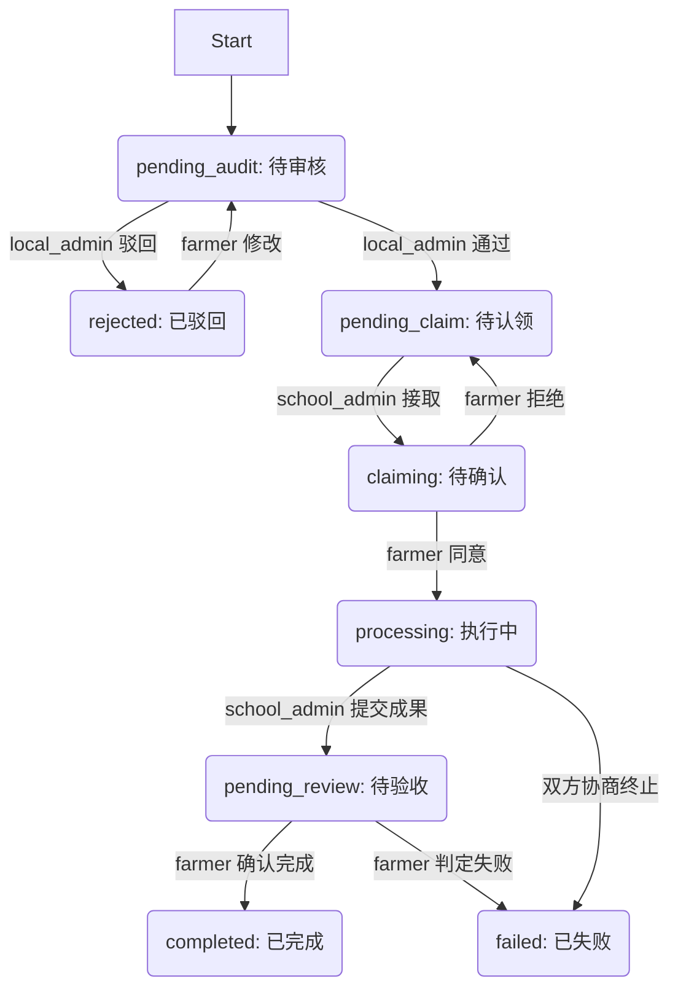

# 权限模型设计文档 (Permission Model Design)

> **文档说明**: 本文档基于 `AI_EXECUTION_REPORT.md`、`发布需求.md` 和 `我的.md`，总结了小程序全生命周期的权限模型。旨在明确各角色在业务流程中的操作边界，确保逻辑严密、无越权漏洞。

## 0. 规范代码说明 (Code Standards & Specifications)

### 0.1 技术栈与版本约束
| 技术栈 | 描述 | 版本约束 |
| :--- | :--- | :--- |
| **Language** | TypeScript | `^5.0.0` (Strict Mode) |
| **Framework** | Uni-app (Vue 3) | `^3.0.0` (Composition API) |
| **Build Tool** | Vite | `^4.0.0` |
| **UI Library** | Wot Design Uni | `^1.0.0` (Latest Stable) |
| **State Mgmt** | Pinia | `^2.1.0` |
| **Linting** | ESLint + Prettier | `airbnb-base` + `prettier` |
| **Backend** | WeChat Cloud Functions | Node.js 16+ |
| **Database** | Cloud Database | MongoDB-compatible |

### 0.2 目录与命名约定 (Naming Conventions)
*   **文件/目录**: `kebab-case`
    *   `src/pages/user-center/index.vue`
*   **Vue 组件**: `PascalCase`
    *   `export default defineComponent({ name: 'UserCard' })`
*   **变量/函数**: `camelCase`
    *   `const userInfo = ...`
*   **常量/枚举**: `UPPER_SNAKE_CASE`
    *   `const MAX_LOGIN_ATTEMPTS = 5;`
*   **类 (Class)**: `PascalCase`
    *   `class AuthService { ... }`
*   **数据库集合/字段**: `snake_case`
    *   Collection: `user_audit_logs`
    *   Field: `audit_status`, `created_at`

### 0.3 代码质量与安全 (Quality & Security)
*   **注释规范**: 所有公共方法、API 接口、核心业务逻辑及复杂算法**必须**包含清晰的注释（JSDoc格式）。
*   **异常处理**:
    *   所有 `async/await` 必须包裹在 `try-catch` 中。
    *   云函数必须返回统一结构 `{ code, msg, data }`。
*   **安全策略**:
    *   **输入校验**: 前端使用 `Zod` 或 `async-validator`，后端二次校验。
    *   **SQL 注入防护**: 严禁拼接 SQL，使用 `db.command` 操作符。
    *   **敏感数据**: 手机号、身份证号在存储和展示时必须脱敏或加密。

### 0.4 提交信息格式 (Commit Message)
遵循 [Conventional Commits](https://www.conventionalcommits.org/) 规范：
`<type>(<scope>): <subject>`
*   `feat`: 新功能
*   `fix`: 修复 Bug
*   `docs`: 文档变更
*   `style`: 代码格式调整
*   `refactor`: 代码重构
*   `test`: 测试用例
*   `chore`: 构建/工具链变更

### 0.5 测试要求 (Testing)
*   **覆盖率**: 核心业务逻辑 (Services/Utils) 单元测试覆盖率 ≥ 80%。
*   **工具**: Vitest + Vue Test Utils。
*   **CI 门禁**: 0 警告，0 严重漏洞。

## 1. 核心角色与权限定义 (RBAC Overview)

基于 **RBAC (Role-Based Access Control)** 模型，系统定义了以下核心角色及其基础职能：

| 角色代码 (`role_code`) | 角色名称 | 职能定义 | 数据权限范围 |
| :--- | :--- | :--- | :--- |
| **`farmer`** | 农户 (需求方) | **发布需求**、验收服务、评价。 | 仅读写自己创建的数据 (`_openid` 匹配)。 |
| **`local_admin`** | 村委/地方团委 (管理者) | **审核需求**、监管流程、仲裁纠纷。 | 可读写辖区内所有数据；拥有最高管理权。 |
| **`school_admin`** | 学校师生/团委 (服务方) | **接取任务**、执行服务、提交成果。 | 可读“待认领”的公开需求；读写自己认领的任务。 |
| **`general_user`** | 普通用户 (访客) | 浏览公开资讯、发起角色认证申请。 | 仅只读公开资讯；无业务操作权限。 |

---

## 2. 全流程权限模型 (Lifecycle Permission Model)

业务全生命周期分为五个关键阶段：**发布 -> 审核 -> 接取 -> 确认(握手) -> 结算**。

### 2.1 阶段一：发布需求 (Demand Creation)
*   **业务描述**: 用户填写需求详情（个人信息、地点、类型）并提交。
*   **前置条件**: 用户必须完成实名认证或角色认证。
*   **权限校验**:
    *   **允许角色**: `farmer` (农户), `local_admin` (代发).
    *   **禁止角色**: `general_user` (需提示去认证), `school_admin` (需切换角色).
*   **数据变更**:
    *   创建一条新记录，初始状态为 `pending_audit` (待审核)。
    *   记录 `creator_id`, `created_at`, `region` 等字段。
*   **逻辑漏洞防护**:
    *   **防篡改**: 服务端校验 `userInfo.role`，禁止前端伪造请求。
    *   **必填校验**: 严格校验联系人、电话、省市区是否完整，否则后端拒绝。

### 2.1.1 高并发发布检查机制 (High Concurrency Check)
针对“200个用户同时发布需求”的高并发场景，需引入以下代码逻辑检查机制以防止系统崩溃或数据错误：
1.  **并发压力测试 (Stress Testing)**:
    *   **场景模拟**: 使用脚本模拟 200 QPS (Queries Per Second) 的并发写入请求。
    *   **监测指标**: 数据库 CPU 利用率、云函数实例扩容速度、写入延迟、丢包率。
    *   **漏洞排查**:
        *   **数据库限流**: 检查是否触发云数据库的 QPS 限制（如超出限制需排队或降级）。
        *   **重复提交**: 检查网络波动下客户端重试导致的重复记录。
2.  **防护策略 (Mitigation)**:
    *   **幂等性设计**: 客户端生成唯一 `request_id`，服务端在 5 分钟内缓存该 ID，重复请求直接返回成功但不处理。
    *   **削峰填谷**: 引入消息队列 (Message Queue)，当瞬时流量超过阈值时，将写请求写入队列异步处理。
    *   **分布式锁**: 对于涉及库存或额度的操作，必须使用 Redis 分布式锁或数据库乐观锁 (Optimistic Locking)。
  

### 2.2 阶段二：审核通过/不通过 (Audit)
*   **业务描述**: 管理员对新发布的需求进行合规性检查。
*   **权限校验**:
    *   **允许角色**: `local_admin` (村委/地方团委).
    *   **范围限制**: 当前审核全平台的需求后续再只能审核本辖区（或全平台，视配置）的需求。
*   **操作分支**:
    *   **审核通过 (Pass)**:
        *   动作: 更新状态 `pending_audit` -> `pending_claim` (待认领/公海池)。
        *   触发: 需求正式进入公共列表，对 所有角色 可见。
    *   **审核不通过 (Reject)**:
        *   动作: 更新状态 `pending_audit` -> `rejected` (已驳回)。
        *   要求: 必须填写 `reject_reason` (驳回原因)。
        *   后续: 允许 `farmer` 或 ‘local_admin’ 修改后重新提交（状态重置为 `pending_audit`）。
*   **逻辑漏洞防护**:
    *   **自审风险**: 若管理员自己发布需求，禁止自己审核，需由上级或互审，或代码强制 `creator_id !== auditor_id` && 发布者角色 != 审核者角色 ， 这个判断条件下允许拥有多个角色的测试人员测试权限模型，例如测试人员可以切换成农商户角色发需求，然后再切换成村委角色审核需求，这是允许的。
    *   **状态锁**: 仅 `pending_audit` 状态可被审核，防止重复操作。

### 2.3 阶段三：接取任务 (Claim / Apply)
*   **业务描述**: 服务方在公海池中选择需求并申请对接。
*   **权限校验**:
    *   **允许角色**: `school_admin` (学校师生/团委).
    *   **禁止角色**: `farmer` (不能自己接自己), `general_user`.
*   **数据变更**:
    *   动作: 更新状态 `pending_claim` -> `claiming` (对接申请中/待确认)。
    *   记录: `claimer_id` (接单人ID), `claim_time`.
*   **逻辑漏洞防护**:
    *   **并发锁**: 使用数据库原子操作（如 `db.command.update` 配合查询条件 `status: 'pending_claim'`），防止多人同时抢单成功。
    *   **资格限制**: 校验接单人是否有未完成的违规记录或信誉分过低。

### 2.4 阶段四：同意/拒绝 (Handshake / Confirmation)
*   **业务描述**: 需求方（或管理员）确认对接人，正式建立结对关系。
    *   *注：此步骤用于防止恶意抢单或不匹配的服务方。*
*   **权限校验**:
    *   **允许角色**: `farmer` (需求发布者)或者 `local_admin` (管理员).
    *   **操作对象**: 必须是该需求的 `creator` 或辖区管理员。
*   **操作分支**:
    *   **同意对接 (Agree)**:
        *   动作: 更新状态 `claiming` -> `processing` (执行中)。
        *   触发: 双方获得对方详细联系方式，开始线下服务。
    *   **拒绝对接 (Reject)**:
        *   动作: 更新状态 `claiming` -> `pending_claim` (重回公海池)。
        *   清理: 清空 `claimer_id`，允许其他人继续认领。
*   **逻辑漏洞防护**:
    *   **越权操作**: 严格校验当前操作者必须是 `creator_id` 对应的用户。
    *   **状态一致性**: 只有在 `claiming` 状态下才能进行此操作。

### 2.4.1 任务执行可视化时间线 (Automated Timeline Visualization)
任务一旦接取并确立关系（状态进入 `processing`），系统将自动创建可视化的时间线记录，用于全程追踪任务进度。
1.  **数据结构**: 在 `demands` 集合中新增 `timeline` 数组字段。
2.  **关键节点 (Milestones)**:
    *   **任务已确认 (Task Confirmed)**:
        *   *触发*: 农户点击“同意对接”瞬间。
        *   *内容*: 自动记录时间戳。
    *   **抵达目的地 (Arrived at Destination)**:
        *   *触发*: 服务方到达现场后，点击“我已抵达”按钮。
        *   *内容*: 自动记录当前时间 (`timestamp`) + 地理位置 (`GeoPoint`) + 现场打卡照片 (可选)。
    *   **任务进行中 (Task In Progress)**:
        *   *触发*: 服务方开始执行任务（如开始授课、开始维修）。
        *   *内容*: 记录开始时间，支持上传过程记录（文字/图片）。
    *   **任务已结束 (Task Completed)**:
        *   *触发*: 服务方提交任务成果。
        *   *内容*: 记录结束时间、服务时长、成果凭证。
3.  **前端展示**:
    *   在需求详情页顶部或专属 Tab 展示垂直时间轴。
    *   当前状态高亮显示，已完成状态显示为实心点，未完成状态显示为灰阶。

### 2.5 阶段五：任务完成/失败 (Completion / Settlement)
*   **业务描述**: 服务方提交成果，需求方验收确认。
*   **权限校验**:
    *   **提交完成**: 仅 `school_admin` (接单人) 可操作 -> 状态变更为 `pending_review` (待验收)。
    *   **确认验收**: 仅 `farmer` (发布者) 或 `local_admin` 可操作。
*   **操作分支**:
    *   **任务完成 (Success)**:
        *   动作: 更新状态 `pending_review` -> `completed` (已完成)。
        *   后续: 触发积分结算、服务时长记录、评价入口开启。
    *   **任务失败 (Fail)**:
        *   动作: 更新状态 `pending_review` -> `failed` (失败) 或 `processing` (打回重做)。
        *   场景: 服务未达标、中途终止。需填写失败原因。
*   **逻辑漏洞防护**:
    *   **僵死任务**: 若发布者长期不确认，系统应设置超时自动确认机制（如 7 天自动好评）。
    *   **恶意刷单**: 结合位置打卡（LBS）或图片凭证，防止虚假完成。

---

## 3. 状态机流转图 (State Machine)

## 4. 技术实现关键点 (Implementation Notes)

1.  **云函数统一入口 (`demandService`)**:
    *   所有状态变更必须通过云函数执行，严禁前端直接 update 数据库的状态字段。
    *   云函数内部先 `await db.collection('demands').doc(id).get()` 获取当前状态，验证状态流转合法性（State Guard）。

2.  **多角色上下文 (`Context`)**:
    *   对于拥有多个角色的用户（如既是村委又是农户），操作前必须在前端显式切换上下文 (`current_context`)，并在云函数中校验 `event.userInfo.role` 是否匹配当前操作所需角色。

3.  **数据可见性隔离**:
    *   **List API**:
        *   `farmer`: `where({ _openid: '{openid}' })` (只看自己的)
        *   `school_admin`: `where({ status: 'pending_claim' })` (看公海池) + `where({ claimer_id: '{openid}' })` (看已接单)
        *   `local_admin`: `where({})` (看所有，可分页)
        *   `general_user`: 可以看到公海池，但是发布和接取任务会被提示权限不足，要跳转个人中心申请权限。
