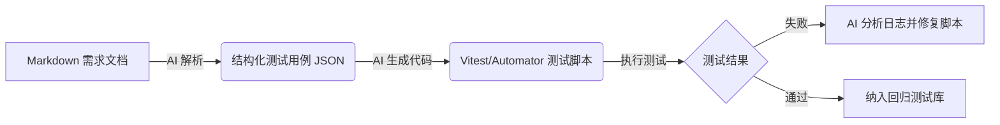

# 云治乡智 - 智能化分层测试架构方案

> **文档说明**: 本方案基于《技连帮_项目核心解析》、《权限模型》、《发布需求》等核心文档制定。旨在构建一个高效、可维护、AI 驱动的自动化测试体系，确保多角色业务逻辑的稳定性与健壮性。

## 1. 测试策略概述 (Testing Strategy)

鉴于本项目具有 **多角色权限复杂 (Role-Based)**、**业务流程长 (Long Process)**、**实时通信 (WebSocket)** 等特点，我们采用 **金字塔测试模型 (Testing Pyramid)**，结合 **AI 驱动生成的测试用例**，实现全链路质量保障。

### 1.1 核心原则
1.  **分层治理**: 底层逻辑全覆盖，顶层流程保关键。
2.  **数据隔离**: 测试数据与生产数据严格物理隔离。
3.  **AI 赋能**: 利用 AI 解析 Markdown 需求文档，自动生成测试用例与断言代码。
4.  **持续集成**: 每次代码提交 (Push/PR) 自动触发单元测试。

---

## 2. 分层测试架构 (Layered Architecture)

### 2.1 第一层：单元测试 (Unit Testing) - L1
*   **目标**: 验证独立函数、工具类、状态管理逻辑的正确性。
*   **覆盖范围**: `src/utils/`, `src/stores/`, `src/services/` (Mocked).
*   **工具栈**: `Vitest` + `Pinia Testing`.
*   **关键测试点**:
    *   **权限工具**: `permission.ts` 中的 `hasPermission(user, role)` 逻辑。
    *   **状态管理**: `user.ts` store 中的 `switchRole` 上下文切换逻辑。
    *   **数据格式化**: 时间格式化、金额计算等纯函数。

### 2.2 第二层：组件测试 (Component Testing) - L2
*   **目标**: 验证 Vue 组件的渲染、交互事件及 Props/Emit 契约。
*   **覆盖范围**: `src/components/`, `src/pages/` (UI Logic).
*   **工具栈**: `Vitest` + `@vue/test-utils`.
*   **关键测试点**:
    *   **表单组件**: `DemandForm.vue` 的校验逻辑（必填项、正则）。
    *   **展示组件**: `StatusTag.vue` 根据状态码显示正确颜色/文案。
    *   **交互反馈**: 点击按钮后的 Loading 状态、Disabled 状态。

### 2.3 第三层：集成测试 (Integration Testing) - L3
*   **目标**: 验证模块间的协作，特别是前端与模拟后端（Mock Backend）的交互。
*   **覆盖范围**: 跨模块流程，如 "登录 -> 获取用户信息 -> 存入 Store"。
*   **工具栈**: `Vitest` + `Mock Service Worker (MSW)` 或 自定义 Mock。
*   **关键测试点**:
    *   **WebSocket**: 模拟 `onMessage` 消息分发到 Pinia Store 的流程。
    *   **云函数调用**: Mock `uniCloud.callFunction`，验证参数封装是否正确。

### 2.4 第四层：端到端测试 (E2E Testing) - L4
*   **目标**: 模拟真实用户操作，验证核心业务闭环。
*   **覆盖范围**: 关键路径 (Critical Paths)。
*   **工具栈**: `uni-automator` (基于 Jest/Miniprogram-Automator)。
*   **关键场景**:
    1.  **发布需求闭环**: 登录(农户) -> 填写表单 -> 提交 -> 验证列表可见。
    2.  **角色切换闭环**: 登录(多角色) -> 切换至村委 -> 验证管理入口出现。
    3.  **聊天闭环**: 发送消息 -> 列表更新 -> 消息气泡渲染。

---

## 3. AI 驱动测试流程 (AI-Driven Testing Workflow)

利用大模型能力，将自然语言需求转化为可执行的测试代码。

### 3.1 流程图


### 3.2 实施案例：角色切换测试
**输入 (Prompt)**:
> 基于 `all角色.md` 文档，生成测试用例。用户 "张奥博" 拥有 `local_admin` 和 `farmer` 角色。测试从 `local_admin` 切换到 `farmer` 时，`current_context` 是否正确更新。

**AI 生成的测试代码 (示例)**:
```typescript
// tests/unit/role-switch.test.ts
import { setActivePinia, createPinia } from 'pinia';
import { useUserStore } from '@/stores/user';
import { describe, it, expect, beforeEach } from 'vitest';

describe('Role Switching Logic', () => {
  beforeEach(() => {
    setActivePinia(createPinia());
  });

  it('should switch context when role is changed', () => {
    const userStore = useUserStore();
    // 1. Setup Initial State (Local Admin)
    userStore.userInfo = {
      role: 'local_admin',
      available_roles: [
        { role_code: 'local_admin', context: { region_code: '441623' } },
        { role_code: 'farmer', context: { farm_location: 'Eagle Peach Base' } }
      ],
      current_context: { region_code: '441623' }
    };

    // 2. Action: Switch to Farmer
    userStore.switchRole('farmer');

    // 3. Assertion
    expect(userStore.userInfo.role).toBe('farmer');
    expect(userStore.userInfo.current_context).toEqual({ farm_location: 'Eagle Peach Base' });
  });
});
```

---

## 4. 关键模块测试方案详解

### 4.1 权限模型测试 (`src/tests/permission.spec.ts`)
*   **依据**: `权限模型.md`
*   **策略**: 状态机测试 (State Machine Testing)。
*   **用例**:
    *   `pending_audit` -> `approved` (Local Admin 操作 -> 允许)
    *   `pending_audit` -> `approved` (Farmer 操作 -> 禁止/抛错)
    *   `pending_audit` -> `claiming` (状态跳转非法 -> 抛错)

### 4.2 聊天模块测试 (`src/tests/chat.spec.ts`)
*   **依据**: `聊天任务清单.md`
*   **策略**: Mock WebSocket 对象。
*   **用例**:
    *   **心跳检测**: Mock 时间流逝，验证是否发送 `PING`。
    *   **断线重连**: 模拟 `onClose` 事件，验证 5s 后是否尝试 `connect`。
    *   **消息去重**: 连续发送两条相同 `msg_id` 的消息，Store 仅增加一条。

### 4.3 需求发布测试 (`src/tests/demand.spec.ts`)
*   **依据**: `发布需求.md`
*   **策略**: 表单校验测试。
*   **用例**:
    *   手机号输入 "123" -> 校验失败 -> 错误提示 "格式不正确"。
    *   省市区未选择 -> 提交按钮 Disabled 或 点击提示。

---

## 5. 推荐工具链配置 (Toolchain Setup)

为了落地上述方案，建议在项目中安装以下依赖：

```bash
# 1. 核心测试框架
npm install -D vitest

# 2. Vue 组件测试工具
npm install -D @vue/test-utils jsdom

# 3. 覆盖率工具
npm install -D @vitest/coverage-c8

# 4. E2E 测试 (Uni-app 专用)
npm install -D @dcloudio/uni-automator
```

### 5.1 `vitest.config.ts` 配置建议
```typescript
import { defineConfig } from 'vitest/config';
import vue from '@vitejs/plugin-vue';

export default defineConfig({
  plugins: [vue()],
  test: {
    environment: 'jsdom', // 模拟浏览器环境
    globals: true,        // 开启全局 describe/it
    coverage: {
      provider: 'c8',
      reporter: ['text', 'json', 'html'],
    },
    include: ['src/**/*.{test,spec}.{js,ts}'],
  },
});
```
